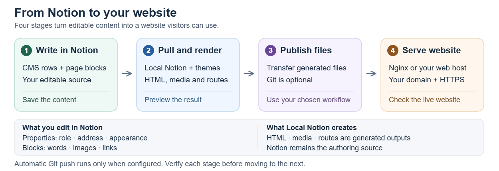

# CMS architecture

Your website starts with one CMS database in Notion. It holds both the content visitors read and the shared pieces that make the site feel connected: its navigation, headers and footer. You edit those pieces in Notion; Local Notion turns them into pages and website files for your host.

Each CMS row is a Notion page with two parts: properties that define its role, location and settings, and blocks that contain its text, images and links. The same database holds articles, page sections and Gallery cards; separate databases are not required for those components.

*Notion stays the editable source. Local Notion creates HTML, media and routes; your chosen publishing workflow transfers those outputs to the web host. Git and automatic push are optional configuration choices.*

Local Notion separates authoring, local generation and hosting. A successful stage does not prove that the next one succeeded.

## One database models the website

The **Type** property tells Local Notion how to use a row. A Page becomes a complete page; several Sections can join into a longer page; a Gallery row supplies a card and its underlying page. Header, NavBar and Footer rows provide shared framing. Those roles live together in the same database.

The other [properties](schema.md) describe where a piece belongs, its order, its publication state and how it looks. **Themes** supply design treatments; **Tags** select supported behavior. Open the row to write with normal Notion blocks. The database title is only an editor label; Local Notion recognizes the CMS through its expected property names and types.

When you pull the site, Local Notion reads those choices together. It joins Sections that belong on the same page, gathers Gallery cards into their collection and selects the shared navigation and framing. You can edit one piece without having to rewrite the whole website by hand.

## The pipeline

1. **Author in Notion.** Edit blocks and CMS properties; verify the save.
2. **Pull locally.** Download accessible CMS pages, underlying objects and attachments.
3. **Compose routes.** Apply publication rules, calculate paths, group sections and select framing.
4. **Render.** Convert Notion blocks into visual models, then apply templates, themes and overrides to produce HTML and assets.
5. **Transfer.** Publish the required files through your configured workflow, which may use Git.
6. **Activate the host.** Ensure Nginx and any containers use the deployed files and mappings.
7. **Verify HTTPS.** Check actual content, routes, assets and access restrictions.

A Notion edit can save without being pulled. A Git push can succeed while a running server still uses old configuration. Verify each boundary separately.

## Rows are not routes

Several Section rows can produce one route. Categories can create intermediate documentation/article listings without a dedicated row for every listing. Shared framing contributes to many routes. `sectioned_page` is a generated composition label, not a Notion Type choice.

Notion child pages within a CMS row can become standalone pages with inherited CMS information. They differ from top-level rows whose website hierarchy comes from Root and categories.

## Database setup details

Modern Notion APIs distinguish a database from its data source. The database is the container; the primary data source owns the schema and rows. The new creation command configures that initial data source. Use the returned **database ID** with `init --cms`, not a data-source ID. The finished CMS has no active content rows. Registering the complete palette requires one temporary Hidden setup row, which is moved to Notion Trash and remains there under its normal trash lifecycle. See [creation side effects and recovery](create-a-cms.md).

No Parent, Menu, Header, Footer or URL relation columns are needed. Local Notion derives hierarchy from slugs, categories and page types. References to a generated item's menu, footer, header and parts describe the result of that calculation.

## Local repository areas

| Area | Purpose |
| --- | --- |
| `.localnotion/registry.json` | Configuration and resource index; may contain the integration key |
| `.localnotion/objects/` | Persisted Notion objects |
| `.localnotion/graphs/` | Downloaded object relationships |
| `.localnotion/themes/` | Theme files and local overrides |
| `.localnotion/nginx/conf/` | Optional hosting configuration and URL mappings |
| `cms/` | Generated CMS HTML and sitemap |
| `files/` | Downloaded attachments |
| Other configured output folders | Rendered resources and assets |

Profiles and overrides can change paths. Cached JSON and generated HTML are not the authoring source; a later generation can replace them. Fix editorial content in Notion and rendering changes in themes/configuration.

The repository and its history can contain secrets, including reversible Basic Authorization values in generated mappings. Treat it as private operational material. See [publishing and authentication](publishing.md).

## Ownership

Notion owns content and CMS properties. Local Notion owns synchronization, persistence, route composition and hosting mappings. Sphere10.VisualRenderer supplies rendering, templates and assets. Your deployment workflow owns transfer and rollback. Your host owns TLS, reverse proxy, file serving and activation.

Creating a CMS does not provision DNS, a server, Git remote, TLS certificate or reload service.
