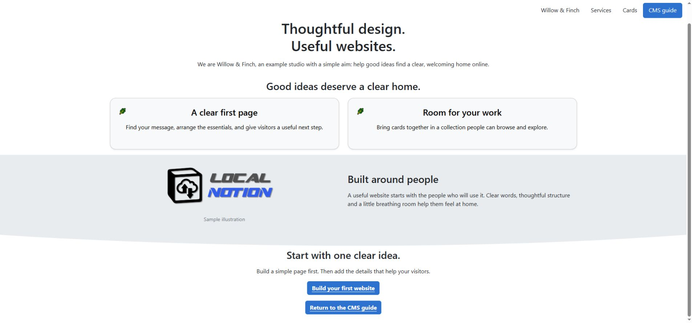

# Arrange columns and make useful cards

Columns let readers compare related choices. Cards give each choice a clear boundary and a place to click. Use them for a small set of services or featured links; give every card a short heading, concise explanation and predictable destination.

*These are blocks authored inside one Page or Section. They are different from a Gallery collection, where separate CMS records supply the entries.*

## Build the columns in Notion

Create two actual Notion columns by dragging one block beside another. Put the first service's content in one column and the second service in the other. A `columns_…` theme changes the rendering of a column list that already exists; it does not split a series of paragraphs into columns.

Start with two columns. Keep their content similar in length and use images with comparable proportions. A wide screen can place the choices beside each other, while a narrow screen needs an easy reading order.

`columns_sm`, `columns_md`, `columns_lg`, `columns_xl` and `columns_xxl` select responsive column breakpoints. They describe when the arrangement changes, rather than a fixed number of pixels for each column. `columns_middle` adds middle alignment within the available column height and is useful for an image beside shorter copy.

The canonical `columns_xs` option emits a class that is absent from the inspected stylesheet. Use a demonstrated breakpoint and check the narrow-screen output rather than relying on its name.

## In Notion: turn two callouts into service cards

The `callout_card` theme gives a Notion callout a special meaning: **its top-level text is the card's destination URL**, and **its child blocks are the visible card body**.

1. Make two columns in a Section.
2. Add a **Callout** block in each column.
3. Put the intended destination URL in the callout's own text, such as `https://example.com/services/design`. Use your site's real destination when building your page.
4. Inside that callout, add child blocks for a heading, a short description and optionally an image and an ordinary link. Indent or drag them inside the callout, rather than leaving them as following sibling blocks.
5. In the CMS row's **Themes**, select `columns_md`, `callout_card` and `color_card_light`.
6. Optionally add `callout_shadow` with `shadow_sm`.
7. Pull and preview. Test the outer card's destination as well as any visible link inside it.

Do not leave ordinary prose such as “Our design service” in the callout's own text when using `callout_card`. That text becomes a navigation target in the installed template. Put the visible words in the children instead.

The theme applies to callouts in the owning row. Keep an ordinary informational callout in a separate Section if it should retain its normal appearance.

## Give a link a clear action

Create the link in Notion with useful text and a destination first. Then choose one presentation:

- `link_button` makes compatible rich-text links look like buttons. It uses the primary button treatment by default; add `button_secondary` or `button_dark` for an alternative.
- `button_shadow` attaches a shadow to a button-styled link. Pair it with one shared strength such as `shadow_sm`.
- `link_arrow` adds a circular arrow accent before a link.
- `link_muted` gives links a quieter treatment.
- `link_no_underline` removes the ordinary CMS link's text underline where that template's hook is used.

Choose one clear treatment for a given purpose. `link_arrow` and `link_muted` replace the normal link template, so combining them with button choices can bypass the effect you expected. Navigation has its own link markup too.

Give a contact action a clear label such as “Discuss your project”. A theme changes how the link looks; it does not create a form, a destination or a submission service.

## Add small details deliberately

**Badges:** mark a short label as **inline code** in Notion, then select `badge` in Themes. Add a `color_aux_…` choice for the accent. Inline code is text formatting inside a paragraph; a separate Code block is different. The badge alignment themes can realign the containing element, so start with a standalone short label and inspect surrounding prose. The inspected left-alignment preset has a stylesheet compatibility gap.

**Check lists:** `bullet_check` changes ordinary bulleted-list dots into check-circle accents. It is a visual treatment, not an interactive task checkbox. `color_aux_…` supplies the accent colour.

**Quotes:** `quote_no_indent` removes the normal quote's border/indent treatment while keeping its quote role. Keep the attribution in the content rather than relying on a decorative style to explain who said it.

**Shadows:** choose the component first, such as `image_shadow`, `callout_shadow`, `button_shadow` or a heading-shadow option. Then choose `shadow_sm`, `shadow_md`, `shadow_lg` or `shadow_none` as the shared strength. Selecting a strength alone does not attach a shadow to every block.

## Authored cards or a Gallery?

Use authored callout cards when you want a small, deliberately arranged group of links inside a page. Use [Gallery rows](galleries.md) when each card should have its own CMS row and page, and the collection should be gathered and filtered automatically.

The `color_card_…` choices target callout cards. The inspected generated Gallery cards have their own fixed light body and shadow treatment; these choices do not recolour those cards simply because both look like cards.

Open the [cards lab](https://staging.sphere10.com/products/localnotion/cms/style-lab/cards) to compare components. Before using the arrangement elsewhere, check the real click targets, keyboard access, phone-width stacking and whether long text makes one card much taller than its neighbour.

[Previous: Images and covers](images-and-covers.md) · [Next: Build a gallery](galleries.md) · [Notion CMS Guide](index.md)
