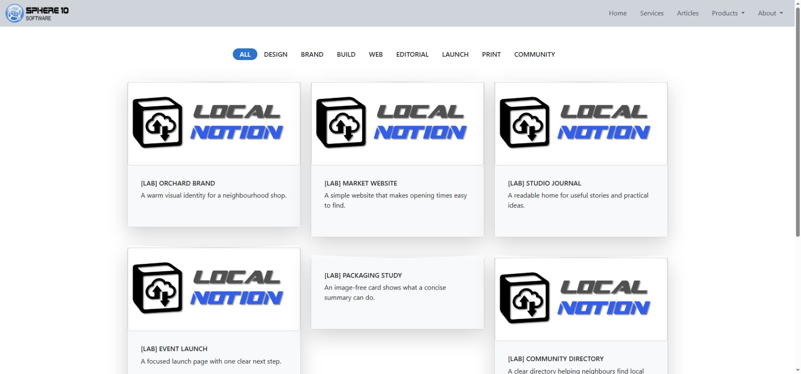
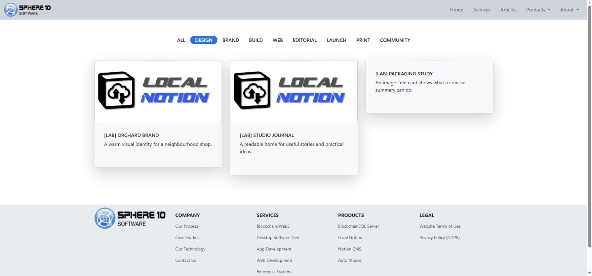

# Build a gallery of cards

A gallery is a collection of cards. Each card displays an image, a title and a short Summary, and links to its detail page. The same structure supports products, photographs, articles, team members and other browsable content.

*Each card comes from a separate CMS row. Add another row to grow the collection; its content can be a product, photograph, article, team profile or another kind of page.*

## Use Gallery records for a growing collection

Choose the **Gallery** CMS Type to generate a collection automatically. Each Gallery row supplies one card and its detail-page content. Product descriptions, photograph captions, full articles and team profiles are examples of that content.

Use [authored callout cards](columns-and-cards.md) for a manually arranged group of links inside a Page or Section. Callout cards are blocks within that page; generated Gallery cards come from separate CMS rows.

Changing a Notion database view to its gallery layout does not choose the Local Notion CMS Type. The CMS reads the row's **Type** property and its content; the editor's preferred database view is a separate choice.

## In Notion: create three cards

Create these rows in your CMS:

| Item | Type | Status | Root | Category1 | Sequence |
| --- | --- | --- | --- | --- | ---: |
| Design service | Gallery | Published | Cards | Design | 10 |
| Website service | Gallery | Published | Cards | Build | 20 |
| Design article | Gallery | Published | Cards | Design | 30 |

For this example, leave Custom Slug and Category2–Category5 blank. Keep **Root** identical for entries in the same collection.

1. Add a short **Summary** to each record describing its detail-page content rather than repeating the title.
2. Open each row and add an Image block, an introductory paragraph and the content for the page behind the card.
3. Put the intended card image first and add `@UseFirstImageAsFeature` in **Tags** for explicit feature-image selection.
4. Pull and preview the collection at `/cards`.
5. Open a card and check its detail page, such as `/cards/website-service`.

In this arrangement, Root groups the collection and the Item title supplies the card page's address. Choose a Root name that suits the collection, such as Cards, Products or Team. The component is still a gallery of cards. Categories become badges/filter values rather than deeper address segments. See [routing](routing.md) for the exact rules.

## Help visitors find the right entry

*Selecting Design shows the cards in that category. Choose category names that help visitors find the content they want.*

In the table above, **Design** and **Build** group the cards by subject. Selecting Design filters the collection to Design service and Design article. Product types, photograph subjects and team roles are other suitable category labels. Add categories that distinguish meaningful groups within the collection.

Use consistent spelling and capitalization in the CMS. Category1–Category5 can supply more labels, but a large set of near-duplicates makes filtering harder to understand. Keep descriptions in Summary or the page body instead of turning every detail into a category.

Try the [gallery lab](https://staging.sphere10.com/products/localnotion/cms/style-lab/galleries): it adds three more cards to the beginner example so you can compare a larger collection. View the complete set, select Design and open a card. Filtering and card links are separate interactions, so check both on your own site.

## Choose images for the collection

Use consistent image proportions for an even catalogue layout. Mixed portrait and landscape images can produce cards of different heights; account for that variation when reviewing the collection.

The card's feature image is selected from its row's image, cover or image thumbnail according to Tags and available content. An emoji icon is not an image URL. See [images and covers](images-and-covers.md) if a card picks the wrong picture.

Keep text on the image itself to a minimum. A card image shrinks on narrow screens, while the title and Summary remain real text below it. Use those fields for the essential explanation.

## Style the card page and the collection separately

A Gallery row's Themes can affect the content of the page behind its card. That does not mean every modifier changes the collection card itself. For example, `image_zoomable` concerns image interaction, and `image_framed` concerns a compatible image block.

In the installed templates used for this guide, the generated Gallery card body has a fixed light treatment and a large shadow. `color_card_…` changes authored callout cards, and the shared `shadow_…` strength does not replace the Gallery card's fixed shadow. Use theme overrides when the catalogue template itself needs a reusable design change; start with the [theme mechanics](themes-and-layout.md).

## Check the reader's journey

Check the gallery with all cards visible, one category selected and a category containing only one card. Open each card, inspect the image and Summary, and make sure its page gives visitors a clear route back.

For deeply nested galleries on installed 1.5.0.12, inspect the card destination as well as the picture. Its older collection template can repeat the parent path when it uses a relative link containing the entry's full path. The staging examples correct `cms_gallery/gallery_card.html` to use a root-relative destination, `href="/{url}"`, then regenerate the site. The newer source resolver handles that URL differently, so review this override when upgrading rather than changing otherwise correct CMS routes.

Very deep card pages can also exceed that version's native Breadcrumb limit. Use the explicit linked trail described in [routing](routing.md), then check the card page's return path.

At a phone width, check the filter labels, reading order and image proportions. Published entries also need an empty or due **Publish On** date and a completed publication cycle. Hiding a record in Notion does not remove an already hosted card until the site is regenerated and published.

[Previous: Columns and cards](columns-and-cards.md) · [Next: Headers and navigation](headers-and-navigation.md) · [Notion CMS Guide](index.md)
