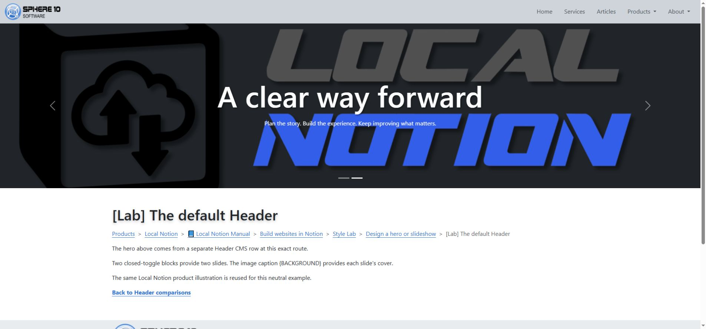
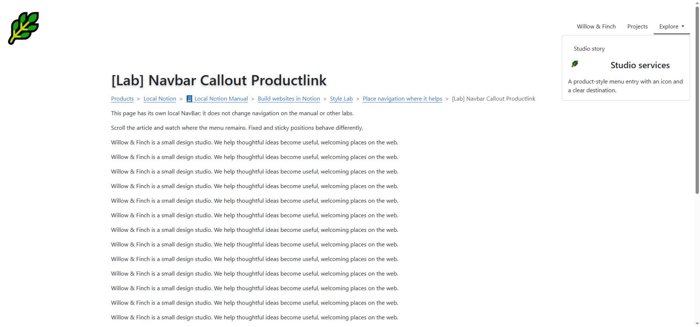

# Frame the site with a header and navigation

A header gives a page a visual introduction. Navigation helps visitors reach other parts of the site. Keep those jobs distinct: a large image can set the mood, but the menu, page title and breadcrumbs should still make the location clear.

*The Header is separate CMS framing. The content below it can still be a Page or a sequence of Sections.*

## Make a header for one page

Start with a local header so you can experiment without changing unrelated pages. In the simple Studio example, create a **Header** row with **Root = Studio**, and leave the categories and Custom Slug blank. It belongs at `/studio`; the row's Item is an editor label rather than another address component.

The installed header template treats **Toggle blocks as slides**. Put each slide's content inside its toggle. One slide makes a static-looking hero; two or more let you compare slideshow behavior. The renderer calls its default template `toggle_closed`; opening or collapsing the block in Notion's editor does not choose a different website template.

## In Notion: build a simple hero

1. Create the Header row for the intended page location. With installed 1.5.0.12, set this framing row's **Status to Hidden** and keep the ordinary content Page **Published**; see the compatibility note below.
2. Inside it, add a **Toggle** block and put a heading, short paragraph and image inside that toggle.
3. Give the image the exact caption `{BACKGROUND}` when it should fill the slide background.
4. Use an ordinary Toggle block for each slide; its expanded state in the editor is not a website setting.
5. Pull and preview the content page at that location.
6. Check the image crop and text readability at desktop and narrow widths.

The special background marker changes the image's role. The header script moves that image behind the caption and uses a cover-style fit, which can crop its edges. Keep important subjects away from the extreme edges, and use an ordinary body image when the whole picture must remain visible.

An alternative `toggle_open` theme template has a missing include in the inspected installation. Ordinary Notion Toggle blocks use `toggle_closed`; changing their editor state does not activate that alternative. Start with the ordinary Toggle recipe and preview the result.

## Choose the header's scale and movement

`header_tiny`, `header_small`, `header_large` and `header_full` choose different header height classes; leaving the choice empty uses the default. These are percentage-based treatments, not fixed pixel heights or a universal promise to fill the viewport. Judge the actual header with its content and container.

Add `header_fade` to compare a fade transition between at least two slides. `header_no_slide_controls` removes previous/next controls and indicators; a one-slide header already has no need for them. `header_no_pause` changes the carousel's pause setting, so inspect its actual hover behavior before depending on it.

`header_particles` adds a decorative animated layer and needs its external script. Use one particle header per route in this implementation because the layer uses a fixed identifier. For most documentation pages, a modest static header or no header leaves more room for the material readers came to use.

See the [header lab](https://staging.sphere10.com/products/localnotion/cms/style-lab/headers) for the comparisons and [motion](motion-and-finishing.md) for interaction checks.

## Share framing deliberately

NavBar and Footer normally inherit from the nearest route ancestor that supplies them. A root NavBar/Footer can therefore frame many pages. A more specific row can replace the framing for a branch.

Headers are local by default. Put `@UseParentHeader` in the **content row's Tags** when it should use its parent's header. `@HideHeader` takes precedence. Similarly, `@HideNavBar` and `@HideFooter` belong on content rows that should suppress those pieces.

Do not put these flags on the Header or Footer itself and expect them to control the page. Framing rows have their Tags cleared during parsing. Also, changing a framing row to Draft does not reliably disable it: shared framing follows different inclusion rules from ordinary content. See [page types and publication](page-types-and-publication.md).

**Older-version compatibility:** installed 1.5.0.12 can mistakenly count Published framing as another body part when it shares an ordinary Page's exact route. Set pure Header, NavBar and Footer rows to **Hidden**, leaving the Page Published. This avoids the “exactly one part” error in the tested Header/NavBar examples. Status still does not control whether framing is selected, so check the whole route after regeneration.

## In Notion: create a short menu

Create a **NavBar** row at the intended root or branch, then add ordinary linked paragraphs for Home, Gallery and Contact. Give each link a clear label and the correct destination. A native Toggle with linked children can supply a dropdown menu in the installed NavBar template.

For the installed 1.5.0.12 recipe, set the NavBar row's **Status to Hidden**, particularly when it shares the exact route of an ordinary Published Page. This follows the compatibility note above; it does not hide the selected menu.

The navbar's page icon/thumbnail can supply branding where the template supports it. Its link rendering is specific to navigation, so ordinary body-link button themes should not be expected to work identically there.

*Compare navigation at the top of a page and while scrolling. Positioning should help readers move around without covering the content.*

`navbar_fixed_top` and `navbar_fixed_bottom` fix the navigation at a viewport edge. `navbar_sticky_top` and `navbar_sticky_bottom` request sticky positioning, whose visible behavior also depends on the scroll container and placement. Choose one position and inspect a long page in the [navigation lab](https://staging.sphere10.com/products/localnotion/cms/style-lab/navigation).

For a richer menu entry, `navbar_callout_productlink` turns a NavBar callout into a product link: the callout's own text is the URL, its icon supplies the image area, and its child blocks provide the visible title/description. Keep this separate from ordinary prose callouts and test the complete entry's destination.

## Keep location and return paths visible

Add a native Notion **Breadcrumb** block near the beginning of each guide page, before its main content. Local Notion resolves the CMS route ancestry to generate the linked trail. For example, a guide article can show **Local Notion › Notion CMS Guide › Images and covers**. The application manual and CMS guide are separate destinations, so their navigation should reflect the route each actually uses.

Use that native block as the primary breadcrumb rather than maintaining a hand-typed trail on every page. Ordinary links can provide extra shortcuts, followed by a compact Previous / Next / CMS home group at the end. The default CMS Page already displays its Item as the page title, so you do not need to repeat the title in another Heading 1 block beneath the breadcrumb.

For very deeply nested entries, check the installed version before adding the native widget. In 1.5.0.12, a trail needing more than six ancestor-category positions fails rendering. Use a short explicit linked trail on those entries, with collection and chapter-home links. The tested deep Gallery pages use this fallback; standard manual chapters keep the native widget.

Breadcrumbs explain hierarchy; the main menu moves between major areas; gallery filters narrow a collection. They solve different navigation tasks. A consistent manual can use all three without forcing one to act as another.

Check that fixed navigation does not cover the title, breadcrumb, anchor target or footer. At a phone width, test the menu toggle, dropdowns and long labels. A screenshot shows placement; the real page is needed to confirm scrolling, focus and clicks.

[Previous: Build a gallery](galleries.md) · [Next: Motion and finishing](motion-and-finishing.md) · [Notion CMS Guide](index.md)
