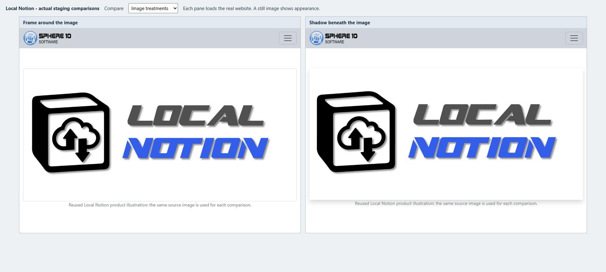

# Choose and present images

An image should explain the work, introduce a person or give a page a clear visual focus. Start with a suitable source image and a useful caption. Then choose how large it should be, where it should sit and whether visitors need to inspect it more closely.

*Compare one change at a time. A frame separates the image from the background; size and alignment determine how it sits beside the words.*

## Put the image in the content first

Open the CMS row and add a normal Notion **Image** block. Add a descriptive caption. In the inspected CMS image template, that caption is displayed beneath the image and is also used as its alternative text, so write it for someone who needs to understand the picture.

Leave Themes empty for the first preview. The default image presentation is responsive and aims to contain the source image rather than force a crop. A size theme changes the existing image; it does not insert one.

Use a source with enough detail for its intended display. An oversized display cannot restore detail missing from a small original. Keep related gallery or service images at similar proportions when you want a tidy repeated layout.

## In Notion: make a modest framed image

1. Add the image and caption inside a Page or Section.
2. In **Themes**, select `image_maxwidth_md`.
3. Add `image_align_center` if the image should sit in the middle of a wider container.
4. Add `image_framed` for the thumbnail-style border and padding.
5. Add `image_shadow` and `shadow_sm` for a restrained shadow.
6. Pull and preview the image in the complete page, then at a narrow width.

Alignment is visible only when the image is narrower than its available space. A full-width image cannot visibly move left or right within the same container. The caption remains centred in the inspected template even when the image alignment changes.

## Width, height and limits

Image sizing has three distinct controls:

**A width or height** asks for a particular display size. **A maximum** limits how large an image can become. **A minimum** prevents it becoming smaller, which can also cause overflow on a narrow screen.

The palette includes named sizes from `xxs` to `xxl`, plus percentage width/height choices. Prefer an explicit maximum, such as `image_maxwidth_sm` or `image_maxheight_md`, when you want a picture to stay within a modest bound.

Some installed `image_width_…` and `image_height_…` presets actually apply a maximum-size rule, despite their shorter names. Do not treat every size choice as a promise of fixed pixels. The [image lab](https://staging.sphere10.com/products/localnotion/cms/style-lab/images) compares the effective results, and the [theme reference](theme-reference.md) records exact names and limits.

Percentage width is relative to the available container. Percentage height needs a container with a defined height, so `image_height_100pc` does not mean “fill the screen” on every page. Avoid combining a large minimum width with a phone-sized layout without checking for horizontal scrolling.

If changing a maximum makes no visible difference, the image may already be smaller than both limits. Compare a suitably large source before concluding that the theme has failed.

## Let visitors inspect an image

Add `image_zoomable` when a diagram, screenshot or photograph benefits from a larger view. It supplies the image's zoom/lightbox attributes and pointer treatment. Open the live page and click the image to check that the viewer loads and closes correctly; a screenshot of the normal page cannot prove that interaction works.

Use [motion and finishing](motion-and-finishing.md) for `animate_image_zoom`. That is an entrance animation, a different feature from clicking an image to enlarge it.

## Cover, feature image or body image?

The **cover** belongs to the Notion page. A **body image** is an Image block inside it. A **feature image** is the image candidate supplied to listings and other templates. These can be the same picture, but their roles differ.

Choose one feature-source tag on the owning content row when you need explicit control:

- `@UseFirstImageAsFeature` prefers the first image block, then falls back to cover and image thumbnail.
- `@UseCoverAsFeature` prefers the cover, with thumbnail fallback.
- `@UseThumbnailAsFeature` uses an image thumbnail/icon; an emoji does not supply an image URL.

Without an explicit flag, the ordinary candidate order is first image, cover, then image thumbnail. The selected template decides where it displays that value. Avoid selecting all three flags as a substitute for choosing the right source.

`@ShowTitleOnBanner` and `@ShowChildPageTitleOnBanner` request titles on compatible cover/banner presentations. They do not create a CMS Header or guarantee that every template draws the title the same way. See [tags](tags.md) for the full rules and [headers and navigation](headers-and-navigation.md) for a real hero/slideshow recipe.

[Previous: Text and colour](text-and-colour.md) · [Next: Columns and cards](columns-and-cards.md) · [Notion CMS Guide](index.md)
