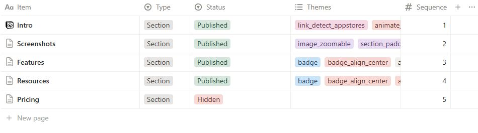
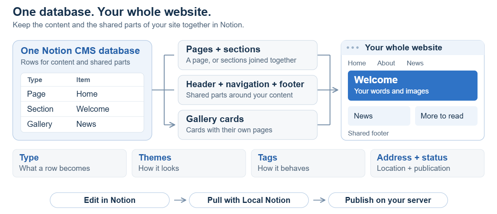
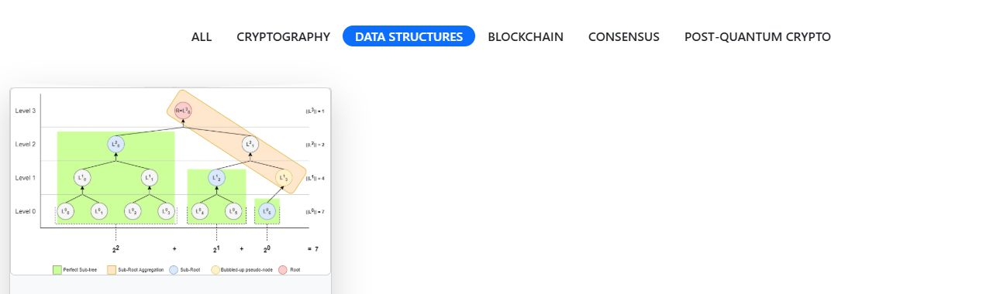
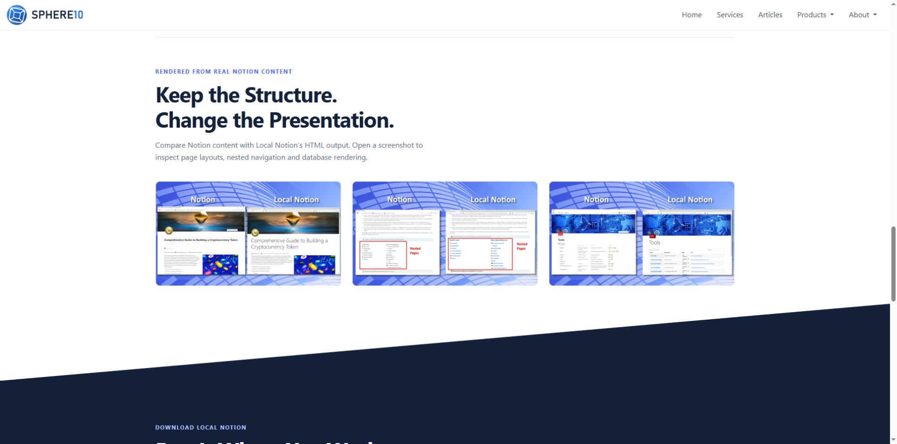
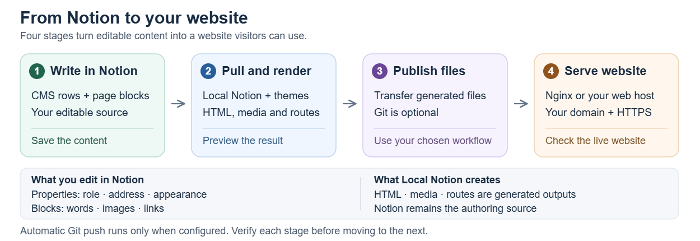

# Notion CMS Guide

Build and maintain a website in Notion. Write the content with native blocks, organize the website in one CMS database, and use Themes to give each component its intended presentation. Local Notion downloads that source and generates the website's pages, media and routes.

This guide starts with everyday editing and a small complete website. It then explains page structure, reusable design, navigation and publication. The appendices retain the full CMS schema, Tags and stock Theme lookup. Installation and the complete command reference belong in the [Local Notion Manual](https://sphere10.com/products/localnotion/local-notion-manual).

## 1. Start in Notion

<!-- figure-row: editor-cms-table -->

One CMS database can supply the whole website. Each row is a Notion page: its properties describe its role and website location, while its body contains the words, pictures, columns and links visitors will see.

Open a row to edit its content. Use the table to manage properties such as Type, Status, Themes and Sequence. A filtered database view makes this easier without creating another CMS or moving the underlying rows.


<!-- /figure-row -->

### Understand the Four Responsibilities

| Responsibility | Where It Belongs |
| --- | --- |
| Content | Native Notion paragraphs, headings, lists, images, columns and child Pages. |
| Website Structure | CMS Type, address fields, Sequence and native Page containment. |
| Presentation | The selected base theme, compatible modifiers and reusable companion themes. |
| Publication | Local Notion's download/render workflow and the configured web host. |

A Theme cannot publish a Draft Page, create a missing image or provide a form submission service. A Notion database view does not determine which rows the website publishes.

<!-- figure-row: one-database-diagram -->
Keep the website's content and shared components in one CMS database. Use their Types and locations to compose pages instead of creating a separate database for every visible component.

The body remains native Notion content. The database properties connect that content to the website's structure and presentation.


<!-- /figure-row -->

### Choose the Right Owner

Use **Page** for a complete article or compact page; **Section** for one band of a longer page; **Gallery** for a growing collection of cards with detail pages. Use **Header**, **NavBar** and **Footer** for shared framing. **Internal** is an advanced customization owner.

Begin with the row that owns the content you want to change. Editing a Footer's text is different from hiding that Footer on one Page. Styling an image is different from changing the background of its Section.

### Check Your Executable and Theme Package

> [!NOTE]
> Features depend on the executable and installed themes. A command implemented in source is not necessarily in the binary you downloaded.

Check the selected executable's help before following a command recipe:

```sh
localnotion --help
localnotion create-cms --help
localnotion git --help
```

If a command is unavailable, use the documented alternative for that build. Keep older compatibility notes tied to their named renderer rather than applying them to every website. The stock Theme lookup also does not install custom theme packages.

## 2. Build a Small Complete Website

Create a homepage, an About Page, navigation, a Footer and a small card collection. Use these neutral names as examples and substitute your own public content.

### Create the Homepage

| Property | Value |
| --- | --- |
| Item | Website Home |
| Type | Page |
| Status | Published |
| Custom Slug | `/` |
| Summary | A useful description of the website. |
| Root and Category1–Category5 | Blank. |
| Publish On, Themes, Tags and Authentication | Blank for the first public example. |

Open the row and add an introduction, a Heading 2 and supporting text. Insert a real Image block with a useful caption. The standard Page template can display Item as the title; avoid adding a duplicate Heading 1 unless the selected page design deliberately owns that title.

Leave the Themes selection empty for the first preview. Selecting the Theme named `empty` is different: that Theme intentionally suppresses visible content.

### Add About, Navigation and a Footer

Create **About Us**, Type Page, Status Published. Leave its address fields blank for the calculated `/about-us` route. Write the Page and its Summary.

Create **Shared Navigation**, Type NavBar, and **Shared Footer**, Type Footer, with blank address fields. Add labelled links to Home, About Us and Cards. Use public contact information in the Footer. Root framing can be inherited by descendant routes, so author it once.

For a website still using the legacy 1.5.0.12 renderer, follow the framing compatibility note in Appendix A.3. Its Hidden framing workaround prevents an older composition defect; Hidden does not disable framing selected for a route.

### Add a Card Collection

| Item | Type | Status | Root | Category1 | Sequence |
| --- | --- | --- | --- | --- | ---: |
| Design Service | Gallery | Published | Cards | Design | 10 |
| Website Service | Gallery | Published | Cards | Build | 20 |
| Design Article | Gallery | Published | Cards | Design | 30 |

Add a Summary, first Image and detail content to each row. Select `@UseFirstImageAsFeature` when that image should be preferred for the card. The collection is `/cards`; Website Service opens `/cards/website-service`. Gallery categories provide badges and filter values rather than extra URL levels.

Products, photographs, articles and team members can all be Gallery subjects. The subject does not change the component's behavior.

### Compare the Collection and Its Detail Pages

<!-- figure-row: tech-all-current -->

Each Gallery row supplies both a card and the Page it opens. Keep category spelling consistent, use comparable image proportions and write Summaries that help visitors choose a card.

Test a category filter, open a card and follow the route back to the collection. A card's appearance alone does not prove its destination works.


<!-- /figure-row -->

<!-- figure-row: tech-filtered-current -->
A collection's category filters come from its Gallery rows. Keep labels consistent and choose categories that help visitors find the right subject.

Selecting a filter changes the visible cards; it does not change the underlying CMS Type or move the card Pages.


<!-- /figure-row -->

## 3. Structure Pages, Sections and Child Pages

### Let the CMS Calculate Normal Routes

For an ordinary Page, Local Notion combines consecutive nonblank Root and category fields with Item. Fill the hierarchy without gaps.

| Item | Root | Category1 | Normal Route |
| --- | --- | --- | --- |
| About Us | Blank | Blank | `/about-us` |
| Getting Started | Guides | CMS | `/guides/cms/getting-started` |
| Writing Content | Guides | CMS | `/guides/cms/writing-content` |

A blank Root stops ordinary category traversal; Category2 cannot skip a blank Category1. Database relations and view order do not define this hierarchy.

Leave **Custom Slug** blank for normal calculated routes. Use an override only for a deliberate routing requirement, such as `/` for a simple Page homepage. Enter a page path, not a complete domain or an anchored visitor link. A literal `#` in Custom Slug does not create a Section anchor.

### Compose a Longer Page from Sections

Create Published Sections with the same base location and distinct Sequence values. For a `/studio` page:

| Item | Type | Root | Sequence |
| --- | --- | --- | ---: |
| Welcome | Section | Studio | 10 |
| What We Do | Section | Studio | 20 |
| Contact | Section | Studio | 30 |

The Sections become one continuous route. Their titles supply Section anchors; they do not become three independent detail Pages. Leave space between Sequence values so another Section can be inserted at 15. Equal values do not establish a dependable editorial order.

Keep one composition strategy at each route. Before replacing an ordinary Page with a Section group, move or retire the competing Page and regenerate the affected route.

### Give Each Section a Clear Job

<!-- figure-row: services-current -->

Use an introduction to explain the page, a content band to develop the subject and a closing band for the next action. Separate Sections make those pieces independently editable and allow compatible presentation choices.

A first Section is still body content. It does not become the website's Header merely because it comes first.


<!-- /figure-row -->

### Create Detail Content as Native Child Pages

Insert a native **Page** block inside the owning Page or Section where its link should appear. Open that child Page and write only the detail belonging to that subject. For example, a Services Section can contain child Pages named **Architecture**, **Implementation** and **Support**.

> [!TIP]
> The child Page's title supplies the displayed embedded Page-link name. Name the Page as you want the link to read. Renaming it can also change its calculated route, so regenerate and check incoming links and breadcrumbs.

A child of a Section uses the Section's base route, without its fragment, then appends the child's title. For example, a Details child of `/company#services` becomes `/company/details`. Verify the calculated result rather than inventing an HTML filename or manually repeating the title in a separate external link.

Native child Pages inherit their owner's publication, scheduling, Tags, authentication and category context. Their Summary is not simply copied. A child Page is not another CMS database row with its own independently editable Type and publication properties. Choose a separate CMS row when those controls must be independent.

### Keep Links and Containment Consistent

<!-- figure-row: ai-detail-current -->

A real child Page establishes containment. A **Link to Page** alias points to an existing Page and does not move or reparent it. Neither a database view nor a URL override changes native containment.

Keep the child link in the intended position in the parent body, use one native Breadcrumb near the beginning of the child, and test the generated Page and its return navigation.


<!-- /figure-row -->

## 4. Manage Editing Views and Publication

Create focused views of the same CMS database. Views are editing tools; they do not publish, hide, reparent or reorder website content by themselves.

| View | Filter and Order |
| --- | --- |
| A Page's Sections | Type is Section **AND** the exact address fields defining that base route; sort by Sequence ascending. |
| Independent Pages | Type is Page, optionally restricted to the intended branch. |
| Gallery Cards | Type is Gallery and Root is the intended collection; sort by Sequence. |
| Shared Framing | Type is Header **OR** NavBar **OR** Footer; optionally restrict its route. |
| Customization | Type is Internal. |
| Ready to Review | Status is QA, with useful address and edit columns visible. |

For a Services editing view, show its overview Section rows rather than every row whose name contains “Services.” Use exact Type and address conditions. Give independently authored detail-page Sections their own view when they belong to another route. Native child Pages remain within their owning content rather than becoming duplicate CMS rows.

Keep an unfiltered administrative view. Hide irrelevant columns in routine views instead of renaming or removing required properties. Show Item, Type, Status, Themes and Sequence when arranging a Section group.

Ordinary Page, Section and Gallery content requires **Published** and no future **Publish On** date. The date is evaluated against UTC during generation. Draft, QA and Hidden do not publish ordinary content. A scheduled or Hidden change takes effect only after the next completed download, render and publication cycle.

Framing is selected independently of that ordinary-content gate. A Draft Footer can still frame a Page. Use deliberate placement or the supported hide Tags on the content owner to change framing behavior. Appendix A gives the complete rules.

## 5. Write and Arrange the Content

### Use Real Structure

Use native headings for the reading hierarchy, paragraphs for explanation and lists for parallel points. Choose heading levels for their meaning, then use the theme to adjust their visual size. A small-looking heading is still a heading; a bold paragraph is not a substitute.

Write clear titles in consistent Title Case, preserving names such as .NET, iOS and scikit-learn. Keep the main title stable and descriptive. Short labels may use a different treatment when the design calls for it; do not apply an uppercase transformation to every heading or link.

### Build Columns in Notion

Drag a block beside another to create native columns. Put the main heading and introduction before supporting columns when that provides the clearest reading order. On a narrow screen, columns stack in their authored order.

`columns_md` changes the breakpoint behavior of an existing column list. `columns_middle` aligns shorter content within available height. Neither creates columns from ordinary paragraphs.

### Distinguish Badges, Links and Lists

Format a short span as **inline code** and select `badge` to make a static label. Use a compatible auxiliary color for its accent. A separate Code block is a different element. A badge is not automatically a link, and a list of tool names should not become a row of unrelated destinations.

Create a labelled link only where navigation is intended. Embedded Page links open their actual Pages; ordinary rich-text links need real destinations. `bullet_check` decorates native bullet points with check-circle markers; it does not create interactive checkbox state.

Preserve native link indicators when changing a theme. Check icon-to-text spacing, first-line alignment and wrapped labels. Hover and keyboard focus should remain visible against the owning Section's background; an underline on interaction can clarify the destination without making every resting label bold.

### Use Notes as Notes

An ordinary Callout is useful for an information or warning note. Use a concise message, appropriate icon and readable block background.

`callout_card` has a different contract: the Callout's own text is a destination URL, while its child blocks supply the visible content. Do not apply that modifier to a prose note unless it is intentionally being authored as a link card.

## 6. Compose a Reusable Theme

### Separate Base Design, Modifiers and Companions

A base theme establishes the site's visual language. Native modifiers adjust supported concerns such as image width, spacing, color, shapes and motion. A reusable companion can define a semantic component such as an introduction, feature grid or closing action band.

Use the selected package's documented owner, block structure and order. Later overlays can replace earlier templates or tokens, so an intentional companion may need to come after a native modifier. A Page-link companion, for example, can replace the ordinary link slot while retaining the native destination and icon contract.

Do not assume every modifier remains a harmless cosmetic layer under every companion. Use one deliberate choice for a concern rather than stacking contradictory alignments or colors. Custom package names are separate from the stock preset lookup and must be installed before selection.

### Put Styling in the Styling System

Make reusable visual changes in theme templates, tokens and styles, then select them through the owning CMS row. Preserve native content, semantic roles and existing modifiers that remain compatible. Avoid putting a complete stylesheet into each Page or editing generated HTML as a permanent fix.

Internal rows can provide named tokens consumed by compatible themes. Use them for supported configuration rather than duplicating large page-specific scripts. A native child Page does not acquire its own CMS Themes property: its presentation follows the renderer's inheritance and package contract.

### Choose Color Roles Deliberately

| Role | Intended Concern |
| --- | --- |
| `color_text_…` | Main content text. |
| `color_text_aux_…` | Auxiliary text consumed by compatible heading treatments. |
| `color_bg_…` | The compatible content container's background. |
| `color_aux_…` | Small accents such as badges and check circles. |
| `color_card_…` | Authored Callout cards, rather than every generated Gallery card. |

Inline Notion colors and component templates can override inherited colors. Inspect actual text, links, badges and hover/focus states against each light or dark surface. A named color does not establish adequate contrast by itself.

### Join Sections with Space and Shape


Select top and bottom padding on the owning Section. Container padding and internal paragraph margins are different sources of space. A separator also needs enough clearance to avoid crossing headings, pictures or links.

> [!TIP]
> Use contrasting neighboring backgrounds when a shape should be visible. If the design calls for a line-up treatment on both edges of a band, use a theme role that deliberately supplies the matching top and bottom geometry. Selecting a bottom-edge modifier twice does not create a paired top edge. Keep joins consistent and inspect the complete boundary at narrow widths.


### Version Theme Assets Together

Templates and their CSS or JavaScript are one design package. When an asset changes, update its versioned URL consistently wherever the package loads it. Use the package's supported token and asset-path conventions; cross-package references must point to the package that actually owns the asset.

Check the generated URLs and served bytes after publication. A changed filename query is useful only when it identifies the new asset. Do not change unrelated runtime files merely to force a refresh.

Local overrides, including empty files, can mask newer embedded defaults. Preserve intended overrides during upgrades and review their lifecycle before removing them. A later repository opening can restore missing built-in files.

## 7. Add Images, Headers, Cards and Galleries

### Preserve an Image's Natural Proportions

<!-- figure-row: product-screenshots-current -->

Insert a real Image block, use sufficient source detail and give it a descriptive caption. In compatible CMS templates, the caption also supplies alternative text. A cover, body image and listing feature image have different jobs.


<!-- /figure-row -->

> [!TIP]
> Prefer an appropriate width or maximum width with automatic height when the complete illustration must remain visible. Use the existing `image_width_…` and `image_maxwidth_…` modifiers before adding custom rules. Alignment needs spare width; minimum dimensions and fixed heights can cause narrow-screen overflow or distortion.

Use `image_framed` or `image_shadow` when that treatment suits the picture. Choose the shadow target before its shared strength. `image_zoomable` controls click-to-enlarge behavior; `animate_image_zoom` controls an entrance effect. Test opening and closing the viewer separately from the image's resting appearance.

### Create a Header with More Than One Slide

A Header is separate framing. In the compatible carousel template, each native Toggle supplies a slide containing its heading, copy, action and images. Add several genuinely different slides when a rotating banner is intended.

An Image captioned exactly `{BACKGROUND}` is treated as the slide background. Use it when cropping is appropriate. Foreground artwork is a separate image and can retain its natural dimensions. Keep any intended overlay or contrast layer as part of the theme's design rather than removing it while replacing artwork.

Header size, fade, controls and particle treatments depend on their actual templates and scripts. Check the active slide, Next/Previous controls, readable overlay and narrow layout. A still picture does not prove a carousel cycles. The Toggle's expanded state in Notion is not a reliable way to choose a different renderer template.

### Author a Small Fixed Card Grid

Create native columns with one Callout per card. Put the destination URL in the Callout's own text and the visible heading, image and description in its child blocks. Select a compatible `callout_card` treatment and appropriate card colors on the owner.

Keep cards comparable in length and check both the outer card and any deliberate child links. With legacy near-full-column-height card templates, arrange additional cards as another column row rather than stacking them within the same column.

Use Gallery rows instead when the collection should grow, carry categories and provide individual card Pages. Authored Callout cards and generated Gallery cards are different mechanisms even when they look similar.

## 8. Add Navigation, Forms and Motion

### Use Native Destinations and Breadcrumbs

Use descriptive navigation labels, verify the calculated route and preserve the native Page-link target where possible. Add one native Breadcrumb near the beginning of a detail Page. Check its ancestry and return link after moving or renaming content.

A root NavBar or Footer can be inherited unless a nearer component replaces it. Headers are local by default; `@UseParentHeader` requests the parent's Header and `@HideHeader` takes precedence. Apply hide Tags to ordinary content, not to the Footer or Header itself.

Test fixed or sticky menus on a long Page. They must leave titles, breadcrumbs, anchor destinations and the Footer visible. Link styling for ordinary content does not necessarily apply to NavBar templates.

### Embed Forms Deliberately

An Embed block or supported integration can display a form, but a button theme and `@ContactForm` do not create a submission backend. Configure the actual form provider, destination and success behavior.

Match the containing Section to the form's surface. A theme outside a third-party iframe cannot freely restyle its internal fields; use the provider's own supported settings. Check labels, required fields, focus, narrow layout and the real submission flow using appropriate test data.

### Keep Typed Text Secondary to the Title

Use a short typed Heading 2 or Heading 3 for a capability line when the selected theme supports it. Separate phrases with a vertical bar, for example `Design the System|Build the Product|Operate the Service`. Keep the main title and navigation stable.

The typing library and compatible template must both be present. Preserve readable text when motion is reduced or the script is unavailable. Check the actual theme definition before combining typing with shadows or other heading replacements.

Apply other motion only after the static layout is sound. Column effects need columns and image effects need images. Test an entrance during scrolling, not just after it has settled. Keep essential content readable when an effect does not initialize.

The native loading circle should be part of the theme's documented lifecycle. Do not permanently hide it with a blanket CSS rule to conceal a stalled dependency. Confirm that fresh navigation reaches usable content; external resources can affect load timing, and a single interrupted navigation does not establish its cause.

## 9. Pull, Preview and Publish

### Create or Connect the CMS

Use an existing CMS with the required schema, or use `create-cms` when the selected executable provides it. Share the intended Notion parent Page with the integration first and grant the capabilities required by the command.

```sh
localnotion create-cms --parent "YOUR_PARENT_PAGE_UUID" --title "Website CMS"
```

The command creates a blank CMS rather than website content. If it is unavailable, prepare the schema from Appendix A. Initialize with the **database ID**; Notion's data-source ID is a separate identifier.

For a new empty local folder, a PowerShell example is:

```powershell
mkdir website-repository
$notionKey = (Get-Content -LiteralPath "C:\Private\notion-key.txt" -Raw).Trim()
localnotion init --cms "YOUR_DATABASE_UUID" --profile website --path "./website-repository" --key $notionKey
Remove-Variable notionKey
```

Use your own protected key file and exclude it from source control. Reading the value from a file avoids putting the literal token in shell history. Credential lookup is command- and build-specific; use the installed help rather than assuming every command supports the same environment-variable convention.

### Fetch New Content or Rebuild Downloaded Content

> [!WARNING]
> Before either operation in an existing repository, inspect its automatic Git and hosting settings. A configured pull or render can commit and push.

```sh
localnotion pull --all --path "./website-repository"
localnotion render --all --path "./website-repository"
```

**Pull** downloads Notion source and normally renders it. **Render** rebuilds downloaded content without fetching new Notion edits. Use render for an installed theme change; fetch the actual owner when its native child list is stale. Rendering an old graph cannot discover a newly added child Page.

A renamed parent can affect descendant breadcrumbs and a shared component can affect many routes. Rebuild the affected dependencies, then inspect the generated result. Do not delete source content or add a duplicate link merely because one browser still shows an older result.

### Keep Preview and Publication Separate

Use an isolated repository or copy for local experiments. Disable automatic commit/push through the supported configuration command when available:

```sh
localnotion git --path "./website-repository"
localnotion git --path "./website-repository" --enabled false --push false
```

If the executable lacks that command, follow its documented configuration workflow. Preserve unrelated settings. Do not replace the complete registry with a small example or hand-edit generated resource registrations as routine authoring.

The website profile generates hosted paths. Opening one HTML file directly does not fully test routes or assets; preview through an appropriate local web host or staging site. Run one writer at a time against a repository.

### Transfer and Activate the Complete Result

Git is one possible transfer mechanism; another deployment process can copy the generated files. Inspect the destination and publication effects before enabling automatic push. Transfer HTML, themes, media and the route mappings together.

For a new Nginx setup, initialization can enable hosting generation and the intended base URL. This does not provision DNS, TLS, a server or a reload service. See the existing **Hosting** companion Page for the full setup procedure.

Validate the generated configuration and activate it through the host's intended process. A successful local render, transfer, active server configuration and served website are separate checkpoints. A zero command exit alone does not prove all of them succeeded; read its warnings and errors.

<!-- figure-row: architecture-diagram -->
Follow the complete path from Notion source to downloaded content, generated output and the hosted website. Check each boundary separately when the public result is stale.

Rendering changes local output. Transfer and host activation make that output available to visitors; neither is implied by a saved Notion edit.


<!-- /figure-row -->

### Check Publication and Access Separately

Published and Publish On control ordinary content inclusion. `@Private` excludes sitemap entries; it does not prevent direct access. Authentication is a host-enforced access setting, not a visual hiding choice.

Native child Pages inherit their CMS owner's authentication context. Independently authored Pages need their intended setting; a protected parent URL is not enough by itself.

> [!WARNING]
> Test access anonymously at both friendly routes and applicable direct HTML or attachment URLs. Confirm that the host enforces the intended protection on those aliases; a protected parent or a `@Private` sitemap flag does not establish that. Keep `.localnotion` and source-control metadata inaccessible publicly.

Keep credential-bearing repository data and history private.

## 10. Verify and Maintain the Website

### Follow the Complete Editing Cycle

Check the saved Notion row and body, downloaded source, generated Page, transferred files and actual public route in that order. This identifies the first stale or failing stage without guessing that every discrepancy is a browser-cache issue.

| Check | What to Verify |
| --- | --- |
| Structure | Correct Page/Section composition, ordered child links, title and breadcrumb. |
| Content | Complete copy, literal technical names, lists, badges and code examples. |
| Layout | Desktop and narrow reading order, intrinsic image proportions, separators, forms and Footer spacing. |
| Interaction | Actual destinations, keyboard focus, hover, zoom/Escape, carousel controls and motion. |
| Metadata | Useful title, description and keywords; no broken technical-name fragments or unwanted URL destinations. |
| Publication | Correct public URLs, current assets, intended access rules and retired routes. |

Write a deliberate Summary on independently authored CMS rows. Where metadata is derived automatically, preview it: names such as .NET, ASP.NET and Node.js must remain intact. Newer source can correct extraction behavior before an installed binary is updated, so verify the artifact actually doing the pull.

### Solve the Smallest Proven Problem

| Symptom | First Checks |
| --- | --- |
| A saved row is absent | Type, Status, Publish On, route, selected `empty` Theme and completed pull/render. |
| A view contains unrelated Sections | Exact Type and base-address filters; separate detail routes into another view. |
| A child link has the wrong name or destination | Real child Page title, containment, fetched owner graph and calculated route. |
| A Theme has no apparent effect | Correct owner, required native block, installed definition, overlay order and available space. |
| An image is stretched or overflows | Width/minimum/maximum rules, automatic height, source proportions and narrow layout. |
| A separator has a seam or overlaps copy | Adjacent backgrounds, actual top/bottom geometry and reserved content clearance. |
| A badge unexpectedly navigates | Actual source link annotation and the active link template; keep labels static unless intentionally linked. |
| The public Page differs from Notion | Locate the first difference between source, cache, generation, transfer and active hosting. |
| A retired Page still opens | Source retirement, cached registration, generated outputs, sitemap and hosting aliases. |
| A publication command reports an error | Preserve the actual outcome and inspect repository/host state before repeating a write. |

### Preserve Useful Structure During Changes

Reuse native Page and block identities when correcting content. Keep intentional links, child order, breadcrumbs and shared components. A working visual change should not silently remove an icon, replace a child Page with an unrelated URL or reset independent configuration.

Use the appendices as a lookup after the first site works. Start with supported native blocks and a small compatible theme combination, then refine one concern at a time and verify the result that visitors actually receive.

## Appendix A. CMS Schema, Types and Tags

This section lists the required CMS structure and supported behavior. Routine editing can use filtered views with only the relevant columns visible.

### A.1 Choose the Right Kind of Content

Select **Type** according to the component the row must produce.

| Component | Choose | What you write |
| --- | --- | --- |
| A complete About, Services or article page | **Page** | Its headings, words, pictures and links inside one row. |
| A long homepage assembled from separate parts | **Section** | One row for each part, such as Welcome, Services and Contact. Local Notion combines them in order. |
| A growing collection of cards that open into pages | **Gallery** | One row per card, with an image, Summary and the page content behind it. |
| A shared navigation menu | **NavBar** | The links and any supported dropdown content. |
| A banner or slideshow above the main content | **Header** | The banner content, images and slides. |
| A shared footer | **Footer** | Public contact details, navigation links and closing information. |
| A small, deliberately maintained template customization | **Internal** | Named code tokens used by a compatible template. This is an advanced option. |
| A downloadable document or attachment | An ordinary attachment inside a supported Page or Section | Do not choose **File**: it is in the preset palette but is unsupported by the inspected CMS parser. |

A Gallery contains **cards**. Their subject might be products, photographs, articles or team members. A card's subject does not change how the Gallery component works.

### A.2 The Complete Table Structure

| Property | Notion property type | How to use it |
| --- | --- | --- |
| **Item** | Title | Name the page, section, card or shared component. It normally supplies the last part of a Page's address. |
| **Type** | Select | Choose the row's job from Appendix A.1. Choose it explicitly instead of relying on the blank default. |
| **Status** | Select | Use Draft while writing, QA while reviewing and Published for ready ordinary content. Hidden excludes ordinary content. |
| **Publish On** | Date | Optional earliest publication time, evaluated against UTC when the website is generated. |
| **Themes** | Multi-select | Choose supported appearance treatments for this row's content or component. Empty is a useful starting point. |
| **Custom Slug** | Text | An exceptional address override. Leave it blank for normal routes; use `/` for a simple Page homepage. |
| **Sequence** | Number | Set a clear reading order with distinct whole numbers such as 10, 20 and 30. |
| **Root** | Text | The first part of the normal website hierarchy. For Gallery rows it groups the collection. |
| **Category1** | Text | The next ordinary hierarchy level. For a Gallery row it supplies a card category/filter label. |
| **Category2** | Text | The next level or an additional Gallery label. Fill ordinary hierarchy fields consecutively. |
| **Category3** | Text | A further level or Gallery label when needed. |
| **Category4** | Text | A further level or Gallery label when needed. |
| **Category5** | Text | The final available category field. Prefer a shallow, understandable website structure. |
| **Tags** | Multi-select | Enable supported behavior, such as choosing a feature image or hiding a header. They are different from Themes. |
| **Summary** | Text | Write the short introduction used by listings and metadata. Help a reader decide whether to open the page. |
| **Authentication** | Text | Optional host-related access credentials. Leave blank for public content; see Chapter 9 before using it. |
| **Created By** | Created by | Notion fills this system property automatically. |
| **Created On** | Created time | Notion fills this automatically. |
| **Edited By** | Last edited by | Notion fills this automatically. |
| **Edited On** | Last edited time | Notion fills this automatically. |

Status must be a **Select**, not Notion's separate Status property type. Themes and Tags are **Multi-select**. The created/edited fields are native system properties, not ordinary text fields with matching names. The canonical CMS does not require relations, formulas, rollups, or Parent/Menu/Header/Footer columns.

### A.3 Publication and Shared Framing

For ordinary Page, Section and Gallery content, choose **Published** and leave Publish On empty or set it to a time that is already due. Draft, QA, Hidden, blank or unrecognized statuses do not publish ordinary content.

The website is generated, so a schedule takes effect on a pull and regeneration after its due time. Changing a row to Hidden also needs a completed publication cycle to remove the old hosted result.

Header, NavBar, Footer and Internal are selected as shared framing independently of ordinary publication gating. Changing a Footer to Draft is therefore not a reliable way to disable it. Remove or change its intended placement, or hide it from the relevant content with the supported Tags.

**For the older 1.5.0.12 website renderer, set pure Header, NavBar and Footer rows to Hidden.** Published framing at the exact address of an ordinary Published Page can be mistaken for an extra body part. Hidden avoids that unwanted contribution while the selected framing still works. Keep the actual Page Published, then check the complete generated route, particularly when upgrading.

### A.4 Use Tags for Behavior

These are the twelve canonical Tags. Put them on ordinary content, and select exact names rather than inventing a similar one.

| Tag | When to use it and its limit |
| --- | --- |
| `@ShowTitleOnBanner` | Request this page's title on a compatible cover/banner presentation. It does not create a Header. |
| `@ShowChildPageTitleOnBanner` | Request a child page's title on its compatible cover/banner. |
| `@UseParentHeader` | Request the parent Header; `@HideHeader` takes precedence. |
| `@HideHeader` | Suppress the selected Header on this content. |
| `@HideNavBar` | Suppress the selected NavBar on this content. |
| `@HideFooter` | Suppress the selected Footer on this content. |
| `@HideInternal` | Suppress the selected Internal customization on this content. |
| `@UseFirstImageAsFeature` | Prefer first image, then cover and image thumbnail. |
| `@UseCoverAsFeature` | Prefer cover, then image thumbnail. |
| `@UseThumbnailAsFeature` | Use an image thumbnail/icon as the feature candidate. |
| `@Private` | Exclude the route and descendants from the sitemap. This does not prevent direct access. |
| `@ContactForm` | A preset custom choice, without established built-in form behavior. It does not provide a form or submission backend by itself. |

Choose one feature-source Tag; if several are present, the current preference is first-image, then cover, then thumbnail. Additional custom tags are metadata unless a theme or program explicitly consumes them. Some site-specific palettes contain other names; that does not make them canonical or universally implemented.

## Appendix B. Stock Theme Reference

The lookup describes stock modifiers, not a requirement to select every option or a catalogue of separately installed design packages. A preset name in Notion does not implement a missing template. Follow the selected package's compatible modifier list and overlay order.

The following tables list the **228 stock Theme preset names**, their intended effects, required content and known limits. Bold Type names identify the recommended owning row. Select exact names in that row’s Themes property. Compatible inherited templates can also affect a Gallery detail page; verify that output before using a modifier more broadly.

Descriptions are grounded in inspected templates and styles. They describe intended mechanisms, not a claim that every option or combination has passed a visual test. Some compatibility notes describe the legacy 1.5.0.12 website renderer and its theme definitions. An installed package can override those definitions, and source changes can precede a released binary. Check the actual executable and theme package rather than treating every historical limitation as universal. Compatibility notes identify known gaps rather than silently substituting a similarly named option.

Choose one deliberate value for a competing role. Keep the relevant Notion block in place, preview its complete route, and test interactions separately from still images. The editor colour of an option is just a Notion label.

### B.1 Content Visibility
Choose whether a row contributes visible content. This is a composition decision, not a substitute for publication settings.

| Theme | Intended result and required content |
| --- | --- |
| `empty` | **Page or Section.** Suppresses the row's visible output. Useful for deliberate metadata-only content; a successful save/pull can still display nothing. |

### B.2 Body Text
These choices affect compatible paragraphs, quotes and callouts on a Page or Section. Heading and image alignment have their own controls. Choose one alignment and one main text-colour treatment rather than competing values.

| Theme | Intended result and required content |
| --- | --- |
| `text_left` | **Page or Section.** Left-aligns compatible paragraphs, quotes and callouts. Heading/image alignment is separate. |
| `text_center` | **Page or Section.** Centres compatible paragraphs, quotes and callouts. Best for short introductions; heading/image alignment is separate. |
| `text_right` | **Page or Section.** Right-aligns compatible paragraphs, quotes and callouts. Heading/image alignment is separate. |
| `text_justify` | **Page or Section.** Justifies compatible body text. Inspect line spacing and word gaps at a narrow width. |
| `text_muted` | **Page or Section.** Gives compatible body text a muted colour; competes with other main-text colour choices. Check readability on the chosen background. |
| `text_small` | **Page or Section.** Makes compatible body blocks smaller. Use for brief supporting notes, with a readable phone preview. |

### B.3 Headings
Create real Heading 1, 2 or 3 blocks in a Page, Section or compatible Header, then choose their presentation. Visual size does not change a heading's structural level. The all-heading choices affect all three levels; level-specific choices affect only that level.

| Theme | Intended result and required content |
| --- | --- |
| `h123_fontsize_default` | **Page, Section or Header.** Clears CMS font-size overrides for all three heading levels; browser/component sizes remain. Needs real heading blocks. |
| `h123_default_padding` | **Page, Section or Header.** Clears the shared heading spacing override for all three levels. Other margins can remain. |
| `h1_large` | **Page, Section or Header.** Makes Heading 1 more prominent than the ordinary CMS size; it remains Heading 1 structurally. |
| `h123_color_aux` | **Page, Section or Header.** Switches Heading 1, 2 and 3 to the auxiliary text colour. Pair with an auxiliary-text colour choice. |
| `h3_shadow` | **Page, Section or Header.** Adds the shared text shadow to Heading 3. Optionally choose a shared shadow strength. |
| `h2_shadow` | **Page, Section or Header.** Adds the shared text shadow to Heading 2. Optionally choose a shared shadow strength. |
| `h1_shadow` | **Page, Section or Header.** Adds the shared text shadow to Heading 1. Optionally choose a shared shadow strength. |
| `h123_shadow` | **Page, Section or Header.** Adds the shared text shadow to Heading 1, 2 and 3. Optionally choose a shared shadow strength. |
| `h1_align_left` | **Page, Section or Header.** Aligns Heading 1 left. Compatibility gap: its left-align rule is absent from the inspected legacy definition; ordinary left appearance is not proof of a working reset. |
| `h1_align_center` | **Page, Section or Header.** Aligns Heading 1 center. Body text and images have separate alignment controls. |
| `h1_align_right` | **Page, Section or Header.** Aligns Heading 1 right. Body text and images have separate alignment controls. |
| `h1_color_aux` | **Page, Section or Header.** Switches Heading 1 to the auxiliary text colour. Pair with an auxiliary-text colour choice. |
| `h1_as_h4` | **Page, Section or Header.** Gives Heading 1 a smaller visual size, like Heading 4; its original structural level remains unchanged. |
| `h1_typed` | **Page, Section or Header.** Types/rotates Heading 1 text; a vertical bar separates phrases. Needs the typing script and a live check. The inspected Heading 1 template has an unresolved shadow reference. |
| `h2_align_left` | **Page, Section or Header.** Aligns Heading 2 left. Compatibility gap: its left-align rule is absent from the inspected legacy definition; ordinary left appearance is not proof of a working reset. |
| `h2_align_center` | **Page, Section or Header.** Aligns Heading 2 center. Body text and images have separate alignment controls. |
| `h2_align_right` | **Page, Section or Header.** Aligns Heading 2 right. Body text and images have separate alignment controls. |
| `h2_color_aux` | **Page, Section or Header.** Switches Heading 2 to the auxiliary text colour. Pair with an auxiliary-text colour choice. |
| `h2_typed` | **Page, Section or Header.** Types/rotates Heading 2 text; a vertical bar separates phrases. Needs the typing script and a live check. The typed template omits the ordinary heading-shadow hook. |
| `h2_as_h5` | **Page, Section or Header.** Gives Heading 2 a smaller visual size, like Heading 5; its original structural level remains unchanged. |
| `h3_align_left` | **Page, Section or Header.** Aligns Heading 3 left. Compatibility gap: its left-align rule is absent from the inspected legacy definition; ordinary left appearance is not proof of a working reset. |
| `h3_align_center` | **Page, Section or Header.** Aligns Heading 3 center. Body text and images have separate alignment controls. |
| `h3_align_right` | **Page, Section or Header.** Aligns Heading 3 right. Body text and images have separate alignment controls. |
| `h3_color_aux` | **Page, Section or Header.** Switches Heading 3 to the auxiliary text colour. Pair with an auxiliary-text colour choice. |
| `h3_typed` | **Page, Section or Header.** Types/rotates Heading 3 text; a vertical bar separates phrases. Needs the typing script and a live check. The typed template omits the ordinary heading-shadow hook. |
| `h3_as_h6` | **Page, Section or Header.** Gives Heading 3 a smaller visual size, like Heading 6; its original structural level remains unchanged. |

**Heading Checks:** typed effects replace the whole heading template and need live verification. In the inspected legacy definitions, the Heading 1 typed template had a missing shared-shadow reference, while typed Heading 2/3 omitted normal shadow hooks. The left-alignment choices also requested a rule absent from that stylesheet. These are compatibility observations: check the installed package before assuming the same limits. An ordinary default's left appearance does not prove that a modifier can reset another alignment.

### B.4 Section Spacing
Apply these to Section rows, not ordinary Pages. Top and bottom can be chosen independently. The inspected stylesheet's default is 3rem per edge; the small choice is 0.5rem and the large choice is 6rem. Content-block margins can remain after section padding is removed.

| Theme | Intended result and required content |
| --- | --- |
| `section_padding_top_lg` | **Section.** Sets the Section's top padding to a generous 6rem. Does not remove margins inside content blocks. |
| `section_padding_bottom_lg` | **Section.** Sets the Section's bottom padding to a generous 6rem. Does not remove margins inside content blocks. |
| `section_padding_top_xxs` | **Section.** Sets the Section's top padding to a small 0.5rem. Does not remove margins inside content blocks. |
| `section_padding_bottom_xxs` | **Section.** Sets the Section's bottom padding to a small 0.5rem. Does not remove margins inside content blocks. |
| `section_padding_top_none` | **Section.** Sets the Section's top padding to zero. Does not remove margins inside content blocks. |
| `section_padding_bottom_none` | **Section.** Sets the Section's bottom padding to zero. Does not remove margins inside content blocks. |

### B.5 Section Separators
A separator decorates the bottom edge of a Section or Header. Its SVG starts with a white or inherited fill; after page load, the CMS script matches it to the next visible Section’s effective background colour. Preview the complete boundary: image or gradient backgrounds, missing scripts and Section padding can affect the result. A Notion divider is instead a rule inside content.

| Theme | Intended result and required content |
| --- | --- |
| `shape_line_up` | **Section or Header.** Adds an angled bottom edge to a Section/Header. The CMS script matches its fill to the next visible Section’s effective background colour; choose one shape per row and preview the boundary. |
| `shape_curve_up` | **Section or Header.** Adds an upward-curved bottom edge to a Section/Header. The CMS script matches its fill to the next visible Section’s effective background colour; choose one shape per row and preview the boundary. |
| `shape_ascend_right` | **Section or Header.** Adds an ascending bottom edge to a Section/Header. The CMS script matches its fill to the next visible Section’s effective background colour; choose one shape per row and preview the boundary. |
| `shape_curve_down` | **Section or Header.** Adds a downward-curved bottom edge to a Section/Header. The CMS script matches its fill to the next visible Section’s effective background colour; choose one shape per row and preview the boundary. |

### B.6 Columns
Make a Notion column list before selecting these choices on its Page or Section. Breakpoints control when columns sit side by side and stack, rather than specifying a fixed column width. Choose one breakpoint. Test the real phone layout rather than inferring it from a theme name.

| Theme | Intended result and required content |
| --- | --- |
| `columns_middle` | **Page or Section.** Vertically centres compatible column content. Needs a Notion column list with unequal content heights to make the difference visible. |
| `columns_xs` | **Page or Section.** Chooses the extra-small breakpoint for an existing Notion column list. Legacy compatibility note: the emitted column rule was absent from the inspected stylesheet; check the installed theme. |
| `columns_sm` | **Page or Section.** Chooses the small breakpoint for an existing Notion column list. Columns stack below the chosen breakpoint; test the narrow-screen reading order. |
| `columns_md` | **Page or Section.** Chooses the medium breakpoint for an existing Notion column list. Columns stack below the chosen breakpoint; test the narrow-screen reading order. |
| `columns_lg` | **Page or Section.** Chooses the large breakpoint for an existing Notion column list. Columns stack below the chosen breakpoint; test the narrow-screen reading order. |
| `columns_xl` | **Page or Section.** Chooses the extra-large breakpoint for an existing Notion column list. Columns stack below the chosen breakpoint; test the narrow-screen reading order. |
| `columns_xxl` | **Page or Section.** Chooses the largest breakpoint for an existing Notion column list. Columns stack below the chosen breakpoint; test the narrow-screen reading order. |

### B.7 Images
Add a real Image block first. The inspected renderer contains the picture responsively. Alignment needs an image narrower than its container; captions stay centred. Size rules below describe the stock definition described here, including maximums hidden behind some shorter option names. The named scale is 5/10/15/25/35/45/60rem from smallest to largest; a rem follows the site's root text size.

| Theme | Intended result and required content |
| --- | --- |
| `image_shadow` | **Page or Section.** Adds the shared shadow to Image blocks. Optionally choose a shared shadow strength. |
| `image_align_right` | **Page or Section.** Places a narrower Image at the right of its container; a full-width image has no room to move. |
| `image_align_center` | **Page or Section.** Places a narrower Image in the centre of its container; a full-width image has no room to move. |
| `image_align_left` | **Page or Section.** Places a narrower Image at the left of its container; a full-width image has no room to move. |
| `image_framed` | **Page or Section.** Adds a thumbnail-style padded border/frame to Image blocks. |
| `image_zoomable` | **Page or Section.** Makes an Image a click-to-enlarge target. Needs the image-viewer script; test opening and closing the live viewer. |
| `image_width_xxs` | **Page or Section.** Limits the maximum Image width of 5rem. This shorter-named preset is a maximum, not a fixed size. A smaller source may show no change. |
| `image_width_xs` | **Page or Section.** Limits the maximum Image width of 10rem. This shorter-named preset is a maximum, not a fixed size. A smaller source may show no change. |
| `image_width_sm` | **Page or Section.** Requests an Image width of 15rem. |
| `image_width_md` | **Page or Section.** Requests an Image width of 25rem. |
| `image_width_lg` | **Page or Section.** Requests an Image width of 35rem. |
| `image_width_xl` | **Page or Section.** Limits the maximum Image width of 45rem. This shorter-named preset is a maximum, not a fixed size. A smaller source may show no change. |
| `image_width_xxl` | **Page or Section.** Requests an Image width of 60rem. |
| `image_width_25pc` | **Page or Section.** Requests an Image width of 25% of its container. |
| `image_width_50pc` | **Page or Section.** Requests an Image width of 50% of its container. |
| `image_width_75pc` | **Page or Section.** Requests an Image width of 75% of its container. |
| `image_width_100pc` | **Page or Section.** Requests an Image width of 100% of its container. |
| `image_height_xxs` | **Page or Section.** Limits the maximum Image height of 5rem. This shorter-named preset is a maximum, not a fixed size. A smaller source may show no change. |
| `image_height_xs` | **Page or Section.** Limits the maximum Image height of 10rem. This shorter-named preset is a maximum, not a fixed size. A smaller source may show no change. |
| `image_height_sm` | **Page or Section.** Requests an Image height of 15rem. |
| `image_height_lg` | **Page or Section.** Requests an Image height of 35rem. |
| `image_height_xl` | **Page or Section.** Limits the maximum Image height of 45rem. This shorter-named preset is a maximum, not a fixed size. A smaller source may show no change. |
| `image_height_xxl` | **Page or Section.** Limits the maximum Image height of 60rem. This shorter-named preset is a maximum, not a fixed size. A smaller source may show no change. |
| `image_height_md` | **Page or Section.** Requests an Image height of 25rem. |
| `image_height_25pc` | **Page or Section.** Requests an Image height of 25% of its container. Needs a defined containing height. |
| `image_height_50pc` | **Page or Section.** Requests an Image height of 50% of its container. Needs a defined containing height. |
| `image_height_75pc` | **Page or Section.** Requests an Image height of 75% of its container. Needs a defined containing height. |
| `image_height_100pc` | **Page or Section.** Requests an Image height of 100% of its container. Needs a defined containing height. |
| `image_minwidth_xxs` | **Page or Section.** Sets the minimum Image width of 5rem. Check for overflow on narrow screens. |
| `image_minwidth_xs` | **Page or Section.** Sets the minimum Image width of 10rem. Check for overflow on narrow screens. |
| `image_minwidth_sm` | **Page or Section.** Sets the minimum Image width of 15rem. Check for overflow on narrow screens. |
| `image_minwidth_md` | **Page or Section.** Sets the minimum Image width of 25rem. Check for overflow on narrow screens. |
| `image_minwidth_lg` | **Page or Section.** Sets the minimum Image width of 35rem. Check for overflow on narrow screens. |
| `image_minwidth_xl` | **Page or Section.** Sets the minimum Image width of 45rem. Check for overflow on narrow screens. |
| `image_minwidth_xxl` | **Page or Section.** Sets the minimum Image width of 60rem. Check for overflow on narrow screens. |
| `image_maxwidth_xxs` | **Page or Section.** Limits the maximum Image width of 5rem. A smaller source may show no change. |
| `image_maxwidth_xs` | **Page or Section.** Limits the maximum Image width of 10rem. A smaller source may show no change. |
| `image_maxwidth_sm` | **Page or Section.** Limits the maximum Image width of 15rem. A smaller source may show no change. |
| `image_maxwidth_md` | **Page or Section.** Limits the maximum Image width of 25rem. A smaller source may show no change. |
| `image_maxwidth_lg` | **Page or Section.** Limits the maximum Image width of 35rem. A smaller source may show no change. |
| `image_maxwidth_xl` | **Page or Section.** Limits the maximum Image width of 45rem. A smaller source may show no change. |
| `image_maxwidth_xxl` | **Page or Section.** Limits the maximum Image width of 60rem. A smaller source may show no change. |
| `image_minheight_xxs` | **Page or Section.** Sets the minimum Image height of 5rem. Check for overflow on narrow screens. |
| `image_minheight_xs` | **Page or Section.** Sets the minimum Image height of 10rem. Check for overflow on narrow screens. |
| `image_minheight_sm` | **Page or Section.** Sets the minimum Image height of 15rem. Check for overflow on narrow screens. |
| `image_minheight_md` | **Page or Section.** Sets the minimum Image height of 25rem. Check for overflow on narrow screens. |
| `image_minheight_lg` | **Page or Section.** Sets the minimum Image height of 35rem. Check for overflow on narrow screens. |
| `image_minheight_xl` | **Page or Section.** Sets the minimum Image height of 45rem. Check for overflow on narrow screens. |
| `image_minheight_xxl` | **Page or Section.** Sets the minimum Image height of 60rem. Check for overflow on narrow screens. |
| `image_maxheight_xxs` | **Page or Section.** Limits the maximum Image height of 5rem. A smaller source may show no change. |
| `image_maxheight_xs` | **Page or Section.** Limits the maximum Image height of 10rem. A smaller source may show no change. |
| `image_maxheight_sm` | **Page or Section.** Limits the maximum Image height of 15rem. A smaller source may show no change. |
| `image_maxheight_md` | **Page or Section.** Limits the maximum Image height of 25rem. A smaller source may show no change. |
| `image_maxheight_lg` | **Page or Section.** Limits the maximum Image height of 35rem. A smaller source may show no change. |
| `image_maxheight_xl` | **Page or Section.** Limits the maximum Image height of 45rem. A smaller source may show no change. |
| `image_maxheight_xxl` | **Page or Section.** Limits the maximum Image height of 60rem. A smaller source may show no change. |

**Image checks:** percentage height requires a defined containing height; minimums can overflow phones; a maximum larger than the source can look unchanged. The actual output also depends on the column/container and source aspect ratio. Compare both portrait and landscape content before generalizing.

### B.8 Color Roles
Names such as primary, success and body refer to the installed theme's palette, not fixed universal colours. Main text, container background, auxiliary text, small accents and callout cards have separate controls. Inline Notion colours and component templates can override inherited colour. Inspect contrast on the final page.

| Theme | Intended result and required content |
| --- | --- |
| `color_text_black` | **Page or Section.** Chooses black as the main text colour on compatible Page/Section blocks. |
| `color_text_black_50` | **Page or Section.** Chooses black at 50% opacity as the main text colour on compatible Page/Section blocks. |
| `color_text_body` | **Page or Section.** Chooses body as the main text colour on compatible Page/Section blocks. |
| `color_text_body_emphasis` | **Page or Section.** Chooses body emphasis as the main text colour on compatible Page/Section blocks. The inspected mapping uses the dark-emphasis treatment. |
| `color_text_body_secondary` | **Page or Section.** Chooses body secondary as the main text colour on compatible Page/Section blocks. Legacy compatibility note: the emitted colour rule was absent from the inspected stylesheet; check the installed theme. |
| `color_text_body_tertiary` | **Page or Section.** Chooses body tertiary as the main text colour on compatible Page/Section blocks. Legacy compatibility note: the emitted colour rule was absent from the inspected stylesheet; check the installed theme. |
| `color_text_danger` | **Page or Section.** Chooses danger as the main text colour on compatible Page/Section blocks. |
| `color_text_danger_emphasis` | **Page or Section.** Chooses danger emphasis as the main text colour on compatible Page/Section blocks. |
| `color_text_dark` | **Page or Section.** Chooses dark as the main text colour on compatible Page/Section blocks. |
| `color_text_dark_emphasis` | **Page or Section.** Chooses dark emphasis as the main text colour on compatible Page/Section blocks. |
| `color_text_info` | **Page or Section.** Chooses info as the main text colour on compatible Page/Section blocks. |
| `color_text_info_emphasis` | **Page or Section.** Chooses info emphasis as the main text colour on compatible Page/Section blocks. |
| `color_text_light` | **Page or Section.** Chooses light as the main text colour on compatible Page/Section blocks. |
| `color_text_light_emphasis` | **Page or Section.** Chooses light emphasis as the main text colour on compatible Page/Section blocks. |
| `color_text_primary` | **Page or Section.** Chooses primary as the main text colour on compatible Page/Section blocks. |
| `color_text_primary_emphasis` | **Page or Section.** Chooses primary emphasis as the main text colour on compatible Page/Section blocks. |
| `color_text_secondary` | **Page or Section.** Chooses secondary as the main text colour on compatible Page/Section blocks. |
| `color_text_secondary_emphasis` | **Page or Section.** Chooses secondary emphasis as the main text colour on compatible Page/Section blocks. |
| `color_text_success` | **Page or Section.** Chooses success as the main text colour on compatible Page/Section blocks. |
| `color_text_success_emphasis` | **Page or Section.** Chooses success emphasis as the main text colour on compatible Page/Section blocks. |
| `color_text_warning` | **Page or Section.** Chooses warning as the main text colour on compatible Page/Section blocks. |
| `color_text_warning_emphasis` | **Page or Section.** Chooses warning emphasis as the main text colour on compatible Page/Section blocks. |
| `color_text_white` | **Page or Section.** Chooses white as the main text colour on compatible Page/Section blocks. |
| `color_text_white_50` | **Page or Section.** Chooses white at 50% opacity as the main text colour on compatible Page/Section blocks. |
| `color_bg_body` | **Page, Section, Header, NavBar or Gallery.** Chooses body for the CMS container background; does not recolour the generated Gallery card body. Choose/check readable text separately. |
| `color_bg_body_secondary` | **Page, Section, Header, NavBar or Gallery.** Chooses body secondary for the CMS container background; does not recolour the generated Gallery card body. Choose/check readable text separately. |
| `color_bg_body_tertiary` | **Page, Section, Header, NavBar or Gallery.** Chooses body tertiary for the CMS container background; does not recolour the generated Gallery card body. Choose/check readable text separately. |
| `color_bg_danger` | **Page, Section, Header, NavBar or Gallery.** Chooses danger for the CMS container background; does not recolour the generated Gallery card body. Choose/check readable text separately. |
| `color_bg_danger_subtle` | **Page, Section, Header, NavBar or Gallery.** Chooses danger subtle for the CMS container background; does not recolour the generated Gallery card body. Choose/check readable text separately. |
| `color_bg_dark` | **Page, Section, Header, NavBar or Gallery.** Chooses dark for the CMS container background; does not recolour the generated Gallery card body. Choose/check readable text separately. |
| `color_bg_dark_subtle` | **Page, Section, Header, NavBar or Gallery.** Chooses dark subtle for the CMS container background; does not recolour the generated Gallery card body. Choose/check readable text separately. |
| `color_bg_info` | **Page, Section, Header, NavBar or Gallery.** Chooses info for the CMS container background; does not recolour the generated Gallery card body. Choose/check readable text separately. |
| `color_bg_info_subtle` | **Page, Section, Header, NavBar or Gallery.** Chooses info subtle for the CMS container background; does not recolour the generated Gallery card body. Choose/check readable text separately. |
| `color_bg_light` | **Page, Section, Header, NavBar or Gallery.** Chooses light for the CMS container background; does not recolour the generated Gallery card body. Choose/check readable text separately. |
| `color_bg_light_subtle` | **Page, Section, Header, NavBar or Gallery.** Chooses light subtle for the CMS container background; does not recolour the generated Gallery card body. Choose/check readable text separately. |
| `color_bg_primary` | **Page, Section, Header, NavBar or Gallery.** Chooses primary for the CMS container background; does not recolour the generated Gallery card body. Choose/check readable text separately. |
| `color_bg_primary_subtle` | **Page, Section, Header, NavBar or Gallery.** Chooses primary subtle for the CMS container background; does not recolour the generated Gallery card body. Choose/check readable text separately. |
| `color_bg_secondary` | **Page, Section, Header, NavBar or Gallery.** Chooses secondary for the CMS container background; does not recolour the generated Gallery card body. Choose/check readable text separately. |
| `color_bg_secondary_subtle` | **Page, Section, Header, NavBar or Gallery.** Chooses secondary subtle for the CMS container background; does not recolour the generated Gallery card body. Choose/check readable text separately. |
| `color_bg_success` | **Page, Section, Header, NavBar or Gallery.** Chooses success for the CMS container background; does not recolour the generated Gallery card body. Also requests contrasting text in this installed mapping. |
| `color_bg_success_subtle` | **Page, Section, Header, NavBar or Gallery.** Chooses success subtle for the CMS container background; does not recolour the generated Gallery card body. Choose/check readable text separately. |
| `color_bg_warning` | **Page, Section, Header, NavBar or Gallery.** Chooses warning for the CMS container background; does not recolour the generated Gallery card body. Choose/check readable text separately. |
| `color_bg_warning_subtle` | **Page, Section, Header, NavBar or Gallery.** Chooses warning subtle for the CMS container background; does not recolour the generated Gallery card body. Choose/check readable text separately. |
| `color_aux_danger` | **Page or Section.** Chooses danger for small accents. Needs a badge, arrow-style link or check-style bullet; no ordinary-paragraph effect. |
| `color_aux_dark` | **Page or Section.** Chooses dark for small accents. Needs a badge, arrow-style link or check-style bullet; no ordinary-paragraph effect. |
| `color_aux_info` | **Page or Section.** Chooses info for small accents. Needs a badge, arrow-style link or check-style bullet; no ordinary-paragraph effect. |
| `color_aux_light` | **Page or Section.** Chooses light for small accents. Needs a badge, arrow-style link or check-style bullet; no ordinary-paragraph effect. |
| `color_aux_primary` | **Page or Section.** Chooses primary for small accents. Needs a badge, arrow-style link or check-style bullet; no ordinary-paragraph effect. |
| `color_aux_secondary` | **Page or Section.** Chooses secondary for small accents. Needs a badge, arrow-style link or check-style bullet; no ordinary-paragraph effect. |
| `color_aux_success` | **Page or Section.** Chooses success for small accents. Needs a badge, arrow-style link or check-style bullet; no ordinary-paragraph effect. |
| `color_aux_warning` | **Page or Section.** Chooses warning for small accents. Needs a badge, arrow-style link or check-style bullet; no ordinary-paragraph effect. |
| `color_text_aux_50` | **Header, Page or Section.** Compatibility note: no matching theme folder was present in the inspected legacy installation. Check the installed package; a similarly named extra option is a different choice, not an automatic substitute. |
| `color_text_aux_black` | **Header, Page or Section.** Chooses black for auxiliary text. Ordinary headings need their auxiliary-colour switch; does not recolour ordinary paragraphs. |
| `color_text_aux_body` | **Header, Page or Section.** Chooses body for auxiliary text. Ordinary headings need their auxiliary-colour switch; does not recolour ordinary paragraphs. |
| `color_text_aux_body_emphasis` | **Header, Page or Section.** Chooses body emphasis for auxiliary text. Ordinary headings need their auxiliary-colour switch; does not recolour ordinary paragraphs. |
| `color_text_aux_body_secondary` | **Header, Page or Section.** Chooses body secondary for auxiliary text. Ordinary headings need their auxiliary-colour switch; does not recolour ordinary paragraphs. |
| `color_text_aux_body_tertiary` | **Header, Page or Section.** Chooses body tertiary for auxiliary text. Ordinary headings need their auxiliary-colour switch; does not recolour ordinary paragraphs. |
| `color_text_aux_danger` | **Header, Page or Section.** Chooses danger for auxiliary text. Ordinary headings need their auxiliary-colour switch; does not recolour ordinary paragraphs. |
| `color_text_aux_danger_emphasis` | **Header, Page or Section.** Chooses danger emphasis for auxiliary text. Ordinary headings need their auxiliary-colour switch; does not recolour ordinary paragraphs. |
| `color_text_aux_dark` | **Header, Page or Section.** Chooses dark for auxiliary text. Ordinary headings need their auxiliary-colour switch; does not recolour ordinary paragraphs. |
| `color_text_aux_dark_emphasis` | **Header, Page or Section.** Chooses dark emphasis for auxiliary text. Ordinary headings need their auxiliary-colour switch; does not recolour ordinary paragraphs. |
| `color_text_aux_info` | **Header, Page or Section.** Chooses info for auxiliary text. Ordinary headings need their auxiliary-colour switch; does not recolour ordinary paragraphs. |
| `color_text_aux_info_emphasis` | **Header, Page or Section.** Chooses info emphasis for auxiliary text. Ordinary headings need their auxiliary-colour switch; does not recolour ordinary paragraphs. |
| `color_text_aux_light` | **Header, Page or Section.** Chooses light for auxiliary text. Ordinary headings need their auxiliary-colour switch; does not recolour ordinary paragraphs. |
| `color_text_aux_light_emphasis` | **Header, Page or Section.** Chooses light emphasis for auxiliary text. Ordinary headings need their auxiliary-colour switch; does not recolour ordinary paragraphs. |
| `color_text_aux_primary` | **Header, Page or Section.** Chooses primary for auxiliary text. Ordinary headings need their auxiliary-colour switch; does not recolour ordinary paragraphs. |
| `color_text_aux_primary_emphasis` | **Header, Page or Section.** Chooses primary emphasis for auxiliary text. Ordinary headings need their auxiliary-colour switch; does not recolour ordinary paragraphs. |
| `color_text_aux_secondary` | **Header, Page or Section.** Chooses secondary for auxiliary text. Ordinary headings need their auxiliary-colour switch; does not recolour ordinary paragraphs. |
| `color_text_aux_secondary_emphasis` | **Header, Page or Section.** Chooses secondary emphasis for auxiliary text. Ordinary headings need their auxiliary-colour switch; does not recolour ordinary paragraphs. |
| `color_text_aux_success` | **Header, Page or Section.** Chooses success for auxiliary text. Ordinary headings need their auxiliary-colour switch; does not recolour ordinary paragraphs. |
| `color_text_aux_success_emphasis` | **Header, Page or Section.** Chooses success emphasis for auxiliary text. Ordinary headings need their auxiliary-colour switch; does not recolour ordinary paragraphs. |
| `color_text_aux_warning` | **Header, Page or Section.** Chooses warning for auxiliary text. Ordinary headings need their auxiliary-colour switch; does not recolour ordinary paragraphs. |
| `color_text_aux_warning_emphasis` | **Header, Page or Section.** Chooses warning emphasis for auxiliary text. Ordinary headings need their auxiliary-colour switch; does not recolour ordinary paragraphs. |
| `color_text_aux_white` | **Header, Page or Section.** Chooses white for auxiliary text. Ordinary headings need their auxiliary-colour switch; does not recolour ordinary paragraphs. |
| `color_text_aux_white_50` | **Header, Page or Section.** Chooses white at 50% opacity for auxiliary text. Ordinary headings need their auxiliary-colour switch; does not recolour ordinary paragraphs. |
| `color_card_danger` | **Page or Section.** Chooses danger text/background treatment for authored callout cards. Needs the callout-card style; not a generated Gallery-card control. |
| `color_card_dark` | **Page or Section.** Chooses dark text/background treatment for authored callout cards. Needs the callout-card style; not a generated Gallery-card control. |
| `color_card_info` | **Page or Section.** Chooses info text/background treatment for authored callout cards. Needs the callout-card style; not a generated Gallery-card control. |
| `color_card_light` | **Page or Section.** Chooses light text/background treatment for authored callout cards. Needs the callout-card style; not a generated Gallery-card control. |
| `color_card_primary` | **Page or Section.** Chooses primary text/background treatment for authored callout cards. Needs the callout-card style; not a generated Gallery-card control. |
| `color_card_secondary` | **Page or Section.** Chooses secondary text/background treatment for authored callout cards. Needs the callout-card style; not a generated Gallery-card control. |
| `color_card_success` | **Page or Section.** Chooses success text/background treatment for authored callout cards. Needs the callout-card style; not a generated Gallery-card control. |
| `color_card_warning` | **Page or Section.** Chooses warning text/background treatment for authored callout cards. Needs the callout-card style; not a generated Gallery-card control. |

### B.9 Badges, Callouts, Lists and Quotes
These choices style particular Notion blocks inside a Page or Section. A clickable callout card needs URL text and visible child blocks. A badge needs inline-code text, not a Code block. The detailed recipes show how to author the underlying content.

| Theme | Intended result and required content |
| --- | --- |
| `callout_shadow` | **Page or Section.** Adds the shared shadow to ordinary or card-style Callouts. Optionally choose a shared shadow strength. |
| `badge` | **Page or Section.** Turns inline-code text into a rounded badge. Needs inline code, not a Code block; an accent colour is optional. Its script can realign the parent block. |
| `badge_align_left` | **Page or Section.** Requests left alignment for a badge and its parent. Needs badge styling/script. Compatibility gap: the left-align rule is absent from the inspected legacy definition; test actual parent behavior. |
| `badge_align_center` | **Page or Section.** Centres a styled badge by changing its parent alignment. Needs badge styling/script; inspect adjacent text too. |
| `badge_align_right` | **Page or Section.** Right-aligns a styled badge by changing its parent alignment. Needs badge styling/script; inspect adjacent text too. |
| `callout_card` | **Page or Section.** Turns a Callout into a clickable card: its own text is the destination URL; child blocks supply the visible heading/body. Test the outer-card link. |
| `bullet_check` | **Page or Section.** Replaces bulleted-list dots with check-circle accents. Needs the icon script; this is presentation, not interactive task state. |
| `quote_no_indent` | **Page or Section.** Removes the normal Quote border/indent treatment while preserving its quote role. |

### B.10 Links and Buttons
Create a labelled rich-text link and a real destination first. A button is a presentation of that link. Arrow and muted-link treatments replace the ordinary link template and can bypass button or underline choices; navigation has its own markup.

| Theme | Intended result and required content |
| --- | --- |
| `button_shadow` | **Page or Section.** Adds the shared shadow to button-styled links. Needs the link-button treatment; optionally choose a shadow strength. |
| `button_secondary` | **Page or Section.** Uses the secondary button treatment. Needs button-styled links; does not change an ordinary link alone. |
| `button_dark` | **Page or Section.** Uses the dark button treatment. Needs button-styled links; does not change an ordinary link alone. |
| `link_button` | **Page or Section.** Makes rich-text links look like primary buttons. Needs existing labelled links/destinations; optional button colour and shadow choices refine them. |
| `link_no_underline` | **Page or Section.** Removes the ordinary CMS link's underline. Full link-template replacements, including NavBar links, can bypass this setting. |
| `link_arrow` | **Page or Section.** Adds a circular arrow accent to rich-text links. Needs the icon script; an accent-colour choice is optional. Replaces the ordinary link template. |
| `link_muted` | **Page or Section.** Gives rich-text/page links a muted, underline-on-hover treatment. Replaces the ordinary link template, so button modifiers may be bypassed. |
| `link_detect_appstores` | **Section.** Converts recognized platform/store labels or bracketed link labels into download treatments. Needs a Section, scripts and external icons; scans links across the document, including other sections/navigation. |

**Download-label checks:** the inspected detector recognizes WINDOWS, WINDOWS STORE, MACOS, APPLE STORE, LINUX and GOOGLE STORE, plus bracketed labels such as [Download]. It needs its Section-end script, supporting libraries and external icons; test other page links because its scan is document-wide.

### B.11 Shadows
First enable the shadow on the intended image, callout, button or heading; then choose one shared strength here. A strength alone does not add shadows everywhere. The inspected Gallery card and badge shadows are independent of this shared setting.

| Theme | Intended result and required content |
| --- | --- |
| `shadow_lg` | **Page or Section.** Chooses large shared shadow strength. Needs a shadow-enabled image, callout, button or heading; fixed Gallery/badge shadows are separate. |
| `shadow_md` | **Page or Section.** Chooses medium shared shadow strength. Needs a shadow-enabled image, callout, button or heading; fixed Gallery/badge shadows are separate. |
| `shadow_sm` | **Page or Section.** Chooses small shared shadow strength. Needs a shadow-enabled image, callout, button or heading; fixed Gallery/badge shadows are separate. |
| `shadow_none` | **Page or Section.** Chooses no shared shadow strength. Needs a shadow-enabled image, callout, button or heading; fixed Gallery/badge shadows are separate. |

### B.12 Headers and Slideshows
Select these on a Header row resolved by the content page. Native Notion Toggles supply slides; their children contain the heading, copy and image. The renderer selects its default slide template regardless of the Toggle's expanded/collapsed state in the editor. An image captioned exactly `{BACKGROUND}` becomes a cover-style slide background. The alternative `toggle_open` template has a missing include in the inspected legacy installation; changing the editor state does not select it. Percentage heights depend on the containing layout.

| Theme | Intended result and required content |
| --- | --- |
| `header_no_pause` | **Header.** Changes the Header carousel's pause setting. Test actual hover behavior with the installed carousel script; the flag alone is not proof. |
| `header_no_slide_controls` | **Header.** Removes previous/next buttons and slide indicators. Test with at least two slides; one-slide headers already omit controls. |
| `header_small` | **Header.** Requests a 25% header height treatment; actual height depends on its containing layout. Needs a resolved Header with slides. |
| `header_tiny` | **Header.** Requests a 15% header height treatment; actual height depends on its containing layout. Needs a resolved Header with slides. |
| `header_particles` | **Header.** Adds an animated particle layer. Needs the external particle script; use only one such Header per route because the installed layer has a fixed identifier. |
| `header_fade` | **Header.** Requests a fade instead of the ordinary slide transition. Needs at least two Header slides and a live transition check. |
| `header_large` | **Header.** Requests a 75% header height treatment; actual height depends on its containing layout. Needs a resolved Header with slides. |
| `header_full` | **Header.** Requests a 100% header height treatment, not an unconditional screen-height promise. Needs a resolved Header with slides. |

### B.13 Navigation
Use a NavBar row at the intended route or branch. Add linked paragraphs and, when needed, a toggle containing dropdown links. Position changes need a long page and a scroll test; a fixed bar can cover a title or anchor. Use one positioning choice.

| Theme | Intended result and required content |
| --- | --- |
| `navbar_callout_productlink` | **NavBar.** Makes a NavBar Callout a product entry: own text=destination URL, icon=image area, children=visible title/description. Test the complete entry's destination. |
| `navbar_fixed_top` | **NavBar.** Fixes the NavBar at the viewport top. Check that it does not cover titles, breadcrumbs or anchor targets. |
| `navbar_sticky_top` | **NavBar.** Requests a NavBar that sticks at the top within its scroll context. Test the complete page's placement and scroll behavior. |
| `navbar_fixed_bottom` | **NavBar.** Fixes the NavBar at the viewport bottom. Check content/footer clearance and phone usability. |
| `navbar_sticky_bottom` | **NavBar.** Requests bottom sticky positioning within the scroll context. Needs a suitable layout; do not assume it behaves like a fixed bottom bar. |

### B.14 Entrance Animation
Motion choices need matching blocks and the website's animation scripts. Test their entrance from a fresh load/scroll position. A still screenshot cannot prove a transition, timing or reduced-motion behavior. Column hooks in the inspected templates cover only one-to-four-column layouts.

| Theme | Intended result and required content |
| --- | --- |
| `animate_columns_slide_fade` | **Page or Section.** Requests sliding/fading entrances for an existing one-to-four-column list. Needs animation scripts and live scroll/entry testing. |
| `animate_columns_flip` | **Page or Section.** Requests flipping entrances for an existing one-to-four-column list. Needs animation scripts and live scroll/entry testing. |
| `animate_columns_zoom` | **Page or Section.** Requests zooming entrances for an existing one-to-four-column list. Needs animation scripts and live scroll/entry testing. |
| `animate_image_zoom` | **Page or Section.** Requests a zoom entrance for Image figures. Needs animation scripts and a live check; this is not click-to-enlarge. |

### B.15 Advanced Content Rendering
Use these on a Page or Section only for reviewed advanced content, with a version-matched preview. Literal code examples should stay readable. These two presets have different jobs; neither should be selected merely because a page contains documentation.

| Theme | Intended result and required content |
| --- | --- |
| `code_inject` | **Page or Section.** Renders affected Code blocks as active raw markup/style/script. Never use on examples intended to remain literal; preview reviewed content with the actual renderer. |
| `code_all` | **Page or Section.** Removes the usual content cover/title/container wrapper and emits its children. Does not by itself make code raw; outer page/framing may remain. |
