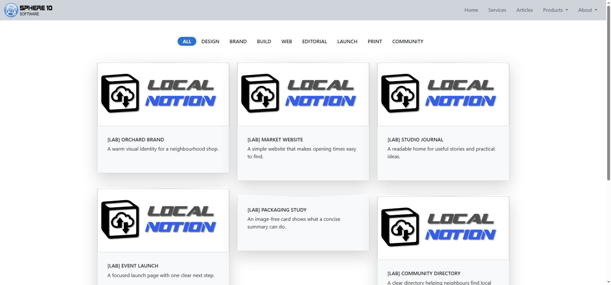
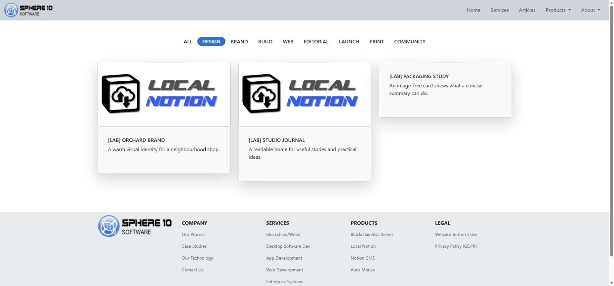
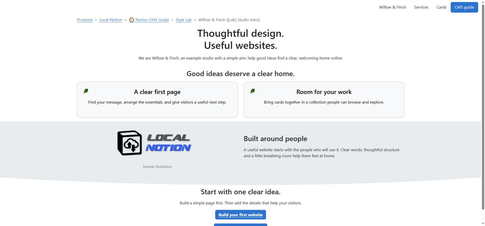
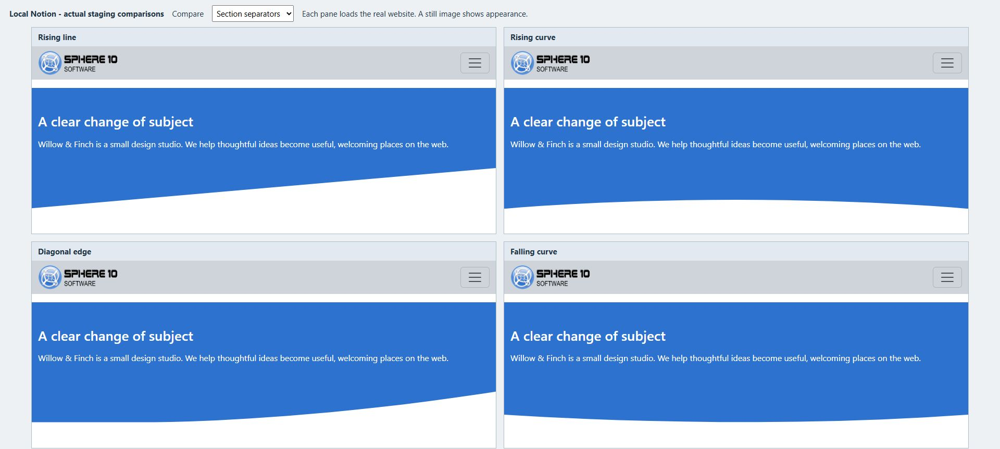
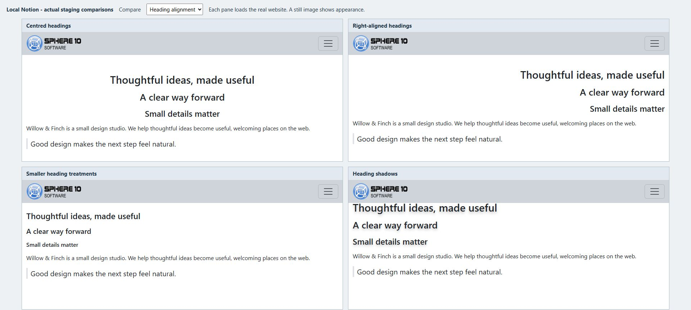
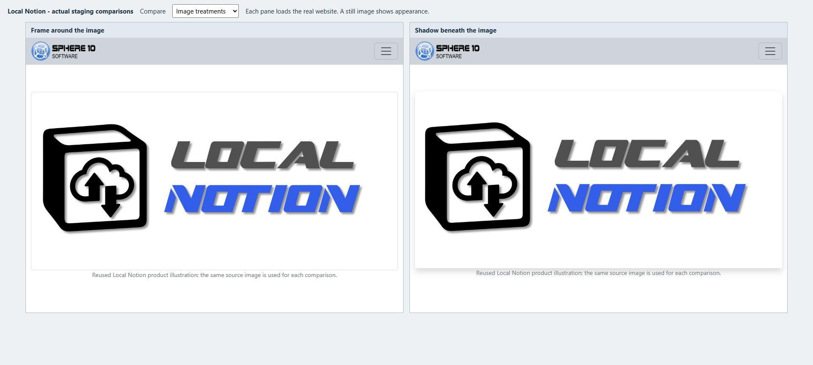
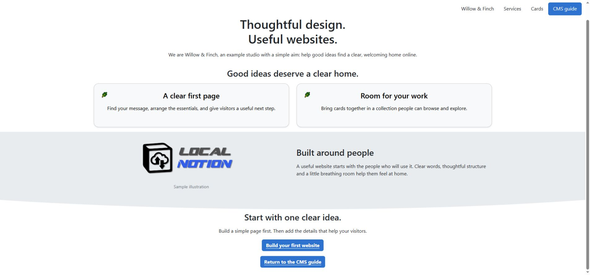
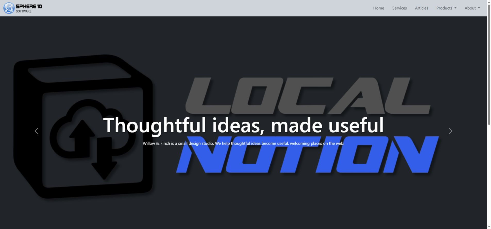

# Notion CMS Guide

Local Notion uses a single Notion database to define an entire website. Each row represents a page, section, Gallery card or shared component such as a header, navigation bar or footer.

Write content with native Notion blocks and use the database properties to control its location, publication status and presentation. Local Notion downloads this content and generates HTML, media and website routes. Deploy the generated files to a configured web host using Git or another file-transfer method. This guide covers CMS authoring, layout, styling and deployment; the [Local Notion Manual](https://sphere10.com/products/localnotion/local-notion-manual) provides installation instructions and the complete command reference.


## 1. Start with one database for the whole website

One CMS database can supply the entire website. Rows in the same table define complete pages, page sections, Gallery cards and shared components such as navigation and footers. Separate databases are not required for each component.

Each row is a Notion page with **properties** and a **content body**. Properties define its CMS Type, website location, order, publication settings and design treatments. Open the row to author its body with native Notion paragraphs, headings, lists, images, columns and links.

The website workflow has four stages:

1. **Write in Notion.** Edit the database properties and the blocks inside its rows.
2. **Pull and render with Local Notion.** Download the content and turn it into HTML, media and website routes on your computer.
3. **Publish the generated files.** Transfer the website to its host. Your setup may use Git or another file-transfer workflow.
4. **Serve the website.** Nginx or another configured web server answers visitors at your domain.

Notion is the authoring source. Saving a Notion edit does not update the hosted website until the content has been pulled, rendered and published. Generated HTML is output: a later render can replace direct changes made to it.


## 2. Prepare your Notion editing space

Open the CMS database connected to the website. Keep its website rows in that database. For an existing site, identify the associated local repository and staging address before making changes.

Use the exact property names and types listed in section 9. Columns may be hidden or reordered in individual Notion views without changing the database schema. Renaming a required property can prevent Local Notion from reading it correctly.

Use `create-cms` in Local Notion **1.7.0 or later** to create a blank CMS database with the required properties and preset choices. Earlier releases, including `v1.6.3` (`1.6.3.7`) and `1.5.0.12`, do not provide this command. Run `localnotion create-cms --help` to check the executable before following section 7.1. An existing CMS with the required schema can also be used.

**2.1 Create filtered Notion views**

Create filtered views of the same CMS database to separate editing tasks without splitting the website data:

| View | Suggested filter | Visible columns |
| --- | --- | --- |
| **Pages** | Type is Page | Item, Status, Root, Category1, Summary, Sequence. |
| **Sections** | Type is Section | Item, Status, Root, categories, Sequence, Themes. Sort by path fields, then Sequence. |
| **Gallery cards** | Type is Gallery | Item, Root, categories, Status, Summary, Sequence. A Notion gallery-shaped view can be convenient here. |
| **Shared framing** | Type is Header, NavBar or Footer | Item, Type, Root, categories, Status, Themes. |
| **Customization** | Type is Internal | Item, Root and categories. Keep advanced changes deliberate. |
| **Ready to review** | Status is QA | Item, Type, path fields and Edited On. |

Use an **OR** filter for Header, NavBar and Footer in the Shared framing view. View filters affect the Notion editor only: a row excluded from a view can still publish. Selecting Notion’s Gallery view layout also does not change the CMS Type of its rows.

Maintain an unfiltered view for database administration. Use the filtered views for routine editing, while preserving the shared path fields and composition relationships within the single CMS.

## 3. Build a small complete website

The following procedure creates a homepage, an About page, shared navigation, a footer and a Gallery collection. The item names and paths are neutral examples; substitute the required public content and domain.

**3.1 Write a simple homepage**

Create a new row with these properties:

| Property | Value |
| --- | --- |
| Item | Website Home |
| Type | Page |
| Status | Published |
| Custom Slug | `/` |
| Summary | Services, information and contact details. |
| Root and Category1–Category5 | Leave blank. |
| Publish On, Themes, Tags, Authentication | Leave blank. |

Open the homepage row. Add an introductory paragraph, a Heading 2 for the main service or topic, and a paragraph beneath it. Insert an Image block and a descriptive caption. The default Page template displays Item as the page title; omit a duplicate Heading 1 from the body.

Leave Themes empty for the initial render. The `empty` theme intentionally suppresses visible content. Wait for Notion to save, reopen the row and confirm that the body content is retained.

**3.2 Add a second page**

Create **About Us** with Type Page and Status Published. Leave Root, categories and Custom Slug blank. Add the page content and a concise Summary. Its calculated address is `/about-us`.

Insert a native **Breadcrumb** block near the beginning to display the page’s website ancestry. Local Notion calculates this trail from the CMS routes. The trail is independent of native Notion page containment in the sidebar.

**3.3 Add navigation and a footer**

Create **Shared Navigation**, Type NavBar, and **Shared Footer**, Type Footer. Leave Root, categories and Custom Slug blank to place them at the website root. Apply the Hidden status compatibility guidance in section 9.3 for the older renderer.

On 1.5.0.12, Hidden prevents pure framing rows from being counted as an additional ordinary Page body at the same route. Selected navigation and footer content still render. Keep the homepage Page Published.

In Shared Navigation, add linked paragraphs labelled Home, About Us and Cards. Set each destination and use a concise label. Native Notion page links can resolve through Local Notion; verify their generated addresses after pulling. For website links, use the hosted route rather than a path guessed from a local HTML filename.

In Shared Footer, add public contact information and the required links. Check every destination. A menu label or button theme does not create a destination page, form or submission service.

A root NavBar and Footer can be inherited by descendant routes. Author their shared content once rather than duplicating it in each Page body.

**3.4 Add a gallery of cards**

Create three more rows:

| Item | Type | Status | Root | Category1 | Sequence |
| --- | --- | --- | --- | --- | ---: |
| Design service | Gallery | Published | Cards | Design | 10 |
| Website service | Gallery | Published | Cards | Build | 20 |
| Design article | Gallery | Published | Cards | Design | 30 |

Leave Custom Slug and Category2–Category5 blank. Add a concise Summary to each row. Open each row, insert a first Image block and write the detail-page content. Select `@UseFirstImageAsFeature` in Tags when that image should be the preferred feature image.

The collection route is `/cards`. The Website service card opens `/cards/website-service`. For Gallery rows, Root groups the collection and Item supplies the final path segment. Category fields provide badges and filter values rather than additional URL levels.

The installed Gallery collection has its own light card body and large shadow. The `color_card_…` choices style authored callout cards; they do not recolour this generated collection simply because both components look like cards.

Use consistent category labels for browsing and filtering. Product types, team roles and photograph subjects are suitable examples. Differences in spelling or capitalization can create unintended categories.





**3.5 Connect Local Notion and preview the first result**

Use the existing staging address to inspect an already hosted website. For a new Nginx website, review section 7.5 before initialization; it describes the domain and hosting-generation options required by that setup.

Create an empty local folder and initialize it with the CMS **database ID**. This PowerShell example reads the integration key from a private file so that its value is not written into the command stored in shell history:

```powershell
mkdir website-repository
$notionKey = (Get-Content -LiteralPath "C:\Private\notion-key.txt" -Raw).Trim()
localnotion init --cms "YOUR_DATABASE_UUID" --profile website --path "./website-repository" --key $notionKey
Remove-Variable notionKey
```

Replace the database ID placeholder and private file path. Protect the key file and exclude it from source control. In the inspected source, `init` accepts `--key` directly but does not resolve `NOTION_API_KEY_FILE`. Credential lookup varies by command and release; consult the installed help.

The example initializes local storage with automatic Git and hosting generation omitted. It does not create CMS content rows, configure a remote server or publish the website.

Pull the CMS:

```sh
localnotion pull --all --path "./website-repository"
```

In CMS mode, `--all` selects the configured CMS, and pull normally renders the downloaded content. Inspect the homepage, About Us, `/cards`, a card detail page, navigation and footer at the staging host. Complete the hosting setup in section 7.5 if no host is configured. The website profile generates hosted paths, so opening an HTML file directly does not fully test routes and assets.

Before using these commands in an existing website repository, inspect the settings described in section 7. Pull and render can automatically commit and push when that behavior is enabled.

## 4. Shape the website with Pages, Sections and addresses

The website hierarchy determines public locations and navigation context. Use consistent path fields so that menus, breadcrumbs and page titles describe the same structure.

**4.1 Use normal calculated addresses**

For an ordinary Page, Local Notion combines consecutive nonblank Root and category fields with Item. It normalizes those values to form the public URL.

| Item | Root | Category1 | Resulting normal path |
| --- | --- | --- | --- |
| About Us | blank | blank | `/about-us` |
| Getting Started | Guides | CMS | `/guides/cms/getting-started` |
| Writing Content | Guides | CMS | `/guides/cms/writing-content` |

Fill hierarchy fields consecutively. A blank Root stops ordinary category traversal; Category2 cannot jump over a blank Category1. Do not use a separate Notion relation or a database view's row order to define the public hierarchy.

Intermediate category paths can generate article or book listings without a dedicated row at each level. Adding an ordinary Page at a category address can change the resulting composition. Regenerate and inspect the affected branch after such a change.

Use **Custom Slug** when the calculated hierarchy does not provide the required address. Set `/` for a simple Page homepage; an Item named Home otherwise normally resolves to `/home`. An explicit override can preserve an established public URL, but ordinary rows should use their calculated addresses.

Enter a page path rather than a hostname or `#` fragment. The inspected slug sanitizer removes a literal hash: `services#contact` can become `servicescontact` instead of producing a contact anchor.

**4.2 Assemble a longer page from Sections**

Use Section rows to compose one continuous page from independently edited parts. Before replacing a Page homepage with Sections, move the Page to another address or set it Hidden and regenerate. An ordinary Page and a Section collection must not compete for the same route.

Create Published Sections with blank Root, categories and Custom Slug:

| Item | Sequence | What goes inside |
| --- | ---: | --- |
| Welcome | 10 | A short introduction and a clear next step. |
| What We Do | 20 | Service descriptions, perhaps in two native Notion columns. |
| Contact | 30 | Public contact information and a relevant action link. |

Local Notion combines these Sections into the homepage in Sequence order. Category fields determine their common base path, while each title supplies an anchor within that page. For a separate landing page, give its Sections the same location, such as Root Services. If Custom Slug is required on a Section, enter only the base page path.

Set distinct whole-number Sequence values. Numbering Sections 10, 20 and 30 leaves room to insert another at 15. Equal values do not establish a reliable editorial order.

Inspect the generated target before linking to an individual Section. In the older website renderer, the outer section ID is the compact Notion page UUID, and the title has a separately derived anchor. Do not assume a fragment exists from its wording alone.



**4.3 Choose between native child pages and independent CMS rows**

A native Notion child page inside a CMS content row can generate another website page. It inherits publication scheduling, status, Tags, authentication and category information from its owning row. Summary is not simply inherited; preview the combined theme behavior.

Create an independent CMS row when a page requires its own Type, publication settings or location. Use native child pages for content that belongs within one authored resource. Moving a native Page link or changing a database view does not reparent independent CMS rows.

Insert a native Breadcrumb near the beginning of ordinary documentation pages. On 1.5.0.12, unusually deep entries can exceed the widget’s implemented category depth. Use an explicit linked trail for affected entries and verify its destinations.

## 5. Design with Notion blocks and Themes

Establish the content structure before applying visual treatments. Use headings to organize topics, paragraphs for explanations and images to support the content. Apply Themes to adjust the presentation of those existing blocks.

**Notion blocks** arrange the content, **CMS Types and properties** control website composition, and **Themes** modify rendering. A theme affects a compatible block or component; it does not create the required content block.

Select Themes on the row that owns the affected content. Change one presentation role at a time and compare the generated result. Competing alignment, colour or size selections can override one another. Local Notion supplies the base rendering for Pages, Sections, Headers and NavBars, so an empty Themes selection is valid.

Notion option colours are editor labels, not website colour values. Select the named colour-role Themes to control the rendered palette.

**5.1 Set Section spacing**

Use top and bottom padding to separate Sections visually. The `section_padding_top_…` and `section_padding_bottom_…` Themes affect the Section container; they do not set the spacing between every paragraph.

For reduced padding, select `section_padding_top_xxs` and `section_padding_bottom_xxs`. Section 10 lists the exact available values. The inspected default has more padding, and the `lg` choices increase it. Check spacing across consecutive Sections.

The `shape_…` Themes add decorative edges to Sections. After the page loads, the CMS script sets each shape’s fill to the effective background colour of the next visible Section. Use contrasting neighbouring backgrounds to make the shape visible, and keep content clear of the edge. These separators do not replace headings or content structure.



**5.2 Set text hierarchy and palette**

Use native Heading 1, 2 and 3 blocks to define the content hierarchy. Select a level for its structural role, then adjust its visual size if required. For example, `h1_as_h4` reduces the display size of Heading 1 without changing its structural level.

Use `text_left`, `text_center` or `text_right` for compatible body text. Headings use the separate `h1_align_…`, `h2_align_…` and `h3_align_…` choices. Centre alignment can suit a short banner; left alignment generally provides a consistent edge for longer explanations.

`text_small` reduces body text size, while `text_muted` applies a muted colour. Check the readability of essential information. Some older left-alignment and secondary/tertiary text aliases lack local stylesheet rules; section 10 identifies those compatibility gaps.

Colour Themes control separate presentation roles:

| Role | What you are changing |
| --- | --- |
| `color_text_…` | The main content text colour. |
| `color_text_aux_…` | The auxiliary text colour used by compatible heading treatments. |
| `color_bg_…` | The background of the compatible content container. |
| `color_aux_…` | An accent, used by compatible badges, check marks and other components. |
| `color_card_…` | Authored callout-card backgrounds, rather than every Gallery card. |

Use a consistent palette and verify text contrast against the actual background. A size or colour name alone does not establish accessibility for a particular combination.



**5.3 Configure images**



Insert an Image block and add a descriptive caption. In the inspected CMS template, the caption is displayed below the image and also supplies alternative text. Use a source image with sufficient detail for its rendered size.

Select `image_maxwidth_md`, `image_align_center` and `image_framed` to limit width, centre the image and add a frame. Add `image_shadow` and a strength such as `shadow_sm` when a shadow is required.

Image alignment requires unused width in the container; a full-width image has no room to move. Maximum dimensions limit growth, while minimum dimensions can cause overflow on narrow screens. Some older `image_width_…` and `image_height_…` choices apply maximum rules despite their names. Percentage height requires a suitable container height.

Select `image_zoomable` to enable click-to-enlarge viewing, then test opening and closing the generated viewer. `animate_image_zoom` instead controls the image’s entrance animation.

A Notion page **cover**, a **body Image block** and a listing **feature image** serve different purposes. Select one feature-source Tag to control the preferred image source:

- `@UseFirstImageAsFeature` prefers the first image, then cover and image thumbnail.
- `@UseCoverAsFeature` prefers the cover, then image thumbnail.
- `@UseThumbnailAsFeature` uses an image thumbnail/icon. An emoji does not supply an image URL.

Without those flags, the ordinary order is first image, cover and image thumbnail. The selected template decides where that feature image is displayed.

**5.4 Arrange columns and authored cards**

Create native columns in Notion by dragging one block beside another. Group related content and balance its length across columns. A `columns_…` theme modifies an existing column list; it does not convert ordinary paragraphs into columns.

Select `columns_md` for a medium-breakpoint column layout. Breakpoint choices control when columns stack rather than assigning a fixed width. `columns_middle` vertically aligns shorter content within the available height. Preview the resulting reading order at a narrow width.

Use **Callout** blocks with `callout_card` for a manually arranged set of linked cards:

1. Make a two-column row in Notion and add one Callout in each column.
2. Put the destination URL in each callout's own text, for example `https://www.example.com/about-us`.
3. Put the visible heading, short description and optional image in child blocks **inside** that callout.
4. Select `columns_md`, `callout_card` and `color_card_light` on the owning CMS row. Add `callout_shadow` and `shadow_sm` if desired.
5. Pull and test the outer card's destination as well as any links in its body.

With `callout_card`, the callout’s own text supplies the destination URL; its child blocks supply the visible description. Place ordinary informational callouts in another Section if they require the normal callout rendering.

Place one callout per column per row with the inspected template. Arrange four cards as two separate two-column rows. Stacking two cards in one column can overlap later content because each card receives almost the full column height.

Authored callout cards are blocks within a Page or Section. A **Gallery** generates cards from independent Gallery rows. Use callout cards for a fixed, manually arranged group of links; use Gallery rows for a collection that can grow and provide category filters.



**5.5 Style links, badges and lists**

Create a link with a descriptive label and valid destination before applying button styling. `link_button` styles compatible body links as buttons; `button_secondary` or `button_dark` selects an alternative treatment. Combine `button_shadow` with a strength such as `shadow_sm`. NavBar links use separate rendering and do not support every body-link modifier.

`link_arrow` and `link_muted` replace the ordinary link template. Combining these with button modifiers can bypass the expected button treatment. Select a single intended link presentation and verify its rendered result.

Format a short text span as **inline code** in Notion, then select `badge` and an optional `color_aux_…` accent. A separate Code block does not provide the same content. Badge alignment can also realign the containing element; test it on a short standalone line before applying it to a longer block.

`bullet_check` changes ordinary bullet dots into check-circle accents; it does not make an interactive checklist. `quote_no_indent` removes a quote's usual border/indent treatment while retaining the quote content.

Choose a shadow's target before its strength: `image_shadow`, `callout_shadow`, `button_shadow` or a heading-shadow option attaches it; `shadow_sm`, `shadow_md`, `shadow_lg` or `shadow_none` chooses the shared strength. A strength alone does not add a shadow to every block.

## 6. Add headers, navigation and supported behavior

Create shared components as rows in the same CMS database and assign their corresponding Types. Website path fields determine their scope; Notion view placement does not affect selection.

**6.1 Create a Header or slideshow**

Create a Header row at the required root or branch, using the framing status guidance in section 9.3. In the inspected template, each native Notion **Toggle** defines one slide. Place the slide heading, description and action link inside that Toggle.

Add a background Image block inside the Toggle and set its caption to exactly **`{BACKGROUND}`**. The template treats this marker specially. Use an image suitable for cropping and keep essential content away from its edges. Use a body Image block when the entire image must remain visible.

The renderer maps a native Toggle to the default `toggle_closed` template, independently of its expanded or collapsed state in the Notion editor. The alternative `toggle_open` template has a missing include in the inspected installation. Changing the editor state does not select that alternative.

Select `header_tiny`, `header_small`, `header_large` or `header_full` for Header size. These use percentage-based treatments, not universal fixed heights. Check the Header with its actual content and containing layout.

For multiple slides, `header_fade` requests a fade. `header_no_slide_controls` removes the visible controls and indicators. `header_no_pause` changes the pause setting; test hover behavior. `header_particles` adds decoration and needs its script; use only one particle header per route in this implementation.



**6.2 Place menus and inherit shared framing**

A root NavBar and Footer normally pass to descendants that do not have a nearer replacement. A branch-specific row can replace that component for its branch. Framing titles are editor labels; Shared Footer does not create `/shared-footer`.

Headers are local by default. Put `@UseParentHeader` in the **content row's Tags** to request its parent's Header. `@HideHeader` wins when both are present. Likewise, `@HideNavBar`, `@HideFooter` and `@HideInternal` belong on ordinary content that should suppress those components. Framing rows have Tags and Summary cleared during parsing, so placing these flags on the Footer itself does not achieve that result.

For a short NavBar, use linked paragraphs with clear labels. A native Toggle with linked children can supply a dropdown in the inspected NavBar template. The page icon/thumbnail can supply branding where supported.

Choose one navigation position. `navbar_fixed_top` and `navbar_fixed_bottom` fix it to a viewport edge. `navbar_sticky_top` and `navbar_sticky_bottom` request sticky placement, which also depends on the scroll container. Check that a fixed menu does not cover titles, breadcrumb trails, anchor targets or the footer.

`navbar_callout_productlink` is a richer NavBar entry: its callout text is the URL, the icon supplies the image area and the child blocks supply visible content. It is distinct from an ordinary body callout.

**6.3 Configure entrance animation**

Apply motion after the static layout is complete. Each `animate_…` choice requires a matching element, such as a heading, column list or image. Per-column effects in the inspected themes cover only columns one to four.

Typed headings require the typing script and a vertical bar between phrases. The older `h1_typed` template has a missing include, while typed Heading 2 and 3 omit the ordinary shadow hook. Verify these version-specific combinations before using them.

Verify animation in the rendered page. Test entrance effects while scrolling, carousel controls and readability when scripts are unavailable or an effect does not trigger. A still desktop screenshot does not establish animation or mobile behavior.

## 7. From the local repository to a hosted website

Use the publication cycle **save in Notion → pull → inspect → transfer → activate → verify**. Complete and verify a manual cycle before configuring automation.

**7.1 Create or connect the database**

The CMS uses a specific property structure. Keep the exact names and types shown in section 9. You can hide columns in a Notion view; do not rename or remove the underlying properties to tidy the display.

The **create-cms** command, available from Local Notion **1.7.0**, creates a blank database with twenty properties, eight Type choices, four Status choices, twelve Tags and 228 Themes. Earlier releases, including `v1.6.3` (`1.6.3.7`), do not include it. Run `localnotion create-cms --help` to confirm that the selected executable includes it.

For a version that provides `create-cms`, share an ordinary Notion parent page with the integration. Grant read, insert-content and update-content capabilities, then create the CMS beneath that page:

```text
localnotion create-cms --parent "YOUR_PARENT_PAGE_UUID" --title "Website CMS"
```

The command needs an integration key through one of its supported sources. For this command, a protected file named by `NOTION_API_KEY_FILE` is supported; an explicit `--key` and the stored key of an optional existing `--path` are other sources. Keep real keys out of this guide, screenshots and shared shell history.

The command creates an empty CMS rather than copying an existing website. Preset registration uses a temporary setup row, which is moved to Notion Trash; the command then verifies that no active content rows remain. Leave that setup row in Trash. If a request times out, inspect the parent page and any reported recovery identifiers before repeating it, because another invocation creates another database.

If the installed version lacks `create-cms`, use a correctly prepared CMS or create the required properties manually in Notion. Adding a Select choice does not implement unsupported behavior. Initialize Local Notion with the database ID; Notion’s separate data-source ID is not interchangeable with it.

**7.2 Understand the repository files**

In the versions covered here, the repository's settings and resource index live in **`.localnotion/registry.json`**. Use that actual filename; a separate file called `repository.json` is not the settings contract described here.

| Area | What it is for |
| --- | --- |
| `.localnotion/registry.json` | CMS connection, path/profile settings, Git/Nginx settings and the resource index. It can contain a Notion key. |
| `.localnotion/objects/` | Stored Notion objects. |
| `.localnotion/graphs/` | Downloaded object relationships. |
| `.localnotion/themes/` | Theme files and intended local overrides. |
| `.localnotion/nginx/conf/` | Optional generated hosting configuration, including URL mappings. |
| `cms/` | Generated CMS HTML and sitemap. |
| `pages/` and other configured render folders | Rendered individual resources according to the selected profile. |
| `files/` | Downloaded attachments. |

Profiles and path overrides can change the output locations. Public website URLs do not necessarily match generated HTML filenames. Use the hosting route mappings rather than constructing links from underscored filenames.

The following sanitized excerpt identifies selected registry settings. It is not a complete registry file:

```json
{
  "cms_database": "YOUR_DATABASE_UUID",
  "default_themes": ["default"],
  "paths": {
    "mode": "online",
    "base_url": "https://www.example.com",
    "cms_path": "cms",
    "files_path": "files",
    "themes_path": ".localnotion/themes"
  },
  "git": { "enabled": false, "push": false },
  "nginx": { "enabled": false }
}
```

`cms_database` chooses the CMS connection. `default_themes` provides the base rendering choices. `paths` determines link mode, base URL and output locations. `git.enabled` enables automatic change tracking/commits; `git.push` additionally enables automatic pushes in the configured workflow. `nginx.enabled` requests Nginx generation; a configured `reload_cmd` is a host-specific action, not a universal server setup.

Do not replace the full registry with this excerpt or hand-edit its generated resource/index entries. Back up the real file before an intentional configuration change, preserve independent settings and run one writer at a time.

**7.3 Pull changes or rebuild stored content**

Confirm that Notion has saved the edited row, then pull the configured CMS:

```sh
localnotion pull --all --path "./website-repository"
```

To regenerate content already downloaded, use:

```sh
localnotion render --all --path "./website-repository"
```

Render uses downloaded content and does not fetch new Notion edits. Use it after theme changes or to recompose shared dependencies. A changed parent title can require a full render to update descendant breadcrumbs. A stale native child graph requires a fresh fetch of its owning subtree; rendering the old cache does not update it.

Consult the installed help for resource selection, force-download and render options. Source and installed releases can differ. The inspected source declares `--override-mode` for init without applying it, so the option’s presence in older help does not establish its effect. Select the appropriate profile and verify the resulting settings.

Configure continuous `sync` only after one-off pulls work as required and their publication effects are understood. Define how the process will be stopped, and avoid concurrent writers to the same repository.

**7.4 Decide when Git should publish**

An existing repository may already have automatic Git commit and push enabled. In that case, a pull or render can publish. Inspect the enabled settings, remote and branch before using a live repository for an experiment.

Local Notion **1.7.0 and later** provides `localnotion git --path "./website"` to display the two supported settings, and `localnotion git --path "./website" --enabled false --push false` to disable them for later operations. It changes configuration without running Git or publishing. Earlier releases, including `v1.6.3` (`1.6.3.7`), do not include this command; check `localnotion git --help`. See [Git configuration](../git.md) for the complete command contract and setup.

Use a separate repository or isolated copy for a local-only preview. Disable automatic Git and push, remove any production remote, and preserve the active website’s configuration. Git is optional; another deployment process may transfer the generated files.

If your host uses Git, prepare the private remote, branch, Git identity and receiver before enabling automatic push. Confirm what a successful push does on the receiver. A deployment that updates a checkout still needs the web server to serve that checkout and use its current configuration.

Transfer the complete required result: HTML, assets, media and route mappings. Copying just the visible page file can leave links, pictures or access rules inconsistent.

**7.5 Generate and activate Nginx hosting**

For a new empty website folder that will use Nginx, select the domain and enable hosting generation during initialization:

```text
localnotion init --cms "YOUR_DATABASE_UUID" --profile website --path "./website-repository" --nginx --override-base-url "https://www.example.com" --key "YOUR_INTEGRATION_KEY"
```

The key above is a placeholder. Use the private credential workflow illustrated earlier for real use. This is an alternative initial setup for an empty folder, not a command to reinitialize a working repository.

Nginx generation creates configuration under `.localnotion/nginx/conf`. Its `ln-urls.conf` maps website routes to generated files. The host must include the right mappings and serve the correct repository root. The creation/init commands do not provision DNS, TLS, a droplet, a reverse proxy or a reload service.

A host may reload Nginx, restart a per-site container or use another approved activation step. Check the actual watched path and intended site. Validate configuration before activation. With individually mounted Docker configuration files, an atomic host-file replacement can leave the container seeing an older file binding; compare what the host and running container actually read when diagnosing a stale route.

`--apache` is declared as a hosting flag in the inspected CLI, but that declaration alone does not establish a working Apache generator. This guide's demonstrated hosting workflow is Nginx; verify another host's actual support rather than assuming the presence of a flag is enough.

After activation, verify the public HTTPS route, updated content, images, navigation, footer, Gallery links and affected shared pages. Local rendering, Git transfer and successful serving are separate verification stages.

**7.6 Publication, privacy and access are different**

Status and Publish On control ordinary content inclusion during generation. `@Private` excludes sitemap entries. Neither is a complete access-control system.

Authentication is a secret-bearing Text field used by the applicable hosting integration. The inspected Nginx workflow uses a `username:password` value for HTTP Basic credentials. Each independently authored CMS Page needs its intended access setting; a protected parent URL does not automatically protect every independently authored descendant. Native child pages inherit their owning CMS row's setting.

Only the active host can enforce generated access rules. Check direct URLs and alternate file paths when protection matters. Block public access to `.localnotion/` and source-control metadata; public page routes do not make the whole checkout suitable for public browsing. Keep the repository and its history private: stored objects, the registry and generated mappings can contain integration keys or reversible authorization values. Never copy real credentials into public examples or screenshots.

## 8. Check the result and solve common problems

Verify that the page is reachable, its content is complete and its navigation works. When the hosted result differs from Notion, identify the first failing stage: source, download, rendering, transfer or active hosting.

| What you see | First things to check |
| --- | --- |
| A saved edit is absent on the website | Reopen Notion to confirm save; verify the right CMS/repository; pull the relevant source; inspect generated output; then confirm transfer and active hosting. |
| A Section stays empty | Check its `empty` theme and whether you edited the visible Section. Empty intentionally suppresses content. |
| A Page fails with an “exactly one part” error | Look for Published framing at the same exact route on the older renderer. Use the Hidden framing compatibility recipe and regenerate. |
| A theme appears to do nothing | Check the owner Type, required block, installed definition, available space/contrast and competing overlays. A shadow strength needs a target; image alignment needs spare width. |
| A card opens a repeated or wrong path | Inspect the actual destination. The older deep Gallery template needed a root-relative link override; do not distort otherwise correct CMS routes to compensate. |
| A large guide's breadcrumb fails | Check native widget depth support. Use a short explicit trail for the affected deep entry. |
| A breadcrumb still uses an old parent title | Freshly render the affected descendants from current stored content; fetch the owning subtree first if its source snapshot is stale. |
| Images or styles work locally but not publicly | Check transferred assets, base URL, hosting mappings and actual server paths. |
| Four authored cards overlap later content | Use two separate two-column rows with one callout per column, rather than two callouts stacked in each column. |
| A contact-looking action does not submit anything | Confirm its destination/backend. A theme or `@ContactForm` choice does not create that service. |

Inspect the rendered page at wide and narrow browser widths, and test on a phone when available. Test menu toggles, dropdowns, card destinations, Gallery filters, anchor navigation and image enlargement. Include long titles, long summaries and a category containing one card. Essential content must remain readable without animation.

The screenshots illustrate specific captured examples. They do not establish support for every preset, combination, device layout or interaction. Use the stated theme requirements and verify the actual generated result.

**8.1 Advanced customization**

Use Notion for editorial content and intended theme overrides for reusable styling changes. Do not patch generated HTML as a lasting fix.

An **Internal** row can supply named template tokens. A Code block's caption is the token name and its raw code is the value. Common tokens include `html_head_start`, `html_head_end`, `html_body_start` and `html_body_end`; the selected template must consume the token. Keep exact spelling and one deliberate value per token. A nearer Internal row replaces the inherited source rather than automatically merging every ancestor's tokens.

For reviewed raw body markup, current source explicitly recognizes a Code block whose language is HTML and whose exact trimmed caption is `{INJECT}`. Check the actual renderer before relying on this on an older site. `code_inject` and `code_all` have different jobs, detailed in section 10; neither is an ordinary documentation-formatting option.

Local theme files can override built-in templates and assets. Existing overrides, including empty files, can mask newer defaults. Missing built-ins may be restored when a repository opens. Review the installed version and intended override lifecycle before deleting files or upgrading a live site.

## 9. CMS table and behavior reference

This section lists the required CMS structure and supported behavior. Routine editing can use filtered views with only the relevant columns visible.

**9.1 Choose the right kind of content**

Select **Type** according to the component the row must produce.

| Component | Choose | What you write |
| --- | --- | --- |
| A complete About, Services or article page | **Page** | Its headings, words, pictures and links inside one row. |
| A long homepage assembled from separate parts | **Section** | One row for each part, such as Welcome, Services and Contact. Local Notion combines them in order. |
| A growing collection of cards that open into pages | **Gallery** | One row per card, with an image, Summary and the page content behind it. |
| A shared navigation menu | **NavBar** | The links and any supported dropdown content. |
| A banner or slideshow above the main content | **Header** | The banner content, images and slides. |
| A shared footer | **Footer** | Public contact details, navigation links and closing information. |
| A small, deliberately maintained template customization | **Internal** | Named code tokens used by a compatible template. This is an advanced option. |
| A downloadable document or attachment | An ordinary attachment inside a supported Page or Section | Do not choose **File**: it is in the preset palette but is unsupported by the inspected CMS parser. |

A Gallery contains **cards**. Their subject might be products, photographs, articles or team members. A card's subject does not change how the Gallery component works.

**9.2 The complete table structure**

| Property | Notion property type | How to use it |
| --- | --- | --- |
| **Item** | Title | Name the page, section, card or shared component. It normally supplies the last part of a Page's address. |
| **Type** | Select | Choose the row's job from section 9.1. Choose it explicitly instead of relying on the blank default. |
| **Status** | Select | Use Draft while writing, QA while reviewing and Published for ready ordinary content. Hidden excludes ordinary content. |
| **Publish On** | Date | Optional earliest publication time, evaluated against UTC when the website is generated. |
| **Themes** | Multi-select | Choose supported appearance treatments for this row's content or component. Empty is a useful starting point. |
| **Custom Slug** | Text | An exceptional address override. Leave it blank for normal routes; use `/` for a simple Page homepage. |
| **Sequence** | Number | Set a clear reading order with distinct whole numbers such as 10, 20 and 30. |
| **Root** | Text | The first part of the normal website hierarchy. For Gallery rows it groups the collection. |
| **Category1** | Text | The next ordinary hierarchy level. For a Gallery row it supplies a card category/filter label. |
| **Category2** | Text | The next level or an additional Gallery label. Fill ordinary hierarchy fields consecutively. |
| **Category3** | Text | A further level or Gallery label when needed. |
| **Category4** | Text | A further level or Gallery label when needed. |
| **Category5** | Text | The final available category field. Prefer a shallow, understandable website structure. |
| **Tags** | Multi-select | Enable supported behavior, such as choosing a feature image or hiding a header. They are different from Themes. |
| **Summary** | Text | Write the short introduction used by listings and metadata. Help a reader decide whether to open the page. |
| **Authentication** | Text | Optional host-related access credentials. Leave blank for public content; see section 7 before using it. |
| **Created By** | Created by | Notion fills this system property automatically. |
| **Created On** | Created time | Notion fills this automatically. |
| **Edited By** | Last edited by | Notion fills this automatically. |
| **Edited On** | Last edited time | Notion fills this automatically. |

Status must be a **Select**, not Notion's separate Status property type. Themes and Tags are **Multi-select**. The created/edited fields are native system properties, not ordinary text fields with matching names. The canonical CMS does not require relations, formulas, rollups, or Parent/Menu/Header/Footer columns.

**9.3 Publication and shared framing**

For ordinary Page, Section and Gallery content, choose **Published** and leave Publish On empty or set it to a time that is already due. Draft, QA, Hidden, blank or unrecognized statuses do not publish ordinary content.

The website is generated, so a schedule takes effect on a pull and regeneration after its due time. Changing a row to Hidden also needs a completed publication cycle to remove the old hosted result.

Header, NavBar, Footer and Internal are selected as shared framing independently of ordinary publication gating. Changing a Footer to Draft is therefore not a reliable way to disable it. Remove or change its intended placement, or hide it from the relevant content with the supported Tags.

**For the older 1.5.0.12 website renderer, set pure Header, NavBar and Footer rows to Hidden.** Published framing at the exact address of an ordinary Published Page can be mistaken for an extra body part. Hidden avoids that unwanted contribution while the selected framing still works. Keep the actual Page Published, then check the complete generated route, particularly when upgrading.

**9.4 Use Tags for behavior**

These are the twelve canonical Tags. Put them on ordinary content, and select exact names rather than inventing a similar one.

| Tag | When to use it and its limit |
| --- | --- |
| `@ShowTitleOnBanner` | Request this page's title on a compatible cover/banner presentation. It does not create a Header. |
| `@ShowChildPageTitleOnBanner` | Request a child page's title on its compatible cover/banner. |
| `@UseParentHeader` | Request the parent Header; `@HideHeader` takes precedence. |
| `@HideHeader` | Suppress the selected Header on this content. |
| `@HideNavBar` | Suppress the selected NavBar on this content. |
| `@HideFooter` | Suppress the selected Footer on this content. |
| `@HideInternal` | Suppress the selected Internal customization on this content. |
| `@UseFirstImageAsFeature` | Prefer first image, then cover and image thumbnail. |
| `@UseCoverAsFeature` | Prefer cover, then image thumbnail. |
| `@UseThumbnailAsFeature` | Use an image thumbnail/icon as the feature candidate. |
| `@Private` | Exclude the route and descendants from the sitemap. This does not prevent direct access. |
| `@ContactForm` | A preset custom choice, without established built-in form behavior. It does not provide a form or submission backend by itself. |

Choose one feature-source Tag; if several are present, the current preference is first-image, then cover, then thumbnail. Additional custom tags are metadata unless a theme or program explicitly consumes them. Some site-specific palettes contain other names; that does not make them canonical or universally implemented.

## 10. Complete Theme lookup

The following tables list all **228 canonical Theme choices**, their intended effects, required content and known limits. Bold Type names identify the recommended owning row. Select exact names in that row’s Themes property. Compatible inherited templates can also affect a Gallery detail page; verify that output before using a modifier more broadly.

Descriptions are grounded in inspected templates and styles. They describe intended mechanisms, not a claim that every option or combination has passed a visual test. The staging examples were produced with an older 1.5.0.12 website renderer and local overrides; newer source and other installations can differ. Compatibility notes identify known gaps rather than silently substituting a similarly named option.

Choose one deliberate value for a competing role. Keep the relevant Notion block in place, preview its complete route, and test interactions separately from still images. The editor colour of an option is just a Notion label.

### 10.1 Content visibility

Choose whether a row contributes visible content. This is a composition decision, not a substitute for publication settings.

| Theme | Intended result and required content |
| --- | --- |
| `empty` | **Page or Section.** Suppresses the row's visible output. Useful for deliberate metadata-only content; a successful save/pull can still display nothing. |

### 10.2 Body text

These choices affect compatible paragraphs, quotes and callouts on a Page or Section. Heading and image alignment have their own controls. Choose one alignment and one main text-colour treatment rather than competing values.

| Theme | Intended result and required content |
| --- | --- |
| `text_left` | **Page or Section.** Left-aligns compatible paragraphs, quotes and callouts. Heading/image alignment is separate. |
| `text_center` | **Page or Section.** Centres compatible paragraphs, quotes and callouts. Best for short introductions; heading/image alignment is separate. |
| `text_right` | **Page or Section.** Right-aligns compatible paragraphs, quotes and callouts. Heading/image alignment is separate. |
| `text_justify` | **Page or Section.** Justifies compatible body text. Inspect line spacing and word gaps at a narrow width. |
| `text_muted` | **Page or Section.** Gives compatible body text a muted colour; competes with other main-text colour choices. Check readability on the chosen background. |
| `text_small` | **Page or Section.** Makes compatible body blocks smaller. Use for brief supporting notes, with a readable phone preview. |

### 10.3 Headings

Create real Heading 1, 2 or 3 blocks in a Page, Section or compatible Header, then choose their presentation. Visual size does not change a heading's structural level. The all-heading choices affect all three levels; level-specific choices affect only that level.

| Theme | Intended result and required content |
| --- | --- |
| `h123_fontsize_default` | **Page, Section or Header.** Clears CMS font-size overrides for all three heading levels; browser/component sizes remain. Needs real heading blocks. |
| `h123_default_padding` | **Page, Section or Header.** Clears the shared heading spacing override for all three levels. Other margins can remain. |
| `h1_large` | **Page, Section or Header.** Makes Heading 1 more prominent than the ordinary CMS size; it remains Heading 1 structurally. |
| `h123_color_aux` | **Page, Section or Header.** Switches Heading 1, 2 and 3 to the auxiliary text colour. Pair with an auxiliary-text colour choice. |
| `h3_shadow` | **Page, Section or Header.** Adds the shared text shadow to Heading 3. Optionally choose a shared shadow strength. |
| `h2_shadow` | **Page, Section or Header.** Adds the shared text shadow to Heading 2. Optionally choose a shared shadow strength. |
| `h1_shadow` | **Page, Section or Header.** Adds the shared text shadow to Heading 1. Optionally choose a shared shadow strength. |
| `h123_shadow` | **Page, Section or Header.** Adds the shared text shadow to Heading 1, 2 and 3. Optionally choose a shared shadow strength. |
| `h1_align_left` | **Page, Section or Header.** Aligns Heading 1 left. Compatibility gap: its left-align rule is absent locally; ordinary left appearance is not proof of a working reset. |
| `h1_align_center` | **Page, Section or Header.** Aligns Heading 1 center. Body text and images have separate alignment controls. |
| `h1_align_right` | **Page, Section or Header.** Aligns Heading 1 right. Body text and images have separate alignment controls. |
| `h1_color_aux` | **Page, Section or Header.** Switches Heading 1 to the auxiliary text colour. Pair with an auxiliary-text colour choice. |
| `h1_as_h4` | **Page, Section or Header.** Gives Heading 1 a smaller visual size, like Heading 4; its original structural level remains unchanged. |
| `h1_typed` | **Page, Section or Header.** Types/rotates Heading 1 text; a vertical bar separates phrases. Needs the typing script and a live check. The inspected Heading 1 template has an unresolved shadow reference. |
| `h2_align_left` | **Page, Section or Header.** Aligns Heading 2 left. Compatibility gap: its left-align rule is absent locally; ordinary left appearance is not proof of a working reset. |
| `h2_align_center` | **Page, Section or Header.** Aligns Heading 2 center. Body text and images have separate alignment controls. |
| `h2_align_right` | **Page, Section or Header.** Aligns Heading 2 right. Body text and images have separate alignment controls. |
| `h2_color_aux` | **Page, Section or Header.** Switches Heading 2 to the auxiliary text colour. Pair with an auxiliary-text colour choice. |
| `h2_typed` | **Page, Section or Header.** Types/rotates Heading 2 text; a vertical bar separates phrases. Needs the typing script and a live check. The typed template omits the ordinary heading-shadow hook. |
| `h2_as_h5` | **Page, Section or Header.** Gives Heading 2 a smaller visual size, like Heading 5; its original structural level remains unchanged. |
| `h3_align_left` | **Page, Section or Header.** Aligns Heading 3 left. Compatibility gap: its left-align rule is absent locally; ordinary left appearance is not proof of a working reset. |
| `h3_align_center` | **Page, Section or Header.** Aligns Heading 3 center. Body text and images have separate alignment controls. |
| `h3_align_right` | **Page, Section or Header.** Aligns Heading 3 right. Body text and images have separate alignment controls. |
| `h3_color_aux` | **Page, Section or Header.** Switches Heading 3 to the auxiliary text colour. Pair with an auxiliary-text colour choice. |
| `h3_typed` | **Page, Section or Header.** Types/rotates Heading 3 text; a vertical bar separates phrases. Needs the typing script and a live check. The typed template omits the ordinary heading-shadow hook. |
| `h3_as_h6` | **Page, Section or Header.** Gives Heading 3 a smaller visual size, like Heading 6; its original structural level remains unchanged. |

**Heading checks:** typed effects replace the whole heading template and need live verification. The Heading 1 typed template has a missing shared-shadow reference; typed Heading 2/3 omit normal shadow hooks. The left-alignment choices request a legacy rule absent from the inspected stylesheet. The ordinary default's left appearance does not prove those choices can reset another alignment.

### 10.4 Section spacing

Apply these to Section rows, not ordinary Pages. Top and bottom can be chosen independently. The inspected stylesheet's default is 3rem per edge; the small choice is 0.5rem and the large choice is 6rem. Content-block margins can remain after section padding is removed.

| Theme | Intended result and required content |
| --- | --- |
| `section_padding_top_lg` | **Section.** Sets the Section's top padding to a generous 6rem. Does not remove margins inside content blocks. |
| `section_padding_bottom_lg` | **Section.** Sets the Section's bottom padding to a generous 6rem. Does not remove margins inside content blocks. |
| `section_padding_top_xxs` | **Section.** Sets the Section's top padding to a small 0.5rem. Does not remove margins inside content blocks. |
| `section_padding_bottom_xxs` | **Section.** Sets the Section's bottom padding to a small 0.5rem. Does not remove margins inside content blocks. |
| `section_padding_top_none` | **Section.** Sets the Section's top padding to zero. Does not remove margins inside content blocks. |
| `section_padding_bottom_none` | **Section.** Sets the Section's bottom padding to zero. Does not remove margins inside content blocks. |

### 10.5 Section separators

A separator decorates the bottom edge of a Section or Header. Its SVG starts with a white or inherited fill; after page load, the CMS script matches it to the next visible Section’s effective background colour. Preview the complete boundary: image or gradient backgrounds, missing scripts and Section padding can affect the result. A Notion divider is instead a rule inside content.

| Theme | Intended result and required content |
| --- | --- |
| `shape_line_up` | **Section or Header.** Adds an angled bottom edge to a Section/Header. The CMS script matches its fill to the next visible Section’s effective background colour; choose one shape per row and preview the boundary. |
| `shape_curve_up` | **Section or Header.** Adds an upward-curved bottom edge to a Section/Header. The CMS script matches its fill to the next visible Section’s effective background colour; choose one shape per row and preview the boundary. |
| `shape_ascend_right` | **Section or Header.** Adds an ascending bottom edge to a Section/Header. The CMS script matches its fill to the next visible Section’s effective background colour; choose one shape per row and preview the boundary. |
| `shape_curve_down` | **Section or Header.** Adds a downward-curved bottom edge to a Section/Header. The CMS script matches its fill to the next visible Section’s effective background colour; choose one shape per row and preview the boundary. |

### 10.6 Columns

Make a Notion column list before selecting these choices on its Page or Section. Breakpoints control when columns sit side by side and stack, rather than specifying a fixed column width. Choose one breakpoint. Test the real phone layout rather than inferring it from a theme name.

| Theme | Intended result and required content |
| --- | --- |
| `columns_middle` | **Page or Section.** Vertically centres compatible column content. Needs a Notion column list with unequal content heights to make the difference visible. |
| `columns_xs` | **Page or Section.** Chooses the extra-small breakpoint for an existing Notion column list. Compatibility gap: the emitted column rule is absent from the inspected stylesheet. |
| `columns_sm` | **Page or Section.** Chooses the small breakpoint for an existing Notion column list. Columns stack below the chosen breakpoint; test the narrow-screen reading order. |
| `columns_md` | **Page or Section.** Chooses the medium breakpoint for an existing Notion column list. Columns stack below the chosen breakpoint; test the narrow-screen reading order. |
| `columns_lg` | **Page or Section.** Chooses the large breakpoint for an existing Notion column list. Columns stack below the chosen breakpoint; test the narrow-screen reading order. |
| `columns_xl` | **Page or Section.** Chooses the extra-large breakpoint for an existing Notion column list. Columns stack below the chosen breakpoint; test the narrow-screen reading order. |
| `columns_xxl` | **Page or Section.** Chooses the largest breakpoint for an existing Notion column list. Columns stack below the chosen breakpoint; test the narrow-screen reading order. |

### 10.7 Images

Add a real Image block first. The inspected renderer contains the picture responsively. Alignment needs an image narrower than its container; captions stay centred. Size rules below describe the actual installed definition, including maximums hidden behind some shorter option names. The named scale is 5/10/15/25/35/45/60rem from smallest to largest; a rem follows the site's root text size.

| Theme | Intended result and required content |
| --- | --- |
| `image_shadow` | **Page or Section.** Adds the shared shadow to Image blocks. Optionally choose a shared shadow strength. |
| `image_align_right` | **Page or Section.** Places a narrower Image at the right of its container; a full-width image has no room to move. |
| `image_align_center` | **Page or Section.** Places a narrower Image in the centre of its container; a full-width image has no room to move. |
| `image_align_left` | **Page or Section.** Places a narrower Image at the left of its container; a full-width image has no room to move. |
| `image_framed` | **Page or Section.** Adds a thumbnail-style padded border/frame to Image blocks. |
| `image_zoomable` | **Page or Section.** Makes an Image a click-to-enlarge target. Needs the image-viewer script; test opening and closing the live viewer. |
| `image_width_xxs` | **Page or Section.** Limits the maximum Image width of 5rem. This shorter-named preset is a maximum, not a fixed size. A smaller source may show no change. |
| `image_width_xs` | **Page or Section.** Limits the maximum Image width of 10rem. This shorter-named preset is a maximum, not a fixed size. A smaller source may show no change. |
| `image_width_sm` | **Page or Section.** Requests an Image width of 15rem. |
| `image_width_md` | **Page or Section.** Requests an Image width of 25rem. |
| `image_width_lg` | **Page or Section.** Requests an Image width of 35rem. |
| `image_width_xl` | **Page or Section.** Limits the maximum Image width of 45rem. This shorter-named preset is a maximum, not a fixed size. A smaller source may show no change. |
| `image_width_xxl` | **Page or Section.** Requests an Image width of 60rem. |
| `image_width_25pc` | **Page or Section.** Requests an Image width of 25% of its container. |
| `image_width_50pc` | **Page or Section.** Requests an Image width of 50% of its container. |
| `image_width_75pc` | **Page or Section.** Requests an Image width of 75% of its container. |
| `image_width_100pc` | **Page or Section.** Requests an Image width of 100% of its container. |
| `image_height_xxs` | **Page or Section.** Limits the maximum Image height of 5rem. This shorter-named preset is a maximum, not a fixed size. A smaller source may show no change. |
| `image_height_xs` | **Page or Section.** Limits the maximum Image height of 10rem. This shorter-named preset is a maximum, not a fixed size. A smaller source may show no change. |
| `image_height_sm` | **Page or Section.** Requests an Image height of 15rem. |
| `image_height_lg` | **Page or Section.** Requests an Image height of 35rem. |
| `image_height_xl` | **Page or Section.** Limits the maximum Image height of 45rem. This shorter-named preset is a maximum, not a fixed size. A smaller source may show no change. |
| `image_height_xxl` | **Page or Section.** Limits the maximum Image height of 60rem. This shorter-named preset is a maximum, not a fixed size. A smaller source may show no change. |
| `image_height_md` | **Page or Section.** Requests an Image height of 25rem. |
| `image_height_25pc` | **Page or Section.** Requests an Image height of 25% of its container. Needs a defined containing height. |
| `image_height_50pc` | **Page or Section.** Requests an Image height of 50% of its container. Needs a defined containing height. |
| `image_height_75pc` | **Page or Section.** Requests an Image height of 75% of its container. Needs a defined containing height. |
| `image_height_100pc` | **Page or Section.** Requests an Image height of 100% of its container. Needs a defined containing height. |
| `image_minwidth_xxs` | **Page or Section.** Sets the minimum Image width of 5rem. Check for overflow on narrow screens. |
| `image_minwidth_xs` | **Page or Section.** Sets the minimum Image width of 10rem. Check for overflow on narrow screens. |
| `image_minwidth_sm` | **Page or Section.** Sets the minimum Image width of 15rem. Check for overflow on narrow screens. |
| `image_minwidth_md` | **Page or Section.** Sets the minimum Image width of 25rem. Check for overflow on narrow screens. |
| `image_minwidth_lg` | **Page or Section.** Sets the minimum Image width of 35rem. Check for overflow on narrow screens. |
| `image_minwidth_xl` | **Page or Section.** Sets the minimum Image width of 45rem. Check for overflow on narrow screens. |
| `image_minwidth_xxl` | **Page or Section.** Sets the minimum Image width of 60rem. Check for overflow on narrow screens. |
| `image_maxwidth_xxs` | **Page or Section.** Limits the maximum Image width of 5rem. A smaller source may show no change. |
| `image_maxwidth_xs` | **Page or Section.** Limits the maximum Image width of 10rem. A smaller source may show no change. |
| `image_maxwidth_sm` | **Page or Section.** Limits the maximum Image width of 15rem. A smaller source may show no change. |
| `image_maxwidth_md` | **Page or Section.** Limits the maximum Image width of 25rem. A smaller source may show no change. |
| `image_maxwidth_lg` | **Page or Section.** Limits the maximum Image width of 35rem. A smaller source may show no change. |
| `image_maxwidth_xl` | **Page or Section.** Limits the maximum Image width of 45rem. A smaller source may show no change. |
| `image_maxwidth_xxl` | **Page or Section.** Limits the maximum Image width of 60rem. A smaller source may show no change. |
| `image_minheight_xxs` | **Page or Section.** Sets the minimum Image height of 5rem. Check for overflow on narrow screens. |
| `image_minheight_xs` | **Page or Section.** Sets the minimum Image height of 10rem. Check for overflow on narrow screens. |
| `image_minheight_sm` | **Page or Section.** Sets the minimum Image height of 15rem. Check for overflow on narrow screens. |
| `image_minheight_md` | **Page or Section.** Sets the minimum Image height of 25rem. Check for overflow on narrow screens. |
| `image_minheight_lg` | **Page or Section.** Sets the minimum Image height of 35rem. Check for overflow on narrow screens. |
| `image_minheight_xl` | **Page or Section.** Sets the minimum Image height of 45rem. Check for overflow on narrow screens. |
| `image_minheight_xxl` | **Page or Section.** Sets the minimum Image height of 60rem. Check for overflow on narrow screens. |
| `image_maxheight_xxs` | **Page or Section.** Limits the maximum Image height of 5rem. A smaller source may show no change. |
| `image_maxheight_xs` | **Page or Section.** Limits the maximum Image height of 10rem. A smaller source may show no change. |
| `image_maxheight_sm` | **Page or Section.** Limits the maximum Image height of 15rem. A smaller source may show no change. |
| `image_maxheight_md` | **Page or Section.** Limits the maximum Image height of 25rem. A smaller source may show no change. |
| `image_maxheight_lg` | **Page or Section.** Limits the maximum Image height of 35rem. A smaller source may show no change. |
| `image_maxheight_xl` | **Page or Section.** Limits the maximum Image height of 45rem. A smaller source may show no change. |
| `image_maxheight_xxl` | **Page or Section.** Limits the maximum Image height of 60rem. A smaller source may show no change. |

**Image checks:** percentage height requires a defined containing height; minimums can overflow phones; a maximum larger than the source can look unchanged. The actual output also depends on the column/container and source aspect ratio. Compare both portrait and landscape content before generalizing.

### 10.8 Colour roles

Names such as primary, success and body refer to the installed theme's palette, not fixed universal colours. Main text, container background, auxiliary text, small accents and callout cards have separate controls. Inline Notion colours and component templates can override inherited colour. Inspect contrast on the final page.

| Theme | Intended result and required content |
| --- | --- |
| `color_text_black` | **Page or Section.** Chooses black as the main text colour on compatible Page/Section blocks. |
| `color_text_black_50` | **Page or Section.** Chooses black at 50% opacity as the main text colour on compatible Page/Section blocks. |
| `color_text_body` | **Page or Section.** Chooses body as the main text colour on compatible Page/Section blocks. |
| `color_text_body_emphasis` | **Page or Section.** Chooses body emphasis as the main text colour on compatible Page/Section blocks. The inspected mapping uses the dark-emphasis treatment. |
| `color_text_body_secondary` | **Page or Section.** Chooses body secondary as the main text colour on compatible Page/Section blocks. Compatibility gap: the emitted colour rule is absent from the inspected stylesheet; visible effect is unproved. |
| `color_text_body_tertiary` | **Page or Section.** Chooses body tertiary as the main text colour on compatible Page/Section blocks. Compatibility gap: the emitted colour rule is absent from the inspected stylesheet; visible effect is unproved. |
| `color_text_danger` | **Page or Section.** Chooses danger as the main text colour on compatible Page/Section blocks. |
| `color_text_danger_emphasis` | **Page or Section.** Chooses danger emphasis as the main text colour on compatible Page/Section blocks. |
| `color_text_dark` | **Page or Section.** Chooses dark as the main text colour on compatible Page/Section blocks. |
| `color_text_dark_emphasis` | **Page or Section.** Chooses dark emphasis as the main text colour on compatible Page/Section blocks. |
| `color_text_info` | **Page or Section.** Chooses info as the main text colour on compatible Page/Section blocks. |
| `color_text_info_emphasis` | **Page or Section.** Chooses info emphasis as the main text colour on compatible Page/Section blocks. |
| `color_text_light` | **Page or Section.** Chooses light as the main text colour on compatible Page/Section blocks. |
| `color_text_light_emphasis` | **Page or Section.** Chooses light emphasis as the main text colour on compatible Page/Section blocks. |
| `color_text_primary` | **Page or Section.** Chooses primary as the main text colour on compatible Page/Section blocks. |
| `color_text_primary_emphasis` | **Page or Section.** Chooses primary emphasis as the main text colour on compatible Page/Section blocks. |
| `color_text_secondary` | **Page or Section.** Chooses secondary as the main text colour on compatible Page/Section blocks. |
| `color_text_secondary_emphasis` | **Page or Section.** Chooses secondary emphasis as the main text colour on compatible Page/Section blocks. |
| `color_text_success` | **Page or Section.** Chooses success as the main text colour on compatible Page/Section blocks. |
| `color_text_success_emphasis` | **Page or Section.** Chooses success emphasis as the main text colour on compatible Page/Section blocks. |
| `color_text_warning` | **Page or Section.** Chooses warning as the main text colour on compatible Page/Section blocks. |
| `color_text_warning_emphasis` | **Page or Section.** Chooses warning emphasis as the main text colour on compatible Page/Section blocks. |
| `color_text_white` | **Page or Section.** Chooses white as the main text colour on compatible Page/Section blocks. |
| `color_text_white_50` | **Page or Section.** Chooses white at 50% opacity as the main text colour on compatible Page/Section blocks. |
| `color_bg_body` | **Page, Section, Header, NavBar or Gallery.** Chooses body for the CMS container background; does not recolour the generated Gallery card body. Choose/check readable text separately. |
| `color_bg_body_secondary` | **Page, Section, Header, NavBar or Gallery.** Chooses body secondary for the CMS container background; does not recolour the generated Gallery card body. Choose/check readable text separately. |
| `color_bg_body_tertiary` | **Page, Section, Header, NavBar or Gallery.** Chooses body tertiary for the CMS container background; does not recolour the generated Gallery card body. Choose/check readable text separately. |
| `color_bg_danger` | **Page, Section, Header, NavBar or Gallery.** Chooses danger for the CMS container background; does not recolour the generated Gallery card body. Choose/check readable text separately. |
| `color_bg_danger_subtle` | **Page, Section, Header, NavBar or Gallery.** Chooses danger subtle for the CMS container background; does not recolour the generated Gallery card body. Choose/check readable text separately. |
| `color_bg_dark` | **Page, Section, Header, NavBar or Gallery.** Chooses dark for the CMS container background; does not recolour the generated Gallery card body. Choose/check readable text separately. |
| `color_bg_dark_subtle` | **Page, Section, Header, NavBar or Gallery.** Chooses dark subtle for the CMS container background; does not recolour the generated Gallery card body. Choose/check readable text separately. |
| `color_bg_info` | **Page, Section, Header, NavBar or Gallery.** Chooses info for the CMS container background; does not recolour the generated Gallery card body. Choose/check readable text separately. |
| `color_bg_info_subtle` | **Page, Section, Header, NavBar or Gallery.** Chooses info subtle for the CMS container background; does not recolour the generated Gallery card body. Choose/check readable text separately. |
| `color_bg_light` | **Page, Section, Header, NavBar or Gallery.** Chooses light for the CMS container background; does not recolour the generated Gallery card body. Choose/check readable text separately. |
| `color_bg_light_subtle` | **Page, Section, Header, NavBar or Gallery.** Chooses light subtle for the CMS container background; does not recolour the generated Gallery card body. Choose/check readable text separately. |
| `color_bg_primary` | **Page, Section, Header, NavBar or Gallery.** Chooses primary for the CMS container background; does not recolour the generated Gallery card body. Choose/check readable text separately. |
| `color_bg_primary_subtle` | **Page, Section, Header, NavBar or Gallery.** Chooses primary subtle for the CMS container background; does not recolour the generated Gallery card body. Choose/check readable text separately. |
| `color_bg_secondary` | **Page, Section, Header, NavBar or Gallery.** Chooses secondary for the CMS container background; does not recolour the generated Gallery card body. Choose/check readable text separately. |
| `color_bg_secondary_subtle` | **Page, Section, Header, NavBar or Gallery.** Chooses secondary subtle for the CMS container background; does not recolour the generated Gallery card body. Choose/check readable text separately. |
| `color_bg_success` | **Page, Section, Header, NavBar or Gallery.** Chooses success for the CMS container background; does not recolour the generated Gallery card body. Also requests contrasting text in this installed mapping. |
| `color_bg_success_subtle` | **Page, Section, Header, NavBar or Gallery.** Chooses success subtle for the CMS container background; does not recolour the generated Gallery card body. Choose/check readable text separately. |
| `color_bg_warning` | **Page, Section, Header, NavBar or Gallery.** Chooses warning for the CMS container background; does not recolour the generated Gallery card body. Choose/check readable text separately. |
| `color_bg_warning_subtle` | **Page, Section, Header, NavBar or Gallery.** Chooses warning subtle for the CMS container background; does not recolour the generated Gallery card body. Choose/check readable text separately. |
| `color_aux_danger` | **Page or Section.** Chooses danger for small accents. Needs a badge, arrow-style link or check-style bullet; no ordinary-paragraph effect. |
| `color_aux_dark` | **Page or Section.** Chooses dark for small accents. Needs a badge, arrow-style link or check-style bullet; no ordinary-paragraph effect. |
| `color_aux_info` | **Page or Section.** Chooses info for small accents. Needs a badge, arrow-style link or check-style bullet; no ordinary-paragraph effect. |
| `color_aux_light` | **Page or Section.** Chooses light for small accents. Needs a badge, arrow-style link or check-style bullet; no ordinary-paragraph effect. |
| `color_aux_primary` | **Page or Section.** Chooses primary for small accents. Needs a badge, arrow-style link or check-style bullet; no ordinary-paragraph effect. |
| `color_aux_secondary` | **Page or Section.** Chooses secondary for small accents. Needs a badge, arrow-style link or check-style bullet; no ordinary-paragraph effect. |
| `color_aux_success` | **Page or Section.** Chooses success for small accents. Needs a badge, arrow-style link or check-style bullet; no ordinary-paragraph effect. |
| `color_aux_warning` | **Page or Section.** Chooses warning for small accents. Needs a badge, arrow-style link or check-style bullet; no ordinary-paragraph effect. |
| `color_text_aux_50` | **Header, Page or Section.** Unavailable in the inspected installation: no matching theme folder. A similarly named extra option is a different choice; no automatic substitute or implemented effect is established. |
| `color_text_aux_black` | **Header, Page or Section.** Chooses black for auxiliary text. Ordinary headings need their auxiliary-colour switch; does not recolour ordinary paragraphs. |
| `color_text_aux_body` | **Header, Page or Section.** Chooses body for auxiliary text. Ordinary headings need their auxiliary-colour switch; does not recolour ordinary paragraphs. |
| `color_text_aux_body_emphasis` | **Header, Page or Section.** Chooses body emphasis for auxiliary text. Ordinary headings need their auxiliary-colour switch; does not recolour ordinary paragraphs. |
| `color_text_aux_body_secondary` | **Header, Page or Section.** Chooses body secondary for auxiliary text. Ordinary headings need their auxiliary-colour switch; does not recolour ordinary paragraphs. |
| `color_text_aux_body_tertiary` | **Header, Page or Section.** Chooses body tertiary for auxiliary text. Ordinary headings need their auxiliary-colour switch; does not recolour ordinary paragraphs. |
| `color_text_aux_danger` | **Header, Page or Section.** Chooses danger for auxiliary text. Ordinary headings need their auxiliary-colour switch; does not recolour ordinary paragraphs. |
| `color_text_aux_danger_emphasis` | **Header, Page or Section.** Chooses danger emphasis for auxiliary text. Ordinary headings need their auxiliary-colour switch; does not recolour ordinary paragraphs. |
| `color_text_aux_dark` | **Header, Page or Section.** Chooses dark for auxiliary text. Ordinary headings need their auxiliary-colour switch; does not recolour ordinary paragraphs. |
| `color_text_aux_dark_emphasis` | **Header, Page or Section.** Chooses dark emphasis for auxiliary text. Ordinary headings need their auxiliary-colour switch; does not recolour ordinary paragraphs. |
| `color_text_aux_info` | **Header, Page or Section.** Chooses info for auxiliary text. Ordinary headings need their auxiliary-colour switch; does not recolour ordinary paragraphs. |
| `color_text_aux_info_emphasis` | **Header, Page or Section.** Chooses info emphasis for auxiliary text. Ordinary headings need their auxiliary-colour switch; does not recolour ordinary paragraphs. |
| `color_text_aux_light` | **Header, Page or Section.** Chooses light for auxiliary text. Ordinary headings need their auxiliary-colour switch; does not recolour ordinary paragraphs. |
| `color_text_aux_light_emphasis` | **Header, Page or Section.** Chooses light emphasis for auxiliary text. Ordinary headings need their auxiliary-colour switch; does not recolour ordinary paragraphs. |
| `color_text_aux_primary` | **Header, Page or Section.** Chooses primary for auxiliary text. Ordinary headings need their auxiliary-colour switch; does not recolour ordinary paragraphs. |
| `color_text_aux_primary_emphasis` | **Header, Page or Section.** Chooses primary emphasis for auxiliary text. Ordinary headings need their auxiliary-colour switch; does not recolour ordinary paragraphs. |
| `color_text_aux_secondary` | **Header, Page or Section.** Chooses secondary for auxiliary text. Ordinary headings need their auxiliary-colour switch; does not recolour ordinary paragraphs. |
| `color_text_aux_secondary_emphasis` | **Header, Page or Section.** Chooses secondary emphasis for auxiliary text. Ordinary headings need their auxiliary-colour switch; does not recolour ordinary paragraphs. |
| `color_text_aux_success` | **Header, Page or Section.** Chooses success for auxiliary text. Ordinary headings need their auxiliary-colour switch; does not recolour ordinary paragraphs. |
| `color_text_aux_success_emphasis` | **Header, Page or Section.** Chooses success emphasis for auxiliary text. Ordinary headings need their auxiliary-colour switch; does not recolour ordinary paragraphs. |
| `color_text_aux_warning` | **Header, Page or Section.** Chooses warning for auxiliary text. Ordinary headings need their auxiliary-colour switch; does not recolour ordinary paragraphs. |
| `color_text_aux_warning_emphasis` | **Header, Page or Section.** Chooses warning emphasis for auxiliary text. Ordinary headings need their auxiliary-colour switch; does not recolour ordinary paragraphs. |
| `color_text_aux_white` | **Header, Page or Section.** Chooses white for auxiliary text. Ordinary headings need their auxiliary-colour switch; does not recolour ordinary paragraphs. |
| `color_text_aux_white_50` | **Header, Page or Section.** Chooses white at 50% opacity for auxiliary text. Ordinary headings need their auxiliary-colour switch; does not recolour ordinary paragraphs. |
| `color_card_danger` | **Page or Section.** Chooses danger text/background treatment for authored callout cards. Needs the callout-card style; not a generated Gallery-card control. |
| `color_card_dark` | **Page or Section.** Chooses dark text/background treatment for authored callout cards. Needs the callout-card style; not a generated Gallery-card control. |
| `color_card_info` | **Page or Section.** Chooses info text/background treatment for authored callout cards. Needs the callout-card style; not a generated Gallery-card control. |
| `color_card_light` | **Page or Section.** Chooses light text/background treatment for authored callout cards. Needs the callout-card style; not a generated Gallery-card control. |
| `color_card_primary` | **Page or Section.** Chooses primary text/background treatment for authored callout cards. Needs the callout-card style; not a generated Gallery-card control. |
| `color_card_secondary` | **Page or Section.** Chooses secondary text/background treatment for authored callout cards. Needs the callout-card style; not a generated Gallery-card control. |
| `color_card_success` | **Page or Section.** Chooses success text/background treatment for authored callout cards. Needs the callout-card style; not a generated Gallery-card control. |
| `color_card_warning` | **Page or Section.** Chooses warning text/background treatment for authored callout cards. Needs the callout-card style; not a generated Gallery-card control. |

### 10.9 Badges, callouts, lists and quotes

These choices style particular Notion blocks inside a Page or Section. A clickable callout card needs URL text and visible child blocks. A badge needs inline-code text, not a Code block. The detailed recipes show how to author the underlying content.

| Theme | Intended result and required content |
| --- | --- |
| `callout_shadow` | **Page or Section.** Adds the shared shadow to ordinary or card-style Callouts. Optionally choose a shared shadow strength. |
| `badge` | **Page or Section.** Turns inline-code text into a rounded badge. Needs inline code, not a Code block; an accent colour is optional. Its script can realign the parent block. |
| `badge_align_left` | **Page or Section.** Requests left alignment for a badge and its parent. Needs badge styling/script. Compatibility gap: the left-align rule is absent locally; test actual parent behavior. |
| `badge_align_center` | **Page or Section.** Centres a styled badge by changing its parent alignment. Needs badge styling/script; inspect adjacent text too. |
| `badge_align_right` | **Page or Section.** Right-aligns a styled badge by changing its parent alignment. Needs badge styling/script; inspect adjacent text too. |
| `callout_card` | **Page or Section.** Turns a Callout into a clickable card: its own text is the destination URL; child blocks supply the visible heading/body. Test the outer-card link. |
| `bullet_check` | **Page or Section.** Replaces bulleted-list dots with check-circle accents. Needs the icon script; this is presentation, not interactive task state. |
| `quote_no_indent` | **Page or Section.** Removes the normal Quote border/indent treatment while preserving its quote role. |

### 10.10 Links and buttons

Create a labelled rich-text link and a real destination first. A button is a presentation of that link. Arrow and muted-link treatments replace the ordinary link template and can bypass button or underline choices; navigation has its own markup.

| Theme | Intended result and required content |
| --- | --- |
| `button_shadow` | **Page or Section.** Adds the shared shadow to button-styled links. Needs the link-button treatment; optionally choose a shadow strength. |
| `button_secondary` | **Page or Section.** Uses the secondary button treatment. Needs button-styled links; does not change an ordinary link alone. |
| `button_dark` | **Page or Section.** Uses the dark button treatment. Needs button-styled links; does not change an ordinary link alone. |
| `link_button` | **Page or Section.** Makes rich-text links look like primary buttons. Needs existing labelled links/destinations; optional button colour and shadow choices refine them. |
| `link_no_underline` | **Page or Section.** Removes the ordinary CMS link's underline. Full link-template replacements, including NavBar links, can bypass this setting. |
| `link_arrow` | **Page or Section.** Adds a circular arrow accent to rich-text links. Needs the icon script; an accent-colour choice is optional. Replaces the ordinary link template. |
| `link_muted` | **Page or Section.** Gives rich-text/page links a muted, underline-on-hover treatment. Replaces the ordinary link template, so button modifiers may be bypassed. |
| `link_detect_appstores` | **Section.** Converts recognized platform/store labels or bracketed link labels into download treatments. Needs a Section, scripts and external icons; scans links across the document, including other sections/navigation. |

**Download-label checks:** the inspected detector recognizes WINDOWS, WINDOWS STORE, MACOS, APPLE STORE, LINUX and GOOGLE STORE, plus bracketed labels such as [Download]. It needs its Section-end script, supporting libraries and external icons; test other page links because its scan is document-wide.

### 10.11 Shadows

First enable the shadow on the intended image, callout, button or heading; then choose one shared strength here. A strength alone does not add shadows everywhere. The inspected Gallery card and badge shadows are independent of this shared setting.

| Theme | Intended result and required content |
| --- | --- |
| `shadow_lg` | **Page or Section.** Chooses large shared shadow strength. Needs a shadow-enabled image, callout, button or heading; fixed Gallery/badge shadows are separate. |
| `shadow_md` | **Page or Section.** Chooses medium shared shadow strength. Needs a shadow-enabled image, callout, button or heading; fixed Gallery/badge shadows are separate. |
| `shadow_sm` | **Page or Section.** Chooses small shared shadow strength. Needs a shadow-enabled image, callout, button or heading; fixed Gallery/badge shadows are separate. |
| `shadow_none` | **Page or Section.** Chooses no shared shadow strength. Needs a shadow-enabled image, callout, button or heading; fixed Gallery/badge shadows are separate. |

### 10.12 Headers and slideshows

Select these on a Header row resolved by the content page. Native Notion Toggles supply slides; their children contain the heading, copy and image. The renderer selects its default slide template regardless of the Toggle's expanded/collapsed state in the editor. An image captioned exactly `{BACKGROUND}` becomes a cover-style slide background. The alternative `toggle_open` template has a missing include in this installation; changing the editor state does not select it. Percentage heights depend on the containing layout.

| Theme | Intended result and required content |
| --- | --- |
| `header_no_pause` | **Header.** Changes the Header carousel's pause setting. Test actual hover behavior with the installed carousel script; the flag alone is not proof. |
| `header_no_slide_controls` | **Header.** Removes previous/next buttons and slide indicators. Test with at least two slides; one-slide headers already omit controls. |
| `header_small` | **Header.** Requests a 25% header height treatment; actual height depends on its containing layout. Needs a resolved Header with slides. |
| `header_tiny` | **Header.** Requests a 15% header height treatment; actual height depends on its containing layout. Needs a resolved Header with slides. |
| `header_particles` | **Header.** Adds an animated particle layer. Needs the external particle script; use only one such Header per route because the installed layer has a fixed identifier. |
| `header_fade` | **Header.** Requests a fade instead of the ordinary slide transition. Needs at least two Header slides and a live transition check. |
| `header_large` | **Header.** Requests a 75% header height treatment; actual height depends on its containing layout. Needs a resolved Header with slides. |
| `header_full` | **Header.** Requests a 100% header height treatment, not an unconditional screen-height promise. Needs a resolved Header with slides. |

### 10.13 Navigation

Use a NavBar row at the intended route or branch. Add linked paragraphs and, when needed, a toggle containing dropdown links. Position changes need a long page and a scroll test; a fixed bar can cover a title or anchor. Use one positioning choice.

| Theme | Intended result and required content |
| --- | --- |
| `navbar_callout_productlink` | **NavBar.** Makes a NavBar Callout a product entry: own text=destination URL, icon=image area, children=visible title/description. Test the complete entry's destination. |
| `navbar_fixed_top` | **NavBar.** Fixes the NavBar at the viewport top. Check that it does not cover titles, breadcrumbs or anchor targets. |
| `navbar_sticky_top` | **NavBar.** Requests a NavBar that sticks at the top within its scroll context. Test the complete page's placement and scroll behavior. |
| `navbar_fixed_bottom` | **NavBar.** Fixes the NavBar at the viewport bottom. Check content/footer clearance and phone usability. |
| `navbar_sticky_bottom` | **NavBar.** Requests bottom sticky positioning within the scroll context. Needs a suitable layout; do not assume it behaves like a fixed bottom bar. |

### 10.14 Entrance animation

Motion choices need matching blocks and the website's animation scripts. Test their entrance from a fresh load/scroll position. A still screenshot cannot prove a transition, timing or reduced-motion behavior. Column hooks in the inspected templates cover only one-to-four-column layouts.

| Theme | Intended result and required content |
| --- | --- |
| `animate_columns_slide_fade` | **Page or Section.** Requests sliding/fading entrances for an existing one-to-four-column list. Needs animation scripts and live scroll/entry testing. |
| `animate_columns_flip` | **Page or Section.** Requests flipping entrances for an existing one-to-four-column list. Needs animation scripts and live scroll/entry testing. |
| `animate_columns_zoom` | **Page or Section.** Requests zooming entrances for an existing one-to-four-column list. Needs animation scripts and live scroll/entry testing. |
| `animate_image_zoom` | **Page or Section.** Requests a zoom entrance for Image figures. Needs animation scripts and a live check; this is not click-to-enlarge. |

### 10.15 Advanced content rendering

Use these on a Page or Section only for reviewed advanced content, with a version-matched preview. Literal code examples should stay readable. These two presets have different jobs; neither should be selected merely because a page contains documentation.

| Theme | Intended result and required content |
| --- | --- |
| `code_inject` | **Page or Section.** Renders affected Code blocks as active raw markup/style/script. Never use on examples intended to remain literal; preview reviewed content with the actual renderer. |
| `code_all` | **Page or Section.** Removes the usual content cover/title/container wrapper and emits its children. Does not by itself make code raw; outer page/framing may remain. |
