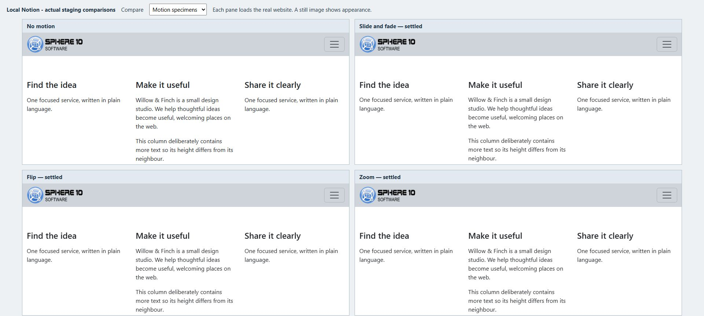

# Add motion and finish the page

Finish the layout before adding movement. An animation can introduce a feature or give a short hero some personality, but the words, images and links should already work without requiring visitors to wait for an effect.

*This still shows the final arrangement. Open the live motion example to observe when the effects begin and how the content moves.*

## Animate an existing arrangement

The column animation choices are `animate_columns_slide_fade`, `animate_columns_flip` and `animate_columns_zoom`. They attach animation settings to an existing Notion column list. Use one motion choice on a modest group of two or three related pieces.

## In Notion: introduce a two-column feature

1. Build a Section with two Notion columns: an image in one, and a heading and short paragraph in the other.
2. Preview the ordinary arrangement first.
3. In **Themes**, select one column animation, such as `animate_columns_slide_fade`.
4. Pull, open the page above the feature and scroll it into view.
5. Reload and repeat so you can distinguish an entrance animation from a static transform or a partially loaded state.
6. Check the narrow-screen reading order and that every link remains usable.

The installed animation hooks cover column lists with one to four columns; the five-to-twelve-column templates do not consume those per-column hooks. Choosing a motion theme does not make an arbitrary grid animate.

`animate_image_zoom` adds an entrance effect to image figures. It differs from `image_zoomable`, which lets visitors click an image to inspect it. Use the [motion lab](https://staging.sphere10.com/products/localnotion/cms/style-lab/motion) to compare the effect with a still image and test the real trigger.

## Give a heading a typed effect

`h1_typed`, `h2_typed` and `h3_typed` replace the corresponding heading's presentation with typed text. In the installed templates, a vertical bar separates rotating phrases.

For example, make a Heading 2 block containing `Design with purpose | Build with confidence`, then select `h2_typed` on its owning row. Choose a short phrase that still makes sense when seen alone. Do not put essential instructions in a sequence that a reader must wait through.

Typed headings replace the complete heading template. Their interaction with heading shadows differs from ordinary headings, and the inspected Heading 1 version has an unresolved shared-shadow include. Compare the live result rather than assuming every static heading modifier will carry across.

When movement is unnecessary, keep the heading static. Check the result with your site's actual motion/accessibility settings; these examples do not establish universal reduced-motion behavior.

## Choose a restrained finish

Add depth only where it helps identify a component. To shadow an image, select `image_shadow`; to shadow a callout card, use `callout_shadow`; for a button-styled link, use `button_shadow`. Then choose one shared strength, such as `shadow_sm`, `shadow_md` or `shadow_lg`. `shadow_none` clears that shared effect where the component uses it.

The strength choice alone does not attach shadows everywhere. Generated Gallery cards and inline badges have their own fixed shadows in the inspected templates. Heading shadows use their corresponding heading choices; see [text and colour](text-and-colour.md).

A complete studio feature might use two columns, a framed image, a pale background and a clear button. Preview that combination before adding a separator or animation. If the page feels busy, remove one effect and compare it with the previous version.

## Recognize download-link helpers

`link_detect_appstores` is a specialized Section helper that recognizes particular link labels. In the inspected script, the normalized labels are `WINDOWS`, `WINDOWS STORE`, `MACOS`, `APPLE STORE`, `LINUX` and `GOOGLE STORE`. A bracketed label such as `[Download]` is also converted into a button.

The script scans anchors across the document, so it may also alter matching links in other sections or navigation. Use it on a deliberate download page, inspect the whole page and check external images/scripts. It does not create a download file, a store listing or a working destination.

## When a preset is not enough

Use ordinary Notion blocks for content, CMS properties for composition and theme overrides for reusable design changes. Small reviewed markup/style/script additions belong to the advanced [customization](customization.md) workflow, not to a first-page recipe.

The `code_inject` theme renders affected Code blocks as active markup rather than an ordinary readable listing in the inspected installation. Do not apply it to a documentation row merely to make its examples look attractive. `code_all` removes the usual content wrapper in that theme; by itself, that is not a promise that every code block becomes raw HTML. A separate explicitly captioned injection mechanism also exists, and behavior varies across renderer versions. Use the documented, version-tested path and inspect the output.

Internal rows can supply template tokens through exact code-block captions. They are powerful shared framing: a nearer Internal row can replace the inherited source, and changing its Status to Draft does not safely disable it. Keep this work separate from ordinary editorial styling and preserve existing tokens.

## Check before you call it finished

Read the page from top to bottom. Check that the heading says what the page is about, images have useful captions, links have meaningful text and the last action is clear. Then inspect it at a phone width, open the menu, follow the breadcrumb and test each interaction you added.

Finally, verify the complete [publishing cycle](publishing.md). A saved Notion change, a generated local file and the served HTTPS website are different checkpoints. Keep the page's design decisions simple enough that the next editor can understand and maintain them.

[Previous: Headers and navigation](headers-and-navigation.md) · [Theme option reference](theme-reference.md) · [Notion CMS Guide](index.md)
