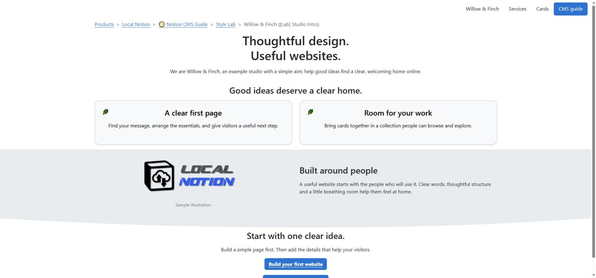

# Build a page from sections

Use sections when a page needs a clear sequence of ideas. A studio homepage might introduce the company, explain its services, show its work and finish with contact details. Each part can be edited and styled separately in Notion, while visitors read one continuous webpage.

*Follow the page from introduction to services to contact. The CMS joins Section rows at the same location; Sequence controls their order.*

## Choose a Page or a set of Sections

A **Page** is a good fit for one article or a compact service description. Its body can still contain headings, columns, images and lists.

A **Section** is one part of a larger page. Several Sections share a page location, and each can have its own Themes. Choose Sections when you want a pale services band, a differently spaced image feature and a concise contact band on the same route.

The page's Header and navigation are separate framing. A first Section can introduce the page, but making it first does not turn it into a Header.

## In Notion: make a three-part page

Create three CMS rows with these settings:

| Item | Type | Status | Root | Sequence |
| --- | --- | --- | --- | ---: |
| Welcome | Section | Published | Studio | 10 |
| What We Do | Section | Published | Studio | 20 |
| Contact | Section | Published | Studio | 30 |

Leave Category1–Category5 and Custom Slug blank for this example. All three contribute to `/studio`. Their titles provide anchors within that page, such as `/studio#contact`; they do not become three unrelated pages.

1. Open **Welcome** and add a short introduction and one useful image.
2. Open **What We Do** and add a heading, two short service descriptions and links.
3. Open **Contact** and add a clear invitation with a contact link.
4. Leave Themes empty for the first preview.
5. Pull and preview `/studio`, then check the order and the contact anchor.

Use numbers such as 10, 20 and 30 so another Section can be inserted later. Give each row a different Sequence rather than relying on its position in a Notion database view.

## Put the arrangement inside the section

Open a row to build its contents. Use Notion headings for structure, ordinary paragraphs for explanation and real columns when text and an image belong side by side. The CMS database row is the container; the blocks inside it determine the arrangement.

Keep a heading and its supporting text together for the first version. Later, a title-only Section followed by a content Section can give you separate styling control, but it also introduces another gap to manage. The [spacing lesson](spacing-and-separators.md) shows how to connect those pieces deliberately.

## Give each band a purpose

For a simple studio page:

- **Welcome:** explain who the site is for, with a short introduction and one next step.
- **What We Do:** group related services in columns or cards.
- **Contact:** keep the final action easy to find.

Vary the layout according to the content. A short centred introduction can precede a longer image-and-text section. Use consistent alignment, image proportions and heading treatment across related Sections to maintain a clear reading order.

Select themes on each owning Section. For example, choose `h1_align_center` for Heading 1 blocks in an introductory Section without centring every paragraph on the whole website. See [text and colour](text-and-colour.md) for the difference between body-text and heading choices.

## Check the whole route

Open the [section lab](https://staging.sphere10.com/products/localnotion/cms/style-lab/sections) to compare the assembled example. When checking your own page, look at the boundaries between sections as well as each individual section. Check the narrow-screen reading order, image sizes and the last link in each band.

Keep one clear composition at an address. An ordinary Page and an unrelated group of Sections competing at `/studio` can produce an unexpected result. Plan the route before adding another row; [addresses and hierarchy](routing.md) explains custom paths and nested content.

If a Section's saved content does not appear, inspect its **Status**, **Publish On**, **Themes** and the completed pull/render cycle. The `empty` theme deliberately suppresses content. It is useful for a metadata-only row, but is a confusing starting point for a visible section.

[Previous: Design a website in Notion](visual-design.md) · [Next: Spacing and separators](spacing-and-separators.md) · [Notion CMS Guide](index.md)
