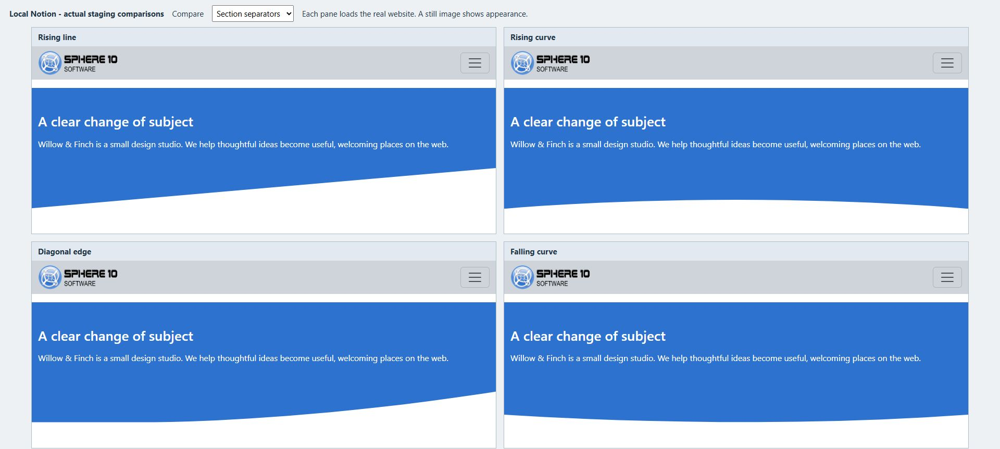

# Give sections space and shape

Space helps readers see which ideas belong together. A shaped edge can mark a change of topic without adding another heading or image. Use both to guide the eye through a page, keeping the content comfortable to read.

*Compare the boundary as well as the section itself. A separator needs a contrasting background to make its shape visible.*

## Start with the default spacing

Preview the Section before adding a padding theme. Its content already has some layout and block spacing. Add more space when a short band feels cramped; reduce it when two related pieces should read as one group.

The canonical palette includes three top-padding choices and three bottom-padding choices: `lg`, `xxs` and `none`. Select their exact names from Themes:

- `section_padding_top_lg` or `section_padding_bottom_lg` requests generous space on that edge.
- `section_padding_top_xxs` or `section_padding_bottom_xxs` requests a small gap.
- `section_padding_top_none` or `section_padding_bottom_none` removes the theme's padding on that edge.

Choose one value for each edge. Selecting both a large and a none choice for the same edge makes the intended result unclear. These named sizes depend on the installed stylesheet; use the [spacing lab](https://staging.sphere10.com/products/localnotion/cms/style-lab/spacing) to compare their effective appearance in this example.

Removing section padding does not remove the margins of every heading, paragraph or image inside it. If a gap remains, inspect the first and last content blocks too.

## In Notion: connect a heading to its content

Suppose **Our Services** is a short title-only Section and **Service Cards** is the following content Section.

1. Give them the same page location and consecutive Sequence values.
2. On **Our Services**, select `section_padding_bottom_xxs`.
3. On **Service Cards**, select `section_padding_top_none`.
4. Pull and check the pair together, including at a narrow width.

For a simpler page, keep the heading and cards in one Section instead. Split them only when the separate control improves the result.

## Choose a separator

The four shape choices are `shape_line_up`, `shape_curve_up`, `shape_curve_down` and `shape_ascend_right`. They add a decorative boundary to the owning section or header. They do not create a new CMS row or a new piece of content.

Use a straight or angled treatment for a crisp change between bands, or a curve for a softer transition. Compare the actual shapes in the lab rather than assuming the name describes the upper edge. In the installed templates used for these examples, all four shapes sit at the **bottom**. Their SVG starts with a white or inherited fill; after page load, the CMS script sets the fill to the effective background colour of the next visible Section.

This matching depends on the CMS script running and resolves a background colour, not a continuous image or gradient. Section padding also affects the shape’s position. Preview the entire transition after the page has loaded, including the boundary and both neighbouring backgrounds, before repeating it elsewhere.

## In Notion: add a shaped edge

1. Open the Section immediately above the intended boundary.
2. In **Themes**, choose one background treatment, such as `color_bg_body_secondary`.
3. Add one shape, such as `shape_curve_down`.
4. Give the following Section a contrasting plain background for the first comparison.
5. Pull and preview both Sections, including the content near the bottom edge.
6. Adjust spacing if the shape crowds the last paragraph or link.

A shape looks most useful where the page changes topic. Repeating a dramatic boundary after every short paragraph can make a simple page harder to follow.

## Divider or section shape?

Use a normal **Notion divider block** for a small rule within the content, such as separating related notes in an article. Use a **shape theme** for the larger transition between section backgrounds. One belongs inside the text flow; the other decorates the section boundary.

If a divider is sufficient, keep the simpler treatment. If a shape disappears, check its owning Section, the adjacent colours and the installed theme before changing the page structure.

See [themes and layout](themes-and-layout.md) for layering and [the full theme reference](theme-reference.md) for exact preset spellings.

[Previous: Build a page from sections](sections-and-layout.md) · [Next: Text and colour](text-and-colour.md) · [Notion CMS Guide](index.md)
