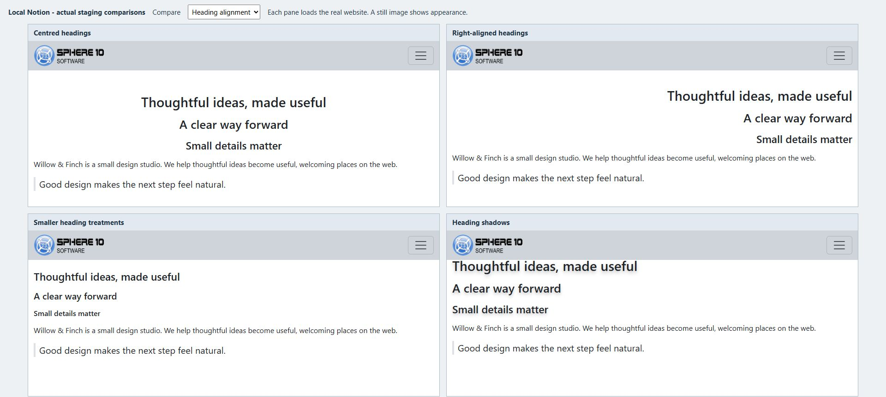
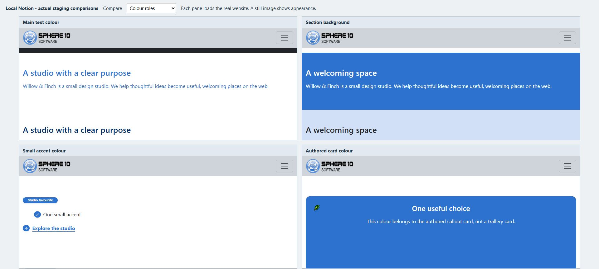

# Make text and colour work together

Choose a small number of clear text treatments and repeat them. Visitors should be able to recognize a heading, scan the explanation and find the next action without learning a new design in every section.

*Compare the heading separately from the body copy. The CMS has independent choices for each, so a centred title can sit above ordinary left-aligned paragraphs.*

## Give the words a useful structure

Use actual Notion **Heading 1**, **Heading 2** and **Heading 3** blocks to mark the structure. Do not choose a heading level only to make text larger. The website's page title may already supply its main heading; avoid typing the same title again as the first body block.

For a services Section, a short heading, one paragraph and a small list are often enough. Keep longer explanations left aligned. Centred copy works best for a short introduction or closing invitation, where every line is easy to follow.

## In Notion: centre the introduction's heading

1. Open the introductory Page or Section.
2. Add a **Heading 1** block, such as “Useful products, thoughtfully made”.
3. Add an ordinary paragraph beneath it.
4. In **Themes**, select `h1_align_center`.
5. Preview the result. Add `text_center` only if you also want the supporting paragraphs centred.

`text_left`, `text_center`, `text_right` and `text_justify` affect compatible body blocks such as paragraphs, quotes and callouts. Heading alignment has its own `h1_`, `h2_` and `h3_` choices. Image alignment is separate again.

The current palette's heading-left presets have a stylesheet compatibility issue in the inspected installation. For a dependable return to the ordinary layout, remove the competing heading alignment choice and preview the default rather than stacking left and centre choices.

## Adjust emphasis without changing the meaning

`h1_large` makes Heading 1 more prominent. `h1_as_h4`, `h2_as_h5` and `h3_as_h6` make the corresponding heading look smaller while preserving its original heading level. This is useful when the article structure is correct but a heading looks too dominant in a compact card or feature.

`h123_fontsize_default` clears the CMS font-size overrides for all three levels. `h123_default_padding` clears their shared spacing override; other block or browser margins can still remain. These are alternative treatments, so compare them with the default rather than adding every heading option together.

Use `text_small` for a short secondary note and `text_muted` for supporting copy. Neither should make essential instructions difficult to read. Check them on the actual background, especially at a phone width.

## Understand the colour roles

*The same colour name can be used in different roles. A background, a badge and a heading need different theme choices even when they share an accent colour.*

The colours shown beside choices in Notion help identify the options in the editor. They do not set the website's colours. The installed theme and stylesheet determine the rendered palette.

Use the colour family that matches the part you want to change:

- **`color_text_…`** changes the main text colour on compatible blocks.
- **`color_bg_…`** changes the CMS container background.
- **`color_text_aux_…`** supplies auxiliary text colour, used by compatible cover/header text and headings switched to it.
- **`color_aux_…`** supplies accents such as badge backgrounds, arrow circles and check icons.
- **`color_card_…`** supplies the colour treatment for authored callout cards.

For example, to accent Heading 1 without recolouring the paragraph, choose `h1_color_aux` together with `color_text_aux_primary`. To accent all three heading levels, use `h123_color_aux` instead. To colour a badge, use `color_aux_primary` with the `badge` theme; that similarly named option has a different job.

## In Notion: make a quiet feature band

1. Open a Section with a heading and ordinary body text.
2. Select `color_bg_body_secondary` for the background.
3. Keep the body text on a readable dark/default treatment.
4. Optionally select `h1_color_aux` and `color_text_aux_primary` for the heading.
5. Preview the whole Section, including links, icons and any adjacent shaped edge.

A dark band can use `color_bg_dark` with `color_text_white`, but inspect every component. A heading, link or inline Notion colour may have its own treatment and may not inherit the colour you expected. Colour names describe roles; they do not guarantee contrast in every custom palette.

## Keep the palette coherent

Use a neutral reading surface, one principal accent and a clear action treatment before adding other colours. Reserve strong warning/success colours for content where the meaning fits. Do not make colour the only way a reader can recognize a link or important message.

The [typography lab](https://staging.sphere10.com/products/localnotion/cms/style-lab/typography) and [colour lab](https://staging.sphere10.com/products/localnotion/cms/style-lab/colours) group the variants for comparison. The [theme reference](theme-reference.md) retains every exact option name, including compatibility limits. In the inspected installation, `color_text_aux_50` has no matching theme folder, and two body-secondary/tertiary text choices emit classes absent from its local stylesheet; do not depend on those choices without checking your rendered result.

[Previous: Spacing and separators](spacing-and-separators.md) · [Next: Images and covers](images-and-covers.md) · [Notion CMS Guide](index.md)
