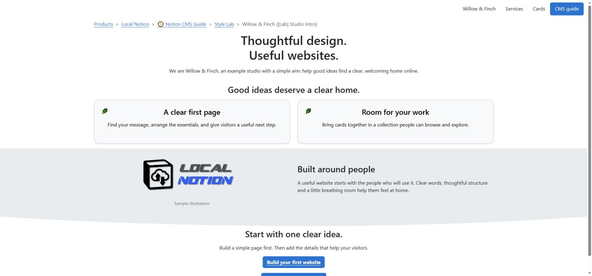

# Design a website in Notion

Use native Notion blocks to create headings, text, images and links. CMS Types determine how those resources form the website, while Themes modify the presentation of compatible content.

This reference explains the available layout components and the steps required to configure them. The examples cover page sections, service cards, Gallery collections and shared navigation.

*Each Section has its own content and visual treatment while contributing to one continuous webpage.*

## Choose what you want to build

Use a **Page** for an article, a service description or a straightforward homepage. Write its content in one Notion row, and give it its own address.

Use **Sections** for a landing page with distinct bands: an introduction, services, examples and contact details. Each Section is a row in the CMS. Sections at the same page location join together in Sequence order.

Use **Gallery** rows to gather cards into a collection. A card can introduce a product, photograph, article, team member or other content. Each Gallery row supplies a card and the page behind it; categories help visitors filter the collection.

Start with [your first website](first-website.md) if you have not yet published a page. Otherwise choose the visual task you need:

- [Build a page from sections](sections-and-layout.md).
- [Control spacing and shaped separators](spacing-and-separators.md).
- [Choose text treatments and colours](text-and-colour.md).
- [Size images and choose covers](images-and-covers.md).
- [Arrange columns and make cards](columns-and-cards.md).
- [Build a gallery of cards](galleries.md).
- [Add a header and navigation](headers-and-navigation.md).
- [Finish with motion and small details](motion-and-finishing.md).

## Three choices shape the result

**The Notion blocks make the content.** A heading is a heading block; a two-column arrangement needs two actual Notion columns. An image theme does not add an image, and a card theme does not create the words inside a card.

**The CMS Type gives the content its role.** Page, Section and Gallery determine how content becomes a website. Header, NavBar and Footer supply shared framing. These are choices in the database's **Type** field.

**Themes style the relevant blocks.** Select them in the owning row's **Themes** field. A row can combine an image frame, centred headings and a section background. The treatment applies to the relevant content in that row, so keep independently styled parts in separate Sections when appropriate.

Leave Themes empty for the first preview. Local Notion supplies a default presentation. Once the page works, add one treatment at a time and compare it with the default.

## Follow a simple design process

1. Define the page topic and required action, then write the heading.
2. Add the supporting paragraph, image and link in Notion.
3. Choose Page, Section or Gallery and check its address and publication state.
4. Pull and preview the basic content.
5. Add a small set of themes for layout, colour and emphasis.
6. Check the complete page at desktop and phone widths, including links and any interaction.

Establish the default layout before combining visual treatments. Apply only the Themes required for spacing, hierarchy and emphasis, then check that the complete page remains readable.

## Use the live examples as a workbench

The [section lab](https://staging.sphere10.com/products/localnotion/cms/style-lab/sections) and the other linked style labs keep the example content visible while you compare treatments. Their labels identify the selected presets. A screenshot helps you compare a shape or layout; open the live example to try zooming, filtering, scrolling or animation.

A theme name in the Notion palette is an available choice, not a guarantee that every version implements it. The reference records exact option names and version limits. If a treatment has no effect, check that its target block exists and that the installed renderer contains that theme before adding more styles.

For exact fields, use the [database schema](schema.md). For the complete palette, use the [theme option reference](theme-reference.md). For the journey from saved Notion content to a served website, use [publishing](publishing.md).

[Next: Build a page from sections](sections-and-layout.md) · [Notion CMS Guide](index.md)
